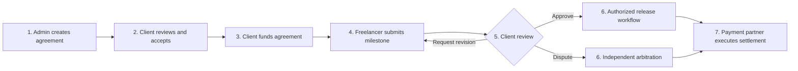
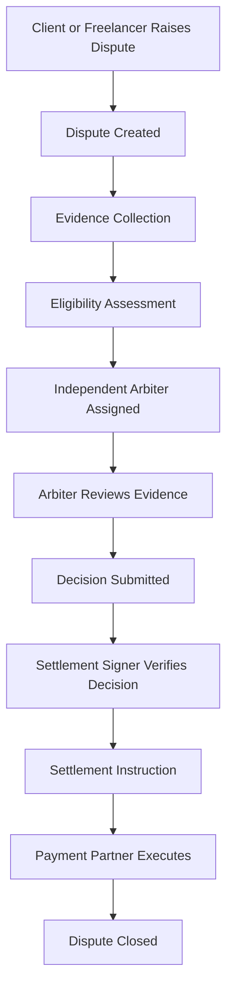

# MilestoneLock — Complete Dashboard UI Sitemap

The platform will have **three primary user dashboards**, **one internal platform dashboard**, and **two restricted operational consoles**.

The UI should be **role-based**: users only see the pages and actions permitted by their role.

## MilestoneLock application structure

```text
MilestoneLock Platform
Shared authentication, permissions, notifications and audit system
```

| Surface | Purpose |
|---|---|
| Organization Admin | Manages an organization's work |
| Client | Funds and approves work |
| Freelancer | Executes and submits work |
| Platform Super Admin | Operates the platform |
| Arbiter Console | Dispute decisions |
| Settlement Signer | Settlement authorization |

---

## 1. Organization Admin Dashboard

**Primary dashboard 01**

**Purpose:** Give an organization complete control over its projects, clients, freelancers, agreements, milestones, and financial operations.

### Main sidebar navigation

| # | Page | What it does |
|---|---|---|
| 1 | Overview | Organization-wide statistics, active projects, pending approvals, escrow balances, upcoming deadlines and recent activity. |
| 2 | Projects | List, create, edit, archive and manage projects. |
| 3 | Clients | Manage client profiles, invitations, contact details and client project history. |
| 4 | Freelancers | Manage freelancer profiles, invitations, assignments, availability and performance history. |
| 5 | Agreements | Create and manage milestone-based agreements, terms, participants and agreement status. |
| 6 | Milestones | View all milestones across projects, deadlines, submissions, approvals and payment states. |
| 7 | Escrow & Payments | View funding status, payment transactions, releases, refunds and payment history. |
| 8 | Disputes | Monitor disputes, evidence submissions, deadlines, arbitration status and outcomes. |
| 9 | Documents | Manage contracts, project attachments, evidence and downloadable records. |
| 10 | Reports & Analytics | Project performance, revenue, payment history, completion rates and dispute statistics. |
| 11 | Team & Permissions | Add organization members, assign roles and configure access permissions. |
| 12 | Notifications | View important project, payment, milestone and dispute notifications. |
| 13 | Settings | Organization profile, branding, billing preferences, security and integrations. |

### Important page-level breakdown

#### 1. Overview

*Design reference: "SaaS Project Management Tools" by Mohammad Ali on Dribbble.*

**Widgets:**

- Total active projects
- Total clients
- Total freelancers
- Total agreement value
- Funds currently held by payment partner
- Pending milestone approvals
- Active disputes
- Upcoming deadlines
- Recent transactions
- Project activity feed

#### 2. Projects

**Project details should contain:**

- Project overview
- Assigned client
- Assigned freelancers
- Agreement details
- Milestone timeline
- Project files
- Payment status
- Activity history

#### 3. Agreements

**Admin can:**

- Create a new agreement.
- Select client and freelancer.
- Define project scope and terms.
- Add milestones and payment amounts.
- Set deadlines and acceptance criteria.
- Send agreement for signatures or acceptance.
- Track agreement status.

#### 4. Escrow & Payments

**Admin can:**

- View funding status.
- Track payment partner transactions.
- View milestone-level allocations.
- Track released and pending amounts.
- View refunds and failed payments.
- Download transaction reports.

> **Important:** The organization admin must **not** have unrestricted access to release funds or override settlement decisions. Payment and settlement permissions must follow the platform's authorization rules.

---

## 2. Client Dashboard

**Primary dashboard 02**

**Purpose:** Give clients control over their agreements, project funding, milestone reviews, approvals and disputes.

### Main sidebar navigation

| # | Page | What it does |
|---|---|---|
| 1 | Overview | Summary of active projects, funds, pending approvals and upcoming deadlines. |
| 2 | My Projects | View projects assigned to the client. |
| 3 | Agreements | Review, accept and manage project agreements. |
| 4 | Milestones | Track milestone progress, deadlines and deliverables. |
| 5 | Deliverable Reviews | Review submissions, request revisions or approve completed work. |
| 6 | Escrow & Funding | Fund agreements and track money held by the payment partner. |
| 7 | Payments & Transactions | View funding history, releases, refunds and receipts. |
| 8 | Disputes | Raise disputes, submit evidence and track resolution. |
| 9 | Documents | Access agreements, project documents and evidence records. |
| 10 | Messages & Activity | View project communication and activity updates. |
| 11 | Notifications | Receive updates about submissions, deadlines, funding and disputes. |
| 12 | Settings | Manage personal profile, security and notification preferences. |

### Important page-level breakdown

#### 1. Overview

*Design reference: "Pavel — Project Payment Manager" (trypavel.com).*

**Widgets:**

- Active projects
- Total committed amount
- Total funded amount
- Funds pending release
- Milestones awaiting review
- Upcoming deadlines
- Active disputes
- Recent activity

#### 2. My Projects

**Each project card should show:**

- Project name
- Organization name
- Freelancer or team
- Overall progress
- Current milestone
- Next deadline
- Funding status

#### 3. Deliverable Reviews

> **This is one of the most important screens.**

**Client actions:**

1. Open submitted milestone.
2. Review submitted files and evidence.
3. Compare submission against acceptance criteria.
4. Approve the milestone.
5. Request revisions with a reason.
6. Raise a dispute if there is a disagreement.

#### 4. Escrow & Funding

**Client can:**

- View required funding.
- Fund an agreement through the licensed payment partner.
- Track payment confirmation.
- See which milestones are funded.
- Track released and remaining funds.
- Download payment receipts.

#### 5. Disputes

**Client can:**

- Open a dispute.
- Select the disputed milestone.
- Explain the issue.
- Upload supporting evidence.
- Respond to requests for information.
- View arbiter assignment and status.
- View the final decision and settlement record.

---

## 3. Freelancer Dashboard

**Primary dashboard 03**

**Purpose:** Give freelancers a clear workspace for their assigned projects, milestones, deliverables, feedback and payout tracking.

### Main sidebar navigation

| # | Page | What it does |
|---|---|---|
| 1 | Overview | Summary of active projects, pending tasks, submissions and earnings. |
| 2 | My Projects | View projects assigned to the freelancer. |
| 3 | Milestones | View assigned milestones, deadlines, criteria and progress. |
| 4 | My Tasks | Manage upcoming tasks and project responsibilities. |
| 5 | Deliverable Submissions | Upload deliverables and submit milestone completion requests. |
| 6 | Feedback & Revisions | View client feedback and respond to revision requests. |
| 7 | Earnings & Payouts | Track approved milestone payments, pending payouts and payment history. |
| 8 | Agreements | View and accept assigned agreements. |
| 9 | Disputes | View disputes, submit evidence and track decisions. |
| 10 | Documents | Access project documents, agreements and uploaded files. |
| 11 | Messages & Activity | View project communication and activity updates. |
| 12 | Notifications | Receive deadline, feedback, payment and dispute notifications. |
| 13 | Profile & Settings | Manage professional profile, payment details and account security. |

### Important page-level breakdown

#### 1. Overview

*Design reference: "ARVO Dashboard" by Lisa on Dribbble.*

**Widgets:**

- Active projects
- Assigned milestones
- Pending submissions
- Revision requests
- Approved milestone value
- Pending payouts
- Completed projects
- Upcoming deadlines

#### 2. My Projects

**Each project should show:**

- Project name
- Client name
- Organization
- Agreement status
- Project progress
- Assigned milestones
- Deadline
- Funding status

#### 3. Milestones

**Every milestone should have:**

- Milestone title
- Description
- Acceptance criteria
- Payment amount
- Deadline
- Current status
- Submission history

#### 4. Deliverable Submissions

**Freelancer workflow:**

1. Open assigned milestone.
2. Review acceptance criteria.
3. Upload files or attach deliverable links.
4. Add submission notes.
5. Submit for client review.
6. Track approval or revision request.

#### 5. Earnings & Payouts

**Show:**

- Total approved earnings
- Payments awaiting release
- Payments processing
- Completed payouts
- Payment history
- Transaction references

> **Do not** show an approved milestone as a completed payout until the payment partner confirms the transaction.

---

## 4. Platform Super Admin Dashboard

**Internal platform operations**

This dashboard belongs to the **MilestoneLock platform team**, not an individual organization.

| Page | Responsibility |
|---|---|
| Overview | Platform-wide KPIs and operational health. |
| Organizations | Manage registered organizations and account status. |
| Users | Manage users, roles, verification and account restrictions. |
| Agreements | Monitor platform-wide agreements. |
| Projects | Monitor project activity and platform usage. |
| Transactions | Monitor payment partner transaction records. |
| Payment Providers | Manage provider configuration and webhook health. |
| Disputes | Monitor disputes, SLA and arbitration operations without overriding independent decisions. |
| Arbitration Management | Assign and monitor arbiters. |
| Settlement Monitoring | Monitor settlement requests and signer activity. |
| AI Resolution Monitoring | Review eligible cases, recommendations, evaluation metrics and failures. |
| Fees & Billing | Manage platform fees, subscriptions and billing records. |
| Audit Logs | Review security-sensitive actions and event history. |
| System Health | Monitor queues, workers, database, storage and integrations. |
| Security | Manage access policies, suspicious activity and security events. |
| Platform Settings | Configure global application settings. |

> **Critical separation:** Super Admin should **not** be able to silently modify an arbiter's decision or independently authorize a settlement. Every sensitive action needs authorization, audit logging and appropriate separation of duties.

---

## 5. Restricted Operational Consoles

These are **not** general-purpose dashboards. They should be separate interfaces with tightly scoped permissions.

### A. Arbiter Console

| Page | Responsibility |
|---|---|
| Assigned Disputes | Show disputes assigned to the arbiter. |
| Dispute Details | Review agreement, milestones and dispute history. |
| Evidence Review | Examine client and freelancer evidence. |
| Case Timeline | Review events and deadlines. |
| Questions & Clarifications | Request additional information from parties. |
| Decision Workspace | Record reasoning and proposed outcome. |
| Decision Submission | Submit the independent arbitration decision. |
| Decision History | View previously handled disputes. |

### B. Settlement Signer Console

| Page | Responsibility |
|---|---|
| Pending Settlements | View settlement requests awaiting authorization. |
| Settlement Details | Review proposed settlement instructions. |
| Decision Verification | Verify the arbiter's signed decision and applicable rules. |
| Authorization | Independently authorize a valid settlement. |
| Settlement History | View previously authorized settlements. |
| Security & Audit | Review signer actions and authorization history. |

---

## 6. Shared application pages

These pages are common across dashboards, with role-based behavior.

| Page | Purpose |
|---|---|
| Login | Authenticate users. |
| Registration | Create an account. |
| Email Verification | Verify email address. |
| Forgot Password | Start password recovery. |
| Reset Password | Set a new password. |
| Onboarding | Configure profile and organization details. |
| Invitations | Accept organization, client or freelancer invitations. |
| Notifications Center | Central notification history. |
| User Profile | Personal account information. |
| Security Settings | Password, sessions and security controls. |
| Help & Support | Access platform support. |
| Terms & Policies | View applicable legal and platform policies. |
| 404 / Unauthorized | Handle missing pages and permission failures. |

---

## 7. Core user workflows

The dashboards must connect through the **same underlying agreement and milestone workflow**.

### Agreement-to-settlement workflow

1. **Organization Admin creates an agreement** — defines the client, freelancer, project scope, milestones, amounts and acceptance criteria.
2. **Client reviews and accepts** — client agrees to the terms and proceeds with funding.
3. **Client funds the agreement** — licensed payment partner receives and holds production funds.
4. **Freelancer completes a milestone** — uploads deliverables and submits the milestone for review.
5. **Client reviews the submission** — approves it, requests revisions or raises a dispute.
6. **Settlement or dispute resolution** — normal approvals follow the authorized release workflow; disputes enter the independent arbitration process.
7. **Payment partner processes settlement** — the independently authorized settlement instruction is executed and recorded.



### Dispute workflow



> **AI auto-resolution** should remain limited to the explicitly approved objective client-silence cases. It must **not** become an unrestricted AI judge.

### Platform architecture diagram

```mermaid
flowchart TB
  ML["MilestoneLock Platform"] --> AUTH["Authentication and RBAC"]

  AUTH --> ORG["Organization Admin Dashboard"]
  AUTH --> CLIENT["Client Dashboard"]
  AUTH --> FREELANCER["Freelancer Dashboard"]
  AUTH --> SUPER["Platform Super Admin"]
  AUTH --> ARBITER["Arbiter Console"]
  AUTH --> SIGNER["Settlement Signer Console"]

  subgraph ADMIN["Organization Admin"]
    ORG --> A1["Overview"]
    ORG --> A2["Projects"]
    ORG --> A3["Clients"]
    ORG --> A4["Freelancers"]
    ORG --> A5["Agreements"]
    ORG --> A6["Milestones"]
    ORG --> A7["Escrow and Payments"]
    ORG --> A8["Disputes"]
    ORG --> A9["Documents"]
    ORG --> A10["Reports and Analytics"]
    ORG --> A11["Team and Permissions"]
    ORG --> A12["Notifications"]
    ORG --> A13["Settings"]
  end

  subgraph CLIENT_DASH["Client Dashboard"]
    CLIENT --> C1["Overview"]
    CLIENT --> C2["My Projects"]
    CLIENT --> C3["Agreements"]
    CLIENT --> C4["Milestones"]
    CLIENT --> C5["Deliverable Reviews"]
    CLIENT --> C6["Escrow and Funding"]
    CLIENT --> C7["Payments and Transactions"]
    CLIENT --> C8["Disputes"]
    CLIENT --> C9["Documents"]
    CLIENT --> C10["Messages and Activity"]
    CLIENT --> C11["Notifications"]
    CLIENT --> C12["Settings"]
  end

  subgraph FREELANCER_DASH["Freelancer Dashboard"]
    FREELANCER --> F1["Overview"]
    FREELANCER --> F2["My Projects"]
    FREELANCER --> F3["Milestones"]
    FREELANCER --> F4["My Tasks"]
    FREELANCER --> F5["Deliverable Submissions"]
    FREELANCER --> F6["Feedback and Revisions"]
    FREELANCER --> F7["Earnings and Payouts"]
    FREELANCER --> F8["Agreements"]
    FREELANCER --> F9["Disputes"]
    FREELANCER --> F10["Documents"]
    FREELANCER --> F11["Messages and Activity"]
    FREELANCER --> F12["Notifications"]
    FREELANCER --> F13["Profile and Settings"]
  end

  subgraph PLATFORM["Platform Super Admin"]
    SUPER --> S1["Overview"]
    SUPER --> S2["Organizations"]
    SUPER --> S3["Users and Roles"]
    SUPER --> S4["Projects and Agreements"]
    SUPER --> S5["Transactions"]
    SUPER --> S6["Payment Providers"]
    SUPER --> S7["Dispute Monitoring"]
    SUPER --> S8["Arbitration Management"]
    SUPER --> S9["Settlement Monitoring"]
    SUPER --> S10["AI Resolution Monitoring"]
    SUPER --> S11["Fees and Billing"]
    SUPER --> S12["Audit Logs"]
    SUPER --> S13["System Health"]
    SUPER --> S14["Security"]
    SUPER --> S15["Platform Settings"]
  end

  subgraph ARBITRATION["Arbiter Operations"]
    ARBITER --> R1["Assigned Disputes"]
    ARBITER --> R2["Dispute Details"]
    ARBITER --> R3["Evidence Review"]
    ARBITER --> R4["Case Timeline"]
    ARBITER --> R5["Questions and Clarifications"]
    ARBITER --> R6["Decision Workspace"]
    ARBITER --> R7["Decision Submission"]
    ARBITER --> R8["Decision History"]
  end

  subgraph SETTLEMENT["Settlement Signer Operations"]
    SIGNER --> T1["Pending Settlements"]
    SIGNER --> T2["Settlement Details"]
    SIGNER --> T3["Decision Verification"]
    SIGNER --> T4["Settlement Authorization"]
    SIGNER --> T5["Settlement History"]
    SIGNER --> T6["Security and Audit"]
  end

  ORG --> SHARED["Shared Platform Services"]
  CLIENT --> SHARED
  FREELANCER --> SHARED
  SUPER --> SHARED

  subgraph SERVICES["Shared Platform Services"]
    SHARED --> P1["Authentication and Authorization"]
    SHARED --> P2["Projects and Agreements"]
    SHARED --> P3["Milestone Management"]
    SHARED --> P4["Payment Integration"]
    SHARED --> P5["Dispute Resolution Engine"]
    SHARED --> P6["Notification Service"]
    SHARED --> P7["Document Storage"]
    SHARED --> P8["Audit and Event Logs"]
  end

  P5 --> ARBITER
  ARBITER --> SIGNER
  SIGNER --> P4

  classDef primary fill:#102b4e,stroke:#3984cf,color:#ffffff
  classDef operations fill:#382650,stroke:#9665cf,color:#ffffff
  classDef service fill:#164333,stroke:#36a878,color:#ffffff
  class ORG,CLIENT,FREELANCER,SUPER primary
  class ARBITER,SIGNER operations
  class SHARED service
```



---

## 8. Recommended sidebar layout

Keep the sidebar consistent across all dashboards, but change the navigation based on the user's role.

```text
MilestoneLock
Admin
├── Overview
├── Projects
├── People
├── Agreements
├── Milestones
├── Escrow & Payments
├── Disputes
├── Reports & Analytics
├── Notifications
├── Settings
└── Account
```

*Illustrative navigation structure, not a live application.*

---

## 9. Recommended frontend route structure

For Next.js App Router, keep each dashboard separated by route groups and shared components.

```text
src/
├── app/
│   ├── (auth)/
│   │   ├── login/
│   │   ├── register/
│   │   ├── forgot-password/
│   │   └── onboarding/
│   │
│   ├── (organization)/
│   │   └── admin/
│   │       ├── overview/
│   │       ├── projects/
│   │       ├── clients/
│   │       ├── freelancers/
│   │       ├── agreements/
│   │       ├── milestones/
│   │       ├── escrow/
│   │       ├── payments/
│   │       ├── disputes/
│   │       ├── documents/
│   │       ├── reports/
│   │       ├── team/
│   │       ├── notifications/
│   │       └── settings/
│   │
│   ├── (client)/
│   │   └── client/
│   │       ├── overview/
│   │       ├── projects/
│   │       ├── agreements/
│   │       ├── milestones/
│   │       ├── reviews/
│   │       ├── funding/
│   │       ├── transactions/
│   │       ├── disputes/
│   │       ├── documents/
│   │       ├── activity/
│   │       └── settings/
│   │
│   ├── (freelancer)/
│   │   └── freelancer/
│   │       ├── overview/
│   │       ├── projects/
│   │       ├── milestones/
│   │       ├── tasks/
│   │       ├── submissions/
│   │       ├── revisions/
│   │       ├── earnings/
│   │       ├── agreements/
│   │       ├── disputes/
│   │       ├── documents/
│   │       └── settings/
│   │
│   ├── (platform)/
│   │   └── super-admin/
│   │       ├── overview/
│   │       ├── organizations/
│   │       ├── users/
│   │       ├── transactions/
│   │       ├── providers/
│   │       ├── disputes/
│   │       ├── arbitration/
│   │       ├── settlements/
│   │       ├── ai-monitoring/
│   │       ├── billing/
│   │       ├── audit-logs/
│   │       ├── system-health/
│   │       └── settings/
│   │
│   ├── (operations)/
│   │   ├── arbiter/
│   │   └── settlement-signer/
│   │
│   └── api/
│
├── components/
│   ├── ui/
│   ├── layouts/
│   ├── navigation/
│   ├── dashboards/
│   ├── projects/
│   ├── agreements/
│   ├── milestones/
│   ├── payments/
│   └── disputes/
│
├── features/
│   ├── authentication/
│   ├── organizations/
│   ├── projects/
│   ├── agreements/
│   ├── milestones/
│   ├── payments/
│   ├── disputes/
│   └── notifications/
│
└── lib/
    ├── permissions/
    ├── api/
    ├── validation/
    └── utils/
```

This is a proposed frontend structure, **not** a requirement to create a separate backend for every dashboard. All dashboards should consume the same modular backend and enforce permissions **server-side**.

---

## 10. Implementation priority

Do not build all pages at once. **Build the workflow first, then add supporting pages.**

| Phase | Pages and functionality | Priority |
|---|---|---|
| 1 | Authentication, onboarding, shared layout, role-based access | Critical |
| 2 | Admin projects, clients, freelancers, agreements | Critical |
| 3 | Client agreements, funding and reviews | Critical |
| 4 | Freelancer projects, milestones and submissions | Critical |
| 5 | Escrow, payments and transaction history | Critical |
| 6 | Disputes, evidence, arbiter and signer consoles | Critical |
| 7 | Notifications, documents and activity | High |
| 8 | Super Admin, audit logs and monitoring | High |
| 9 | Reports, analytics and advanced settings | Later |

---

## Final recommendation

For the first release, build around **three core dashboards and one complete end-to-end workflow**:

1. Admin creates an agreement.
2. Client accepts and funds it.
3. Freelancer submits work.
4. Client approves or disputes.
5. The authorized settlement process executes.

Everything else should support that workflow.

**One architectural rule:** build shared domain components rather than three separate implementations. For example, the milestone detail page can reuse the same underlying milestone data and components, while showing different actions to the admin, client and freelancer.

This keeps MilestoneLock maintainable as the platform grows.
