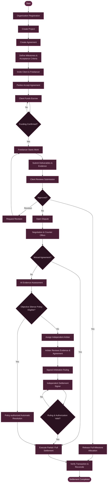
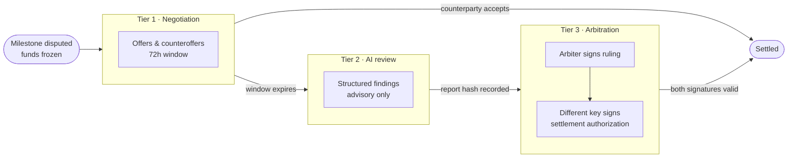
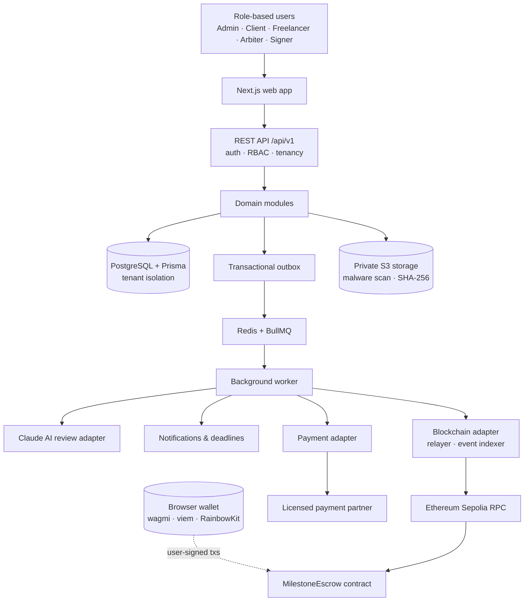
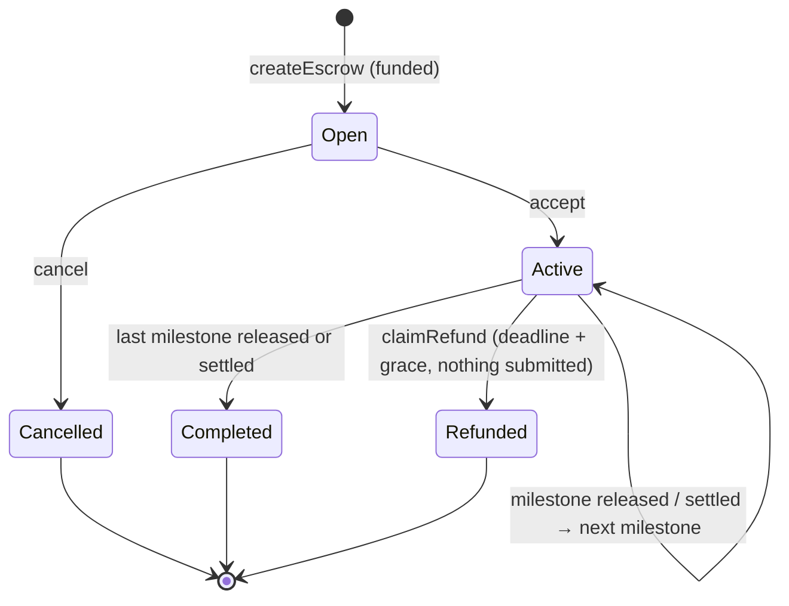

# MilestoneLock

**Milestone escrow and dispute resolution for software agencies, started from one link in WhatsApp or LinkedIn.**
Funds are locked before work begins. Evidence is hashed and kept private. Silent parties are handled by timers, and contested work goes through negotiation, AI-assisted review and an independent arbiter. **No single person or AI can both decide a disputed award and move the money.**

Built at **DEV</>NEXUS** by **Team Dark Matter** · Blockchain & Cybersecurity track

> ⚠️ **Hackathon MVP. Testnet money only (Ethereum Sepolia).** Not audited and not for mainnet. Production fiat would be held by a licensed payment partner, never by MilestoneLock.

**Live contract (Sepolia):** [`0xb68B276D9bCCa40BFb7045Ba520dB2651CC9AD59`](https://sepolia.etherscan.io/address/0xb68B276D9bCCa40BFb7045Ba520dB2651CC9AD59)

---

## Contents

- [The problem](#the-problem)
- [How it works](#how-it-works)
- [End-to-end workflow](#end-to-end-workflow)
- [Three-tier dispute resolution](#three-tier-dispute-resolution)
- [Who does what](#who-does-what)
- [Architecture](#architecture)
- [Smart contract](#smart-contract-milestoneescrowsol)
- [Project structure](#project-structure)
- [Getting started](#getting-started)
- [Roadmap](#roadmap)
- [Demo script](#demo-script)
- [Scope](#scope)

---

## The problem

Freelancers and agencies often agree on work over WhatsApp or LinkedIn. Advance payments are risky for both sides:

- The **client** pays upfront and the freelancer disappears.
- The **freelancer** delivers and the client stops replying.

No neutral party holds the money, acceptance criteria are vague, and there's no evidence trail. Whoever goes silent wins.
*(Source: Razorpay Fix My Itch, B2B Services, Itch Score 76.)*

## How it works

1. **Agree.** The organization creates an agreement with milestones, amounts, deadlines and **explicit acceptance criteria**.
2. **Invite.** One invite link goes into the chat. The freelancer connects a wallet, can see the money is locked, and accepts.
3. **Fund.** The client locks the full amount in the escrow contract before work starts.
4. **Deliver.** Milestones run **one at a time**. The freelancer submits deliverables and evidence. Files stay private, and only their hash goes on-chain.
5. **Review.** The client approves, requests one revision, or disputes.
6. **Resolve.** Disputes go through negotiation, then AI evidence assessment, then an independent arbiter and a separate settlement signer.
7. **Settle.** The payout is executed once, then verified and reconciled. Recipients withdraw their funds (pull payments).

**Silence never wins:**

| Situation | What happens |
|---|---|
| 👻 **Freelancer ghosts** (no submission by deadline + grace period) | Anyone can call `claimRefund`, and every unreleased milestone goes back to the client. |
| 👻 **Client ghosts** (no review by the review deadline) | The keeper runs the AI evidence check. If the objective-silence policy is met, `autoRelease` pays the freelancer. Otherwise the case goes to an arbiter. |
| ✍️ **Client rejects** | First rejection: one revision with a fresh deadline. Second rejection: dispute. |

Reminders go out at 50% of each window. The contract enforces only the hard deadlines.

---

## End-to-end workflow



### How each step maps to the system

| Workflow step | Where it happens | Contract call / record |
|---|---|---|
| Organization registration → invite | Backend (Postgres) | Off-chain `DRAFT` agreement, expiring invite token |
| Parties accept agreement | Freelancer's wallet | `accept(id)` starts milestone 0's deadline |
| Client funds escrow → funding confirmed? | Client's wallet + indexer | `createEscrow(...)` with `msg.value == sum`; confirmed by the `EscrowCreated` event |
| Submit deliverables & evidence | Private storage + freelancer's wallet | SHA-256 per file, `submitProof(id, ref)`, `anchorEvidence(id, i, root)` |
| Approved? (Yes / Revision / No) | Client's wallet | `approve(id)`; `reject(id, reason)`: 1st = revision, 2nd = dispute |
| Negotiation & counter offers | Both wallets | `proposeOffer(id, freelancerAmount)` → `acceptOffer(id)` (counterparty only) |
| AI evidence assessment | Worker (Claude API, advisory) | `recordAIReview(id, reportHash, eligible)`: hash only, no funds move |
| Policy-authorized automatic resolution | Keeper (`AUTOMATION_ROLE`) | `autoRelease(id, true)`: only when every eligibility condition holds |
| Signed ruling → independent signer → valid? | Arbiter + signer wallets (EIP-712) | `resolveDispute(ruling, arbiterSig, signerSig)`: two different keys, nonce + deadline, executes once |
| Execute → verify & reconcile | Contract + indexer | Credits recorded, then `withdraw()`; reconciliation checks `getMilestones` |

> The contract opens a dispute on the client's **second** rejection (the first is always a revision) or when the AI check of a silent client's milestone fails. The freelancer can't open one on-chain yet.

---

## Three-tier dispute resolution



| Tier | Who decides | What the contract enforces |
|---|---|---|
| **1. Negotiation** | Client and freelancer | Split ≤ frozen balance. Only the counterparty can accept. Expiry never awards funds |
| **2. AI review** | Nobody (advisory) | Stores only the report hash. Moves no money. Runs only after negotiation expires |
| **3. Arbitration** | Independent arbiter + separate settlement signer | EIP-712 signatures from `ARBITER_ROLE` and `SETTLEMENT_SIGNER_ROLE`. The two keys must differ. Awards must sum to the frozen balance. Nonce and deadline are checked, and the settlement executes once |

**AI auto-resolution** applies only to the narrow *objective client-silence* case. Every condition must hold:

- the client is silent
- the work was submitted
- the criteria are structured
- evidence integrity is verified
- objective checks pass
- there is no objection
- there is no conflicting evidence
- confidence ≥ 0.95
- the milestone is within the value limit

It is off by default in production.

---

## Who does what

| Role | Responsibility | Cannot |
|---|---|---|
| Organization owner / admin | Projects, agreements, people | Override a disputed award or release funds freely |
| Client | Fund, review, approve, revise, dispute | Alter evidence history or skip settlement authorization |
| Freelancer | Accept, deliver, respond to revisions, withdraw | See a payout as complete before it is confirmed |
| Independent arbiter | Review the frozen evidence and sign a ruling | Execute the settlement |
| Settlement signer | Verify and authorize a valid ruling | Change the award on its merits |
| Platform super admin | Operate and monitor the platform | Edit a ruling or authorize a settlement alone |
| AI | Analyse evidence and return structured findings | Hold keys, sign, or authorize payouts |

---

## Architecture



| Layer | Choice |
|---|---|
| Smart contract | Solidity ^0.8.24, Hardhat 2, OpenZeppelin 5 (`AccessControl`, `Pausable`, `ReentrancyGuard`, `EIP712`) |
| Network | Hardhat local node for development, **Ethereum Sepolia** for the demo |
| Frontend | Next.js (App Router), TypeScript, Tailwind CSS, wagmi + viem + RainbowKit |
| Backend | Modular monolith: Next.js API plus a separate worker process |
| Data | PostgreSQL + Prisma, organization-scoped tenancy |
| Jobs | Redis + BullMQ fed by a transactional outbox (idempotent, retryable) |
| Evidence | Private S3-compatible storage, malware scan, SHA-256, version history, frozen snapshots. Only hashes or Merkle roots go on-chain |
| AI | Claude API: strict JSON findings with model and prompt versions recorded |
| Payments | `SepoliaSettlementAdapter` for the MVP, `LicensedPaymentSettlementAdapter` for production |

---

## Smart contract: `MilestoneEscrow.sol`

One contract holds every escrow. Money leaves **only** through `withdraw()` (pull payments).

| Function | Who | Purpose |
|---|---|---|
| `createEscrow(freelancer, amounts[], workWindow, reviewWindow)` | client | Lock funds. `freelancer = address(0)` is an open invite |
| `accept(id)` / `cancel(id)` | freelancer / client | Join and start milestone 0, or cancel before acceptance |
| `submitProof(id, cid)` | freelancer | Submit the evidence reference before the deadline |
| `approve(id)` / `reject(id, reason)` | client | Release, or request a revision (the 2nd rejection opens a dispute) |
| `claimRefund(id)` | anyone | Freelancer ghosted: refund all unreleased milestones |
| `autoRelease(id, aiPassed)` | `AUTOMATION_ROLE` | Client ghosted: pay on pass, escalate to Tier 3 on fail |
| `proposeOffer` / `acceptOffer` | client, freelancer | Tier 1 negotiation |
| `recordAIReview(id, reportHash, eligible)` | `AUTOMATION_ROLE` | Tier 2 advisory record |
| `resolveDispute(ruling, arbiterSig, signerSig)` | anyone (relayer) | Tier 3: dual-signed EIP-712 settlement |
| `anchorEvidence(id, milestoneId, root)` | `EVIDENCE_ANCHOR_ROLE` | Commit an evidence hash or Merkle root |
| `withdraw()` | any credited account | Pull payout. Works even while paused |
| `pause()` / `unpause()` | `PAUSER_ROLE` | Emergency stop |



**Security:**
- Checks-effects-interactions with `nonReentrant` on every ETH path.
- Custom errors, and an event for every state change.
- EIP-712 domain separation (chain ID + contract address), global nonces and deadlines.
- Separation of duties between arbiter and signer.
- Disputed funds are frozen against ordinary release or refund.

> 🚧 **Known gap:** `_validateAllocation` (the Tier 3 allocation check) is still a stub, so `resolveDispute` reverts until it is implemented. 36 of 46 tests pass; the 10 failing tests are all Tier 3.

---

## Project structure

```
MIlesstone/
├── README.md
├── CLAUDE.md           # working guide for AI-assisted development
├── project.md          # full product & architecture spec (source of truth)
├── change log.md       # changes, with JSON records
├── web3/               # Hardhat project
│   ├── contracts/      # MilestoneEscrow.sol (+ test-only mocks)
│   ├── test/           # lifecycle, ghosting & revision, 3 dispute tiers, security
│   ├── scripts/        # deploy.ts, onchain-test.ts
│   └── hardhat.config.ts
└── web/                # planned: Next.js app, API, worker, Prisma
```

## Getting started

### Frontend dashboards

The React SPA exposes a dedicated entry URL for each dashboard role:

- Organization admin: `/admin` (for example, `/admin/projects`)
- Client: `/client` (for example, `/client/reviews`)
- Freelancer: `/freelancer` (for example, `/freelancer/submissions`)

Run `npm install` and `npm run dev` from `MIlesstone/`. Each URL opens a fixed role application; the dashboard has no role-switching panel. The frontend uses TypeScript throughout. Each dashboard page has its own route component under `src/roles/{admin,client,freelancer}/pages/<page>/page.tsx`; each role has its own `pages/pageData.ts`. Overview components live under `src/components/admin`, `client`, and `freelancer`; shared layout and presentation components live under `src/components/`.

The role page folders follow the dashboard sitemap while adapting its proposed Next.js route groups to this repository's Vite React SPA. Shared authentication and operational consoles are outside the three dashboard roles currently included. Pages use local demo records; action dialogs are previews and do not call a backend, payment provider, or smart contract.

`npm run typecheck` checks the TypeScript application code, and `npm run build` creates the production bundle. Dashboard records are currently local demo data; workflow buttons preview actions and do not execute payments or alter on-chain state.

```bash
cd web3
npm install
npx hardhat compile
npx hardhat test                                              # unit tests with time travel

# Local chain
npx hardhat node                                              # terminal 1
npx hardhat run scripts/deploy.ts --network localhost         # terminal 2
npx hardhat run scripts/onchain-test.ts --network localhost   # 3 scenarios, prints tx hashes

# Sepolia (fill web3/.env first)
npx hardhat run scripts/onchain-test.ts --network sepolia     # ~3 min, Etherscan links per tx
```

### Environment variables

Copy `web3/.env.example` to `web3/.env`. **Never commit `.env`. Use a dedicated testnet wallet, never your main account.**

| Variable | Used for |
|---|---|
| `SEPOLIA_RPC_URL`, `DEPLOYER_PRIVATE_KEY`, `ETHERSCAN_API_KEY` | Deploy and verify |
| `ARBITER_ADDRESS`, `SETTLEMENT_SIGNER_ADDRESS` | Tier 3 keys (must be two different addresses) |
| `AUTOMATION_ADDRESS` | Keeper / relayer (defaults to the deployer) |
| `GRACE_PERIOD_SECONDS`, `NEGOTIATION_WINDOW_SECONDS` | Timers (use 60–120 s for live demos) |
| Backend (planned): `DATABASE_URL`, `REDIS_URL`, S3 credentials, `ANTHROPIC_API_KEY` | API, worker, evidence, AI review |

## Roadmap

- [x] **Contract:** `MilestoneEscrow.sol` with roles, three dispute tiers, EIP-712, pull withdrawals and pause
- [x] **Tests:** ghosting paths, revision, negotiation, AI tier, arbitration, access control, reentrancy, conservation
- [x] **Sepolia:** deployed, with the live scenario run verified on Etherscan
- [ ] **Contract:** implement `_validateAllocation` to unblock Tier 3
- [ ] **Backend foundation:** Postgres/Prisma, tenancy, auth, wallet linking
- [ ] **Dispute engine:** outbox + BullMQ deadlines, evidence pipeline, event indexer
- [ ] **AI review + arbitration:** Claude adapter, arbiter queue, signer authorization
- [ ] **Dashboards:** org admin, client, freelancer, arbiter and signer consoles
- [ ] **Demo rehearsal** from a fresh deployment

## Demo script

1. The client creates a 3-milestone escrow and locks test ETH. Show the locked balance.
2. The invite link is shared in WhatsApp. The freelancer connects a wallet and accepts.
3. The freelancer uploads evidence. The file is stored privately, and its hash appears on-chain on Etherscan.
4. The client goes silent. The keeper runs the AI review, the policy checks pass, and `autoRelease` pays the freelancer.
5. Next milestone: the client rejects twice. The dispute settles by mutual offer, or goes on to AI review and a dual-signed arbiter ruling.
6. Last milestone: the freelancer goes silent, and `claimRefund` returns the remaining funds to the client.

## Scope

**In the MVP:**
- Organizations and roles
- Agreements with structured milestones
- Sepolia funding
- Submissions, revisions and disputes
- Private hashed evidence
- Negotiation
- AI structured findings
- Independent arbiter + separate signer
- Pull withdrawals
- Audit log
- Notifications

**Not in the MVP:**
- Production custody or fiat settlement
- Stablecoins
- External arbitration (evidence export only)
- Arbitrator marketplace
- Fully autonomous AI judging
- Multi-arbiter panels
- Mobile apps
- White-label
- International payments
- Mainnet

## Team

**Team Dark Matter** at DEV</>NEXUS.
