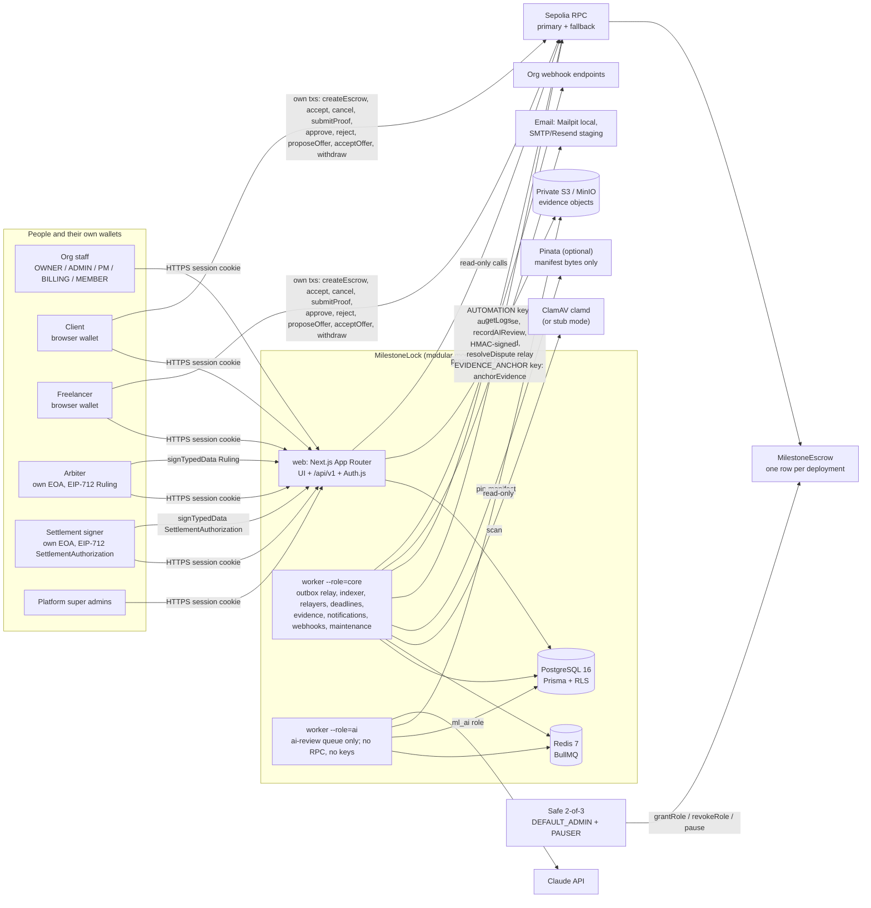
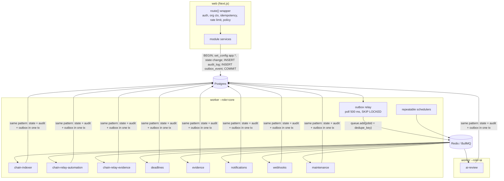

# MilestoneLock — Backend Design

This is the backend design for MilestoneLock, the DEV</>NEXUS hackathon MVP (Team Dark Matter). It follows the **full `project.md` architecture**: a modular monolith (Next.js app + a separate worker process), PostgreSQL + Prisma with organization tenancy and Row-Level Security, Redis + BullMQ fed by a transactional outbox, private S3-compatible evidence storage with malware scanning and SHA-256, a Claude AI review adapter that holds no keys, an independent arbiter plus a separate settlement signer, an append-only audit log, webhooks, and notifications. It integrates with the deployed `web3/contracts/MilestoneEscrow.sol` exactly as written and never invents functions the contract lacks.

**Status: design only. No backend code exists yet.** The current contract (`0xb68B276D9bCCa40BFb7045Ba520dB2651CC9AD59`, Sepolia, chainId `11155111`) cannot settle a Tier 3 dispute (`_validateAllocation` is a `TODO(human)` stub), so the build plan starts with a Day 0 contract fix and redeploy (section 16). This document merges four drafts (architecture, data model, API + chain, workers + flows) and the cross-section review; every table, queue, endpoint, and environment variable is spelled the same way everywhere below.

> Note for the team: `CLAUDE.md` still describes Prisma + SQLite, a `contracts/` folder, and a demo script where the client funds before the freelancer is known. This design uses Postgres + Redis + a worker, `web3/` + `web/`, and a named-freelancer demo order (section 2.8). Update `CLAUDE.md` once the team agrees.

Scope tags used throughout:

| Tag | Meaning |
|---|---|
| **[DEMO]** | Build it for the hackathon demo. |
| **[LITE]** | Build a thin version for the demo; the shape stays, the depth is cut. |
| **[CUT]** | Designed here, not built for the demo. |
| **[BLOCKER]** | Stops an on-chain flow, or breaks a `project.md` invariant, until it is fixed. |

## Key decisions

| # | Decision | Why | Section |
|---|---|---|---|
| K1 | **Day 0: implement `_validateAllocation`, pass the 10 Tier 3 tests, redeploy, register a new `contract_deployment` row.** The demo runs on the new address. | On `0xb68B…` any escrow that reaches tier Arbitration is locked forever (no exit but `resolveDispute`). | 6.9, 16, 17 |
| K2 | Defect rule **DR-1**: on a deployment whose `known_issues` contains `RESOLVE_DISPUTE_ALWAYS_REVERTS`, the worker never sends `autoRelease(false)` or `recordAIReview`, `/milestones/:id/dispute/prepare` returns `409 FEATURE_DISABLED`, and the UI warns that a second rejection freezes funds. | Avoids pushing more funds into an unexitable state on the old contract. | 6.9 |
| K3 | The chain is the source of truth for money. API calls create **intents**; only confirmed events change escrow, milestone, dispute, or payment state. | `project.md`: timers alone never imply a transition; Sepolia is never shown as a real payment. | 4, 6.4 |
| K4 | The backend never holds user keys. It holds only two relayer keys (`AUTOMATION`, `EVIDENCE_ANCHOR`), in the core worker only. Arbiter and signer sign EIP-712 in their own EOAs. | No single admin or AI can decide and move a disputed payout. | 13.1 |
| K5 | Three processes from one image: `web`, `worker --role=core`, `worker --role=ai`. The AI process has no RPC URL, no chain key, and a least-privilege DB role (`ml_ai`). | `project.md` §9 AI isolation. | 1.2, 10.1 |
| K6 | Nine BullMQ queues, named once in `src/shared/queue/names.ts`; job id = `outbox_event.dedupe_key` (dot separators). Two relay queues with concurrency 1 each, one worker replica. | BullMQ "groups" are a paid Pro feature; plain queues serialize nonces. | 1.5, 7 |
| K7 | One Prisma schema (section 3.3, validated with `prisma validate`, 54 models), snake_case via `@@map`. All raw SQL uses the mapped names. | The drafts had three incompatible schemas. | 3 |
| K8 | `submitProof` CID = locally computed **CIDv1 (raw codec, sha2-256) of the RFC 8785 manifest**; the manifest holds the evidence Merkle root. Auto-release integrity is checked against this CID, not against a later `anchorEvidence` tx. | The on-chain CID already commits to the root; the anchor tx cannot be mined inside a 60–120 s review window. | 9.1, 10.6 |
| K9 | `reject(id, reason)` sends `mlk1:rej:<REASON_CODE>:<sha256hex(private text)>`. | `reason` is public forever; this gives a readable code plus a commitment. | 4.2, 5.6 |
| K10 | Client silence: run the AI check **early** (when `ProofSubmitted` is indexed), **act only after the review deadline** on a fresh chain read. Every `aiPassed = false` outcome uses notify-then-escalate (`CLIENT_SILENCE_ESCALATION_SECONDS`). | AI latency would otherwise exceed the whole demo review window. | 8.4 |
| K11 | Auto-release cap = `project.md`'s 500,000 paise (₹5,000), converted with a fixed `DEMO_INR_PER_ETH = 300000` and snapshotted into `escrow.policy_snapshot` (≈ 0.016667 ETH). | One cap, traceable to the source policy. | 10.7 |
| K12 | Ruling nonce = `hexToBigInt(keccak256("ruling." + decisionId))`; ruling document canonicalized with RFC 8785. | Unique without a sequence; replay-safe because a new decision gets a new id. | 11.3 |
| K13 | `DEFAULT_ADMIN_ROLE` and `PAUSER_ROLE` move to a 2-of-3 Safe and the deployer renounces both **before Tier 3 is enabled**. No backend endpoint prepares role grants or pauses. A second SUPER_ADMIN must approve every ARBITER / SETTLEMENT_SIGNER grant. | Otherwise one person can appoint an arbiter + signer and settle any case. | 13.1, 13.3 |
| K14 | Named-freelancer flow by default: draft → share link → freelancer links wallet → client confirms the bound wallet (it is inside `termsHash`) → fund `createEscrow(freelancerWallet, …)` → `accept`. Open invites only with `ALLOW_OPEN_INVITES=true` and a visible warning. | An on-chain open invite can be claimed by anyone who calls `accept` first. | 2.8 |
| K15 | Payment and ledger rows carry `deployment_id`; `Withdrawn` closes credits only for `(deployment_id, payee_address)`. | `credits` and `Withdrawn` are per contract; old-contract credits must not be shown as paid out. | 4.6, 6.6 |
| K16 | Hackathon cut list (section 16.2): no double-entry ledger writes, no reorg rollback table, no fee bumping, no audit hash chain, no solvency reconciler, no arbiter initial-review SLA, no webhook secret rotation, no write-once triggers; RLS on `escrow`, `milestone`, `evidence`, `evidence_version` only. | Buildable by 1–3 people in a few days. | 16 |

## Table of contents

1. [Architecture and repository layout](#1-architecture-and-repository-layout)
2. [Identity, tenancy, and RBAC](#2-identity-tenancy-and-rbac)
3. [Data model](#3-data-model)
4. [State machines and on-chain mapping](#4-state-machines-and-on-chain-mapping)
5. [REST API](#5-rest-api)
6. [Blockchain integration and EIP-712](#6-blockchain-integration-and-eip-712)
7. [Workers, outbox, and queues](#7-workers-outbox-and-queues)
8. [Deadline engine](#8-deadline-engine)
9. [Evidence pipeline](#9-evidence-pipeline)
10. [AI review](#10-ai-review)
11. [Arbitration and settlement](#11-arbitration-and-settlement)
12. [Notifications, webhooks, and audit](#12-notifications-webhooks-and-audit)
13. [Security](#13-security)
14. [Observability and recovery](#14-observability-and-recovery)
15. [Testing](#15-testing)
16. [Build plan and hackathon cut list](#16-build-plan-and-hackathon-cut-list)
17. [Contract gaps and launch blockers](#17-contract-gaps-and-launch-blockers)
18. [Open questions](#18-open-questions)
- [Appendix A. Review fixes: applied, adapted, skipped](#appendix-a-review-fixes-applied-adapted-skipped)

---

## 1. Architecture and repository layout

### 1.1 System context



Trust boundaries:

| Boundary | Inside | Holds | Never holds |
|---|---|---|---|
| User wallets (browser) | Client, freelancer | Their own keys | Anything of the platform |
| Arbiter and signer wallets | Different people, different EOAs | `ARBITER_ROLE` key, `SETTLEMENT_SIGNER_ROLE` key | Server copies; the server stores signatures only |
| `web` | API, UI, Auth.js | DB (`ml_app`), S3 read-write (presign), read-only RPC URL | Any chain key, the Claude key |
| `worker --role=core` | Outbox relay, indexer, relayers, deadlines, evidence, notifications, webhooks | `AUTOMATION_RELAYER_KEY`, `EVIDENCE_ANCHOR_RELAYER_KEY`, DB (`ml_app`) | Claude key, arbiter/signer keys |
| `worker --role=ai` | AI review adapter | `ANTHROPIC_API_KEY`, S3 read-only, DB (`ml_ai`) | Any chain key, RPC URL, payment or webhook credentials |
| Safe | 2-of-3 team owners | `DEFAULT_ADMIN_ROLE`, `PAUSER_ROLE` | Day-to-day automation |

### 1.2 Process topology

| Process | Command (in `web/`) | Replicas | Does | Tag |
|---|---|---|---|---|
| `web` | `next start -p 3000` | 1 (stateless) | SSR, `/api/v1/*`, Auth.js, SIWE verify, presigned S3 URLs, read-only viem calls; writes DB + `outbox_event` + `audit_log` in one transaction | [DEMO] |
| `worker` (core) | `tsx worker/main.ts --role=core` | **exactly 1** (the relay queues are single-writer) | Outbox relay, every queue except `ai-review`, repeatable schedulers | [DEMO] |
| `worker-ai` | `tsx worker/main.ts --role=ai` | 1 | Only the `ai-review` queue | [DEMO] (same image, different env) |
| `postgres` | `postgres:16` | 1 | Business data, RLS | [DEMO] |
| `redis` | `redis:7` | 1 | BullMQ, rate limits, 60 s `hasRole` cache | [DEMO] |
| `minio` | `minio/minio` | local only | Private bucket `ml-evidence-<env>` | [DEMO] |
| `clamav` | `clamav/clamav:1.4` | 1 (compose profile `scan`) | clamd TCP 3310 | [LITE] (`MALWARE_SCAN_MODE=stub` on laptops) |
| `mailpit` | `axllent/mailpit` | local only | Magic-link and notification mail (UI :8025) | [DEMO] |
| `hardhat` | `npx hardhat node` in `web3/` | local only | Chain 31337 | [DEMO] |

Rules that hold in every environment:

1. `web` never calls `queue.add()`. It writes `outbox_event` rows in the same Prisma transaction as the state change; only the outbox relay in the core worker publishes to Redis. A lint rule bans importing `Queue` outside `worker/dispatcher.ts` and `worker/schedulers.ts`.
2. `web` never signs a chain transaction. User actions return prepared calldata; platform actions are queued to a relay queue.
3. `worker --role=ai` fails at startup if `RPC_URL`, `AUTOMATION_RELAYER_KEY`, `EVIDENCE_ANCHOR_RELAYER_KEY`, or `WEBHOOK_SECRET_ENC_KEY` is set, or if `DATABASE_URL` does not log in as `ml_ai`.
4. Chain reads go through one viem public client per process with `fallback([http(RPC_URL), http(RPC_URL_FALLBACK)])` (web uses `RPC_URL_READ`).
5. The worker never calls the web app over HTTP. It calls module services in-process with `ctx.actor = { type: 'SYSTEM', actorId: 'SYSTEM:<queue>.<job>' }`.



### 1.3 `web/` folder layout

```
web/
├── package.json              # dev, build, start, worker, worker:ai, db:migrate, db:seed, abi, test, ops
├── Dockerfile                # one image; CMD chosen per process
├── docker-compose.yml        # local stack (1.6)
├── .env.example              # every variable in 1.7, no secret values
├── wagmi.config.ts           # @wagmi/cli: typed ABI from ../web3 artifacts
├── prisma/
│   ├── schema.prisma         # section 3.3 (the only schema)
│   ├── migrations/
│   │   ├── 0001_init/
│   │   ├── 0002_rls/migration.sql              # roles, helpers, policies (2.5)
│   │   ├── 0003_audit_append_only/migration.sql
│   │   └── 0004_invariants/migration.sql       # CHECKs, triggers, view (3.4)
│   └── seed.ts               # demo orgs, users, two SUPER_ADMINs, arbiters, signers, policy
├── scripts/
│   ├── register-deployment.ts  # reads gracePeriod(), negotiationWindow(), eip712Domain(); upserts contract_deployment
│   └── ops.ts                  # outbox:retry, outbox:republish, indexer:backfill, chain:nonce-check
├── src/
│   ├── app/
│   │   ├── (public)/login, verify-request, invite/[token]/, terms/
│   │   ├── (app)/org/[orgSlug]/..., client/..., freelancer/...
│   │   ├── (restricted)/arbiter/..., signer/..., admin/...
│   │   └── api/
│   │       ├── auth/[...nextauth]/route.ts      # Auth.js (magic link, sessions)
│   │       └── v1/**/route.ts                   # section 5 catalog; thin handlers
│   ├── generated/milestoneEscrow.ts             # GENERATED ABI (as const), shared with the frontend
│   ├── modules/
│   │   ├── identity/      index service repo policy siwe api-keys platform-roles
│   │   ├── organization/  index service repo policy invitations
│   │   ├── escrow/        index service repo policy state handlers terms
│   │   ├── dispute/       index service repo policy state handlers eligibility
│   │   ├── evidence/      index service repo policy storage scan hashing extract manifest snapshot ipfs
│   │   ├── ai-review/     index service repo adapter.claude prompt.v1 schema report   # no chain imports
│   │   ├── arbitration/   index service repo policy assignment ruling
│   │   ├── settlement/    index service repo policy verify adapters/{sepolia,licensed.stub}
│   │   ├── payment/       index service repo credits
│   │   ├── blockchain/    index abi clients reads eip712 errors intents/ indexer/ relayer/ roles deployments
│   │   ├── deadline/      index service repo guards handlers
│   │   ├── notification/  index service repo email webhooks templates/
│   │   └── audit/         index service repo
│   └── shared/
│       ├── config/env.ts         # zod, one schema per role (web | core | ai)
│       ├── db/{prisma.ts, context.ts, extension.ts}
│       ├── http/{route.ts, errors.ts, envelope.ts, idempotency.ts, ratelimit.ts, pagination.ts}
│       ├── outbox/enqueue.ts
│       ├── queue/names.ts        # 1.5, the only place queue names are defined
│       ├── money.ts              # wei <-> Decimal(78,0) <-> bigint <-> string; paise
│       ├── time.ts               # UTC only; chain uint64 seconds <-> Date
│       ├── canonical.ts          # RFC 8785 (canonicalize package)
│       └── ids.ts, logger.ts (pino)
├── worker/
│   ├── main.ts               # parses --role, registers that role's processors only
│   ├── dispatcher.ts         # outbox relay
│   ├── schedulers.ts         # upsertJobScheduler for repeatables
│   └── processors/ chain-indexer.ts chain-relay.ts deadlines.ts evidence.ts ai-review.ts
│                   notifications.ts webhooks.ts maintenance.ts
└── tests/ unit/ integration/ e2e/
```

Module file roles:

| File | Contents | Rule |
|---|---|---|
| `index.ts` | The only public surface: service functions, DTO types, event names | Other modules import `@/modules/<m>` only (ESLint `no-restricted-imports` on `@/modules/*/*`) |
| `service.ts` | Use cases `fn(ctx, tx, input)`: policy → state guard → repo writes → `audit.record` → `outbox.enqueue` | No HTTP or Next.js imports |
| `repo.ts` | Prisma queries on this module's own tables | No other module's tables |
| `policy.ts` | Pure `can(actor, action, resource)` | No I/O |
| `state.ts` / `guards.ts` | Transition tables and guards | Pure, unit-tested |
| `handlers.ts` | Indexer and outbox consumers for this module | Idempotent |

ABI: `npm run abi` = `cd ../web3 && npx hardhat compile && cd ../web && wagmi generate` (plugin `hardhat({ project: "../web3", include: ["MilestoneEscrow.json"] })`, output `src/generated/milestoneEscrow.ts`). CI regenerates and runs `git diff --exit-code src/generated`. The address is never baked into codegen; it comes from `contract_deployment`.

### 1.4 Module ownership and allowed dependencies

| Module | Owns (tables) | Main inbound events | Must not |
|---|---|---|---|
| Identity | `user`, `account`, `session`, `verification_token`, `wallet_link`, `siwe_nonce`, `api_key`, `platform_role_grant` | — | Decide escrow outcomes |
| Organization | `organization`, `membership`, `invitation`, `organization_billing` | — | Touch funds |
| Escrow | `project`, `escrow`, `escrow_participant`, `milestone`, `milestone_submission`, `client_objection`, `chain_intent` | `EscrowCreated`, `EscrowAccepted`, `EscrowCancelled`, `MilestoneStarted`, `ProofSubmitted`, `MilestoneApproved`, `MilestoneRejected`, `RevisionGranted`, `AutoReleased`, `Refunded`, `EscrowCompleted` | Make arbiter decisions |
| Dispute | `dispute`, `dispute_offer` | `DisputeOpened`, `OfferProposed`, `AIReviewRecorded`, `DisputeSettled`; `ai.review.completed` | Move funds |
| Evidence | `evidence`, `evidence_version`, `evidence_snapshot`, `evidence_snapshot_item`, `evidence_access_log`, `late_evidence_exception` | `EvidenceAnchored` | Decide outcomes |
| AI Review | `ai_review` | `ai.review.requested` | Import `blockchain`, `settlement`, `payment`; hold keys |
| Arbitration | `arbiter_profile`, `arbiter_assignment`, `arbiter_conflict_declaration`, `arbitration_decision`, `appeal` [CUT] | `dispute.escalated` | Execute payments |
| Settlement | `settlement_instruction`, `settlement_authorization`, `settlement_signer_profile` | `arbitration.decision.signed`, `DisputeSettled` | Change award amounts |
| Payment | `payment`, `ledger_entry` [CUT writes], `provider_webhook` [CUT], `provider_reconciliation` | `Credited`, `Withdrawn`, `Refunded`, `EscrowCancelled` | Decide disputes |
| Blockchain | `contract_deployment`, `chain_cursor`, `chain_event`, `chain_tx`, `onchain_role`, `relayer_account` | — (it is the event source) | Check tenant permissions |
| Deadline | `deadline` | indexer projections, domain services | Move state without a guard |
| Notification | `notification`, `notification_preference`, `webhook_endpoint`, `webhook_delivery` | `notification.requested`, `webhook.dispatch` | Change business state |
| Audit | `audit_log` (append-only) | — | Be updated or deleted |
| Shared kernel | `outbox_event`, `idempotency_record` | — | Contain business rules |

Allowed synchronous calls (through `index.ts`; anything not listed is forbidden; cross-module reactions go through outbox events):

| Caller ↓ / may call → | identity | organization | escrow | dispute | evidence | ai-review | arbitration | settlement | payment | blockchain | deadline | notification | audit |
|---|---|---|---|---|---|---|---|---|---|---|---|---|---|
| identity | | | | | | | | | | read | | | Y |
| organization | Y | | | | | | | | | | | | Y |
| escrow | Y | Y | | | Y | | | | read | prepare + read | Y | | Y |
| dispute | Y | | read | | Y | read | | | | prepare + read | Y | | Y |
| evidence | Y | | read | read | | | | | | | | | Y |
| ai-review | | | read (criteria DTO) | read | read (snapshot) | | | | | **forbidden** | | | Y |
| arbitration | Y | Y | read | read | Y | read | | | | read + eip712 | Y | | Y |
| settlement | Y | | read | read | read | | read | | Y | eip712 + relay | Y | | Y |
| payment | | | read | | | | | | | read | | | Y |
| deadline | | | read | read | | | read | read | | read | | | Y |
| notification | Y | Y | | | | | | | | | | | |

"read" = DTO-returning queries; "prepare" = unsigned calldata for the browser; "relay" = insert `chain_tx` + enqueue a relay job. The `ai-review → blockchain/settlement/payment` ban is a CI-failing `eslint-plugin-boundaries` rule [DEMO]; the rest is [LITE].

### 1.5 Queue names (`src/shared/queue/names.ts`)

Every section uses exactly these names. Job id = `outbox_event.dedupe_key`; BullMQ drops an `add` whose job id already exists, and BullMQ custom ids must not contain `:`, so all keys use `.`.

| Queue | Consumer | Concurrency | Job names | Purpose |
|---|---|---|---|---|
| `chain-indexer` | core | 1 (ordered) | `indexer.poll` (scheduler), `indexer.backfill` | `getLogs` per deployment → `chain_event` → projections (6.5) |
| `chain-relay-automation` | core | **1** | `tx.autoRelease`, `tx.claimRefund`, `tx.recordAIReview`, `tx.resolveDispute`, `tx.monitor` | AUTOMATION key sends (6.7) |
| `chain-relay-evidence` | core | **1** | `tx.anchorEvidence`, `tx.monitor` | EVIDENCE_ANCHOR key sends |
| `deadlines` | core | 5 | `deadline.sweep` (scheduler), `deadline.remind`, `deadline.fire` | Timer engine (8) |
| `evidence` | core | 3 | `evidence.scan`, `evidence.hash`, `evidence.extract`, `evidence.snapshot`, `evidence.pin` | Upload → VERIFIED, snapshots (9) |
| `ai-review` | **ai** | 2, limiter 10 / min | `ai.silenceCheck`, `ai.disputeReview` | Claude call + validation (10) |
| `notifications` | core | 10 | `notify.dispatch` | In-app rows, email (12.1) |
| `webhooks` | core | 5 | `webhook.fanout`, `webhook.deliver` | Signed delivery (12.2) |
| `maintenance` | core | 1 | `arbiter.assign`, `signer.route`, `reconcile.chain`, `reconcile.credits`, `ops.roleAudit`, `ops.relayerBalance`, `ops.outboxStuck`, `cleanup.outbox`, `cleanup.idempotency`, `cleanup.evidenceOrphans` | Assignment (serial on purpose), reconciliation, housekeeping |

Dedupe key catalog (`{escrowId}` is always the DB uuid, never the on-chain id, because on-chain ids repeat across deployments):

| Job | `dedupe_key` |
|---|---|
| refund | `tx.claimRefund.{escrowId}.{i}.{deadline}` |
| auto-release | `tx.autoRelease.{escrowId}.{i}.{reviewDeadline}` |
| AI record | `tx.recordAIReview.{escrowId}.{i}` |
| anchor | `tx.anchorEvidence.{escrowId}.{i}.{root}` |
| resolve | `tx.resolveDispute.{instructionId}` |
| monitor | `tx.monitor.{chainTxId}.{n}` |
| deadlines | `deadline.remind.{deadlineId}`, `deadline.fire.{deadlineId}.{attempt}` |
| evidence | `evidence.scan.{versionId}`, `evidence.hash.{versionId}`, `evidence.extract.{versionId}`, `evidence.snapshot.{milestoneId}.{purpose}.{version}`, `evidence.pin.{submissionId}` |
| AI | `ai.silenceCheck.{aiReviewId}`, `ai.disputeReview.{aiReviewId}` |
| notify | `notify.{template}.{userId}.{entityId}.{stage}` |
| webhooks | `webhook.fanout.{outboxEventId}`, `webhook.deliver.{deliveryId}.{attempt}` |
| arbitration | `arbiter.assign.{disputeId}.{attempt}`, `signer.route.{instructionId}.{tier}` |

Repeatable schedulers (registered with `queue.upsertJobScheduler` at boot):

| Scheduler | Queue / job | Default | Demo |
|---|---|---|---|
| `indexer-poll` | `chain-indexer` / `indexer.poll` | 12 s | 4 s (Sepolia), 1 s (hardhat) |
| `deadline-sweep` | `deadlines` / `deadline.sweep` | 15 s | 15 s |
| `reconcile-chain` | `maintenance` / `reconcile.chain` | 5 min | 60 s |
| `reconcile-credits` | `maintenance` / `reconcile.credits` | 15 min | 2 min |
| `role-audit` | `maintenance` / `ops.roleAudit` | 10 min | 10 min |
| `relayer-balance` | `maintenance` / `ops.relayerBalance` | 10 min | 2 min |
| `outbox-stuck` | `maintenance` / `ops.outboxStuck` | 1 min | 1 min |
| `cleanup-*` | `maintenance` / `cleanup.*` | outbox daily (PUBLISHED > 7 d), idempotency hourly, evidence orphans hourly | same |

### 1.6 Environments and local stack

| | Local | Staging / demo (Sepolia) | Production |
|---|---|---|---|
| Purpose | Development, CI | The hackathon demo | Not built [CUT]; needs a licensed provider and legal review |
| Chain | Hardhat 31337, deployed by `web3/scripts/deploy.ts --network localhost` | Sepolia 11155111, the Day 0 redeploy (`0xb68B…` stays registered, `accepts_new_escrows = false`) | Licensed provider adapter, no ETH custody |
| Rail label | `TESTNET_LOCAL` | `TESTNET_SEPOLIA`: every amount shows "Sepolia test ETH, not real money" | `PROVIDER_INR` (paise) |
| Postgres / Redis | docker-compose | Managed Postgres with RLS + managed Redis, or one VPS with compose | Managed, separate |
| Object storage | MinIO `ml-evidence-local` | S3 or R2 `ml-evidence-staging`, private, SSE on | Separate account |
| Email | Mailpit | SMTP/Resend sandbox | Production domain |
| Keys | Hardhat default accounts | Fresh testnet-only EOAs per role (13.1) | KMS / HSM signer service |
| Timers | demo values (1.7) | demo values | Policy defaults |

`web/docker-compose.yml`:

```yaml
services:
  postgres:
    image: postgres:16
    environment: { POSTGRES_USER: ml_owner, POSTGRES_PASSWORD: ml_owner, POSTGRES_DB: milestonelock }
    ports: ["5432:5432"]
    volumes: [pgdata:/var/lib/postgresql/data, ./prisma/init-roles.sql:/docker-entrypoint-initdb.d/00-roles.sql]
  redis:
    image: redis:7
    ports: ["6379:6379"]
  minio:
    image: minio/minio
    command: server /data --console-address :9001
    environment: { MINIO_ROOT_USER: minio, MINIO_ROOT_PASSWORD: minio12345 }
    ports: ["9000:9000", "9001:9001"]
  clamav:
    image: clamav/clamav:1.4
    ports: ["3310:3310"]
    profiles: ["scan"]           # docker compose --profile scan up
  mailpit:
    image: axllent/mailpit
    ports: ["1025:1025", "8025:8025"]
volumes: { pgdata: {} }
```

`web`, `worker`, and `worker-ai` run on the host locally (`npm run dev`, `npm run worker`, `npm run worker:ai`); on staging they run from one image with different `CMD` and env sets.

Boot checks (all processes that read the chain): for every `contract_deployment` row, read `eip712Domain()` (name `MilestoneLock`, version `1`, `chainId == CHAIN_ID`, `verifyingContract == address`), `gracePeriod()`, `negotiationWindow()`; refuse to start if `CHAIN_ID` differs from `eth_chainId`. The core worker also checks that each relayer address holds its role and **does not** hold `DEFAULT_ADMIN_ROLE`, `ARBITER_ROLE`, or `SETTLEMENT_SIGNER_ROLE`; a missing role disables that relay queue and raises `relayer.missingRole`. The immutable windows always come from the chain, never from env.

### 1.7 Configuration and environment variables

This is the **only** env table. `src/shared/config/env.ts` validates it with zod, one schema per role; a role that receives a variable it must not have fails to start (Day 1 task). Columns: **web / core / ai** = which process reads it; **Default** = production-like default; **Demo** = value in `.env.demo` (Sepolia demo); **Local** only where it differs from Demo.

| Variable | web | core | ai | Secret | Default | Demo | Notes |
|---|:-:|:-:|:-:|:-:|---|---|---|
| `NODE_ENV`, `APP_ENV` | Y | Y | Y | | `production`, `staging` | `production`, `demo` | `APP_ENV=production` refuses `MALWARE_SCAN_MODE=stub` |
| `APP_URL`, `APP_DOMAIN` | Y | Y | | | — | `https://<demo-host>`, `<demo-host>` | SIWE domain/uri check; local `http://localhost:3000`, `localhost:3000` |
| `DATABASE_URL` | Y | Y | Y | Y | — | — | web/core log in as `ml_app`; **ai logs in as `ml_ai`** (same name, different value per process) |
| `DIRECT_DATABASE_URL` | migrate | | | Y | — | — | `ml_owner`; Prisma `directUrl` |
| `REDIS_URL` | Y | Y | Y | Y | — | — | web uses it for rate limits only |
| `AUTH_SECRET`, `AUTH_TRUST_HOST` | Y | | | Y | — | `true` behind Caddy | Auth.js |
| `EMAIL_SERVER`, `EMAIL_FROM` | Y | Y | | Y | — | Resend/SMTP sandbox | Auth.js magic link (web), notifications (core); local `smtp://localhost:1025` |
| `NOTIFICATION_EMAIL_ENABLED` | | Y | | | `true` | `false` | In-app toasts only in the demo |
| `API_KEY_PEPPER` | Y | | | Y | — | — | HMAC key for `api_key.secret_hash` |
| `CHAIN_ID` | Y | Y | | | `11155111` | `11155111` | local `31337` |
| `ESCROW_CONTRACT_ADDRESS` | Y | Y | | | — | Day 0 redeploy address | **Default for new escrows only**; existing escrows use `escrow.deployment` |
| `ESCROW_DEPLOY_BLOCK` | | Y | | | — | deploy block of the redeploy | Used by `register-deployment.ts`; the indexer reads `contract_deployment.deploy_block` |
| `RPC_URL`, `RPC_URL_FALLBACK` | | Y | | Y | — | provider URLs | Must be absent in ai; local `http://127.0.0.1:8545` |
| `RPC_URL_READ` | Y | | | Y | — | separate read-only key | |
| `CHAIN_CONFIRMATIONS` | | Y | | | `3` | `2` | local `0` |
| `INDEXER_POLL_MS`, `INDEXER_MAX_BLOCK_RANGE` | | Y | | | `12000`, `500` | `4000`, `500` | local `1000` |
| `AUTOMATION_RELAYER_KEY` | **never** | Y | **never** | Y | — | testnet EOA #1 | Holds `AUTOMATION_ROLE`; ≤ 0.2 Sepolia ETH |
| `EVIDENCE_ANCHOR_RELAYER_KEY` | **never** | Y | **never** | Y | — | testnet EOA #2 | Holds `EVIDENCE_ANCHOR_ROLE`; must differ from #1 |
| `RELAYER_MIN_BALANCE_WEI` | | Y | | | `50000000000000000` | same | Alert threshold |
| `TX_STUCK_AFTER_SECONDS` | | Y | | | `180` | `180` | Alert only (no fee bump) |
| `CHAIN_INTENT_TTL_SECONDS`, `SUBMIT_SAFETY_MARGIN_SECONDS` | Y | | | | `900`, `30` | same | |
| `S3_ENDPOINT`, `S3_REGION`, `S3_BUCKET`, `S3_FORCE_PATH_STYLE` | Y | Y | Y | | — | bucket `ml-evidence-staging` | local MinIO `http://localhost:9000`, `true` |
| `S3_ACCESS_KEY_ID`, `S3_SECRET_ACCESS_KEY` | Y | Y | | Y | — | — | Read-write |
| `S3_READONLY_ACCESS_KEY_ID`, `S3_READONLY_SECRET_ACCESS_KEY` | | | Y | Y | — | — | `GetObject` on `clean/*` and `extracted/*` only |
| `EVIDENCE_MAX_BYTES`, `EVIDENCE_ALLOWED_MIME` | Y | Y | | | `26214400`, `application/pdf,image/png,image/jpeg,image/webp,text/plain,text/markdown,application/json,text/csv,application/zip` | same | |
| `MALWARE_SCAN_MODE`, `CLAMAV_HOST`, `CLAMAV_PORT` | | Y | | | `clamd`, `clamav`, `3310` | `stub` or `clamd` | `stub` detects EICAR only; there is no `skip` mode |
| `PINATA_ENABLED`, `PINATA_JWT` | | Y | | Y | `false` | `true` | Pins manifest bytes only |
| `ANTHROPIC_API_KEY` | **never** | **never** | Y | Y | — | — | |
| `AI_MODEL`, `AI_PROMPT_VERSION`, `AI_EFFORT` | | | Y | | `claude-opus-5-5`, `review-v1`, `high` | same | Recorded on every `ai_review` row |
| `AI_FALLBACK_ENABLED` | | | Y | | `true` | `true` | Server-side refusal fallback; a fallback-served review is never eligible |
| `AI_TIMEOUT_MS` | | Y | Y | | `120000` | `90000` | ai: request timeout; core: when to treat a review as `TIMED_OUT` |
| `AUTO_RESOLVE_ENABLED` | | Y | | | `false` | `true` | Global flag; org consent is also required |
| `AUTO_RESOLVE_MIN_CONFIDENCE`, `AUTO_RESOLVE_MAX_PAISE`, `DEMO_INR_PER_ETH` | | Y | | | `0.95`, `500000`, `300000` | same | Seed values for `organization.policy` (10.7) |
| `CLIENT_SILENCE_ESCALATION_SECONDS` | | Y | | | `86400` | `60` | Notify-then-escalate delay (8.4) |
| `EVIDENCE_WINDOW_SECONDS` | | Y | | | `172800` | `60` | Capped at `negotiationEnd` |
| `INVITE_TTL_SECONDS` | Y | | | | `604800` | `1800` | |
| `ALLOW_OPEN_INVITES` | Y | | | | `false` | `false` | `true` only for the alternate demo (2.8) |
| `ARBITER_ACCEPT_SLA_SECONDS`, `ARBITER_RULING_SLA_SECONDS` | | Y | | | `21600`, `259200` | `120`, `600` | |
| `SIGNER_PRIMARY_SLA_SECONDS`, `SIGNER_BACKUP_SLA_SECONDS` | | Y | | | `43200`, `43200` | `120`, `120` | |
| `RULING_TTL_SECONDS`, `MIN_SIGNER_WINDOW_SECONDS` | Y | Y | | | `259200`, `600` | `1800`, `600` | `Ruling.deadline` = draft block time + TTL |
| `PAUSE_GRACE_SECONDS` | | Y | | | `3600` | `120` | Hold `autoRelease` after `Unpaused` (8.7) |
| `APPEALS_ENABLED` | Y | Y | | | `false` | `false` | [CUT] |
| `IDEMPOTENCY_TTL_HOURS` | Y | | | | `24` | `24` | |
| `WEBHOOK_SECRET_ENC_KEY` | Y | Y | **never** | Y | — | 32-byte base64 | AES-256-GCM for `webhook_endpoint.secret_ciphertext` |
| `BULL_BOARD_USER`, `BULL_BOARD_PASS` | | Y | | Y | — | — | Queue UI on the private network |
| `SENTRY_DSN`, `LOG_LEVEL` | Y | Y | Y | | —, `info` | same | |
| `DEMO_MODE` | Y | Y | | | `false` | `true` | Testnet banner, seeded demo data |
| `NEXT_PUBLIC_CHAIN_ID`, `NEXT_PUBLIC_ESCROW_CONTRACT_ADDRESS`, `NEXT_PUBLIC_WALLETCONNECT_PROJECT_ID`, `NEXT_PUBLIC_APP_ENV` | Y (bundle) | | | | — | — | The only public variables |

Not in any backend env: `DEPLOYER_PRIVATE_KEY` (only `web3/.env`), arbiter keys, signer keys, Safe owner keys. Removed on purpose: `INTERNAL_API_TOKEN` (13.4), any shared-relayer-key flag, fee-bump settings (cut), a reorg window (cut), a fixed wei auto-release cap (replaced by K11).

---
## 2. Identity, tenancy, and RBAC

### 2.1 Authentication

| Concern | Decision | Tag |
|---|---|---|
| Library | Auth.js v5 (`next-auth@5`) + `@auth/prisma-adapter`, **database sessions** (table `session`) | [DEMO] |
| Primary login | **Email magic link** (Auth.js Email/Nodemailer). Token hashed in `verification_token`, 15 min, single use | [DEMO] |
| Passwords | Not offered. Auth.js Credentials forces JWT sessions, which loses server-side revocation. If needed later: argon2id + our own session insert | [CUT] |
| Wallet | **SIWE wallet linking** (EIP-4361) for a signed-in user. A wallet is a linked credential, not a login method | [DEMO] |
| Sign in with wallet | Same flow, creating the session | [CUT] |
| MFA for arbiter / signer / super admin | Deferred. Interim step-up: a fresh SIWE re-sign (≤ 10 min old) before decision signing, settlement authorization, platform-role approval, and internal routes | [LITE] |
| Session cookie | `__Secure-authjs.session-token`, HttpOnly, Secure, SameSite=Lax; 7 d absolute, 24 h idle; restricted consoles 12 h absolute | [DEMO] |
| CSRF | Auth.js CSRF on auth routes; state-changing `/api/v1` routes require `Content-Type: application/json` and an `Origin` matching `APP_URL` | [DEMO] |

### 2.2 SIWE wallet linking

```mermaid
sequenceDiagram
  participant B as Browser (wagmi + RainbowKit)
  participant W as web /api/v1/wallets/siwe
  participant DB as Postgres
  B->>W: POST /nonce {address} (session cookie)
  W->>DB: INSERT siwe_nonce {nonce 128-bit, user_id, expires_at = now+5min}
  W-->>B: {nonce, message} (server builds it with createSiweMessage)
  B->>B: personal_sign(message)
  B->>W: POST /verify {message, signature}
  W->>W: parseSiweMessage: domain == APP_DOMAIN, uri starts with APP_URL, chainId == CHAIN_ID, issuedAt <= 5 min
  W->>W: recoverMessageAddress (EOA only; matches the contract's ECDSA-only checks)
  W->>DB: UPDATE siwe_nonce SET used_at=now() WHERE nonce=? AND user_id=? AND used_at IS NULL AND expires_at>now() RETURNING
  W->>DB: INSERT wallet_link {user_id, address lowercase, chain_id, verified_at, siwe_message_sha256}
  W->>DB: audit_log identity.wallet.linked
  W-->>B: {wallet}
```

Rules:

- `wallet_link.address` is unique across all users (`409 WALLET_ALREADY_LINKED`).
- A wallet cannot be unlinked while it is an `escrow_participant.wallet_address` of a non-terminal escrow, or a profile wallet with open work (`409 WALLET_IN_USE`).
- `escrow_participant.wallet_address` is copied at bind time and never changes. Wallet-action policies check `connectedAddress == participant.wallet_address`; the browser compares the wagmi account with `expectedFrom` before sending.
- Arbiter and signer profile wallets must also hold the on-chain role. `blockchain.roles.hasRole(role, addr)` is cached in Redis for 60 s and checked on every console request; `onchain_role` mirrors `RoleGranted` / `RoleRevoked`.

### 2.3 Sessions vs API keys

| | Session (cookie) | API key |
|---|---|---|
| Who | People | An organization's server integration |
| Format | Auth.js session token | `ml_test_<keyId>_<secret>` (staging) / `ml_live_…`; secret = 32 random bytes base64url |
| Storage | `session` | `api_key.secret_hash = HMAC-SHA256(API_KEY_PEPPER, secret)` hex; shown once |
| Org context | Resolved per request (2.4) | Fixed to `api_key.organization_id`; any other `X-Org-Id` → `403` |
| Scopes | Everything the user's roles allow | `escrows:read`, `escrows:write` (drafts and invitations only), `disputes:read`, `webhooks:manage`, `audit:read` |
| Never allowed | — | Wallet actions, evidence download, arbitration, settlement, `/internal/*`, member or role management, API key management |
| Tag | [DEMO] | [LITE] (create, revoke, `escrows:read`) |

### 2.4 Organization tenancy

- Every user gets a **personal organization** (`kind = PERSONAL`) at first sign-in; agencies create `kind = TEAM` orgs. [DEMO]
- An escrow belongs to exactly one organization (`escrow.organization_id`, the creating org).
- Counterparties are often outside that org. They get access through `escrow_participant {escrow_id, user_id, role CLIENT|FREELANCER, wallet_address, invitation_id}`, not through membership.
- Arbiters and signers are platform actors. Their access comes from an ACTIVE `platform_role_grant` plus `arbiter_assignment` / `settlement_instruction`, never from membership.
- Every tenant table carries a denormalized `organization_id` (nullable only on `notification`, `outbox_event`, `audit_log`, `chain_intent`, `provider_webhook`, `provider_reconciliation`), so policies stay single-column checks.
- Global tables (no tenant column, module repos only): `user`, `account`, `session`, `verification_token`, `wallet_link`, `siwe_nonce`, `platform_role_grant`, `arbiter_profile`, `settlement_signer_profile`, `contract_deployment`, `chain_cursor`, `chain_event`, `chain_tx`, `onchain_role`, `relayer_account`, `idempotency_record`, `notification_preference`.

Request context:

```ts
type Ctx = {
  requestId: string;
  actor:
    | { type: 'USER'; userId: string }
    | { type: 'API_KEY'; apiKeyId: string; organizationId: string }
    | { type: 'SYSTEM'; actorId: string };     // "SYSTEM:<queue>.<job>", "SYSTEM:eligibility", "SYSTEM:reconciler"
  orgId: string | null;                        // active org, if any
  orgRole: MembershipRole | null;
  participantRole: 'CLIENT' | 'FREELANCER' | null; // computed by the service on resource routes
  platformRoles: PlatformRole[];               // ACTIVE grants only
  scope: 'user' | 'api_key' | 'arbiter' | 'signer' | 'platform_admin' | 'system';
};
```

| Route kind | `org` option | How `orgId` is set |
|---|---|---|
| `/orgs/:orgId/**` | `required` | From the path; membership required (else 404) |
| `/escrows`, `/projects` list and create | `required` | `X-Org-Id` header, else `user.default_org_id`; membership required |
| `/escrows/:id`, `/milestones/:id`, `/disputes/:id`, `/evidence/:id` | `fromResource` | Not trusted from the client. RLS lets the row through if the user is a member of its org **or** a participant; the service then computes `orgRole` and `participantRole` |
| `/arbiter/**` | `none` | `scope = 'arbiter'`, ACTIVE `ARBITER` grant |
| `/signer/**` | `none` | `scope = 'signer'`, ACTIVE `SETTLEMENT_SIGNER` grant |
| `/admin/**`, `/internal/**` | `none` | `scope = 'platform_admin'`, ACTIVE `SUPER_ADMIN` grant (+ step-up for `/internal`) |
| API key | fixed | `api_key.organization_id`, `scope = 'api_key'` |
| Worker job | from payload | Jobs carry `organizationId`; only the indexer, outbox relay, sweeps, and reconcilers use `withSystem(reason)` |

Prisma context (`src/shared/db/context.ts`):

```ts
export async function withTenant<T>(ctx: Ctx, fn: (tx: Tx) => Promise<T>): Promise<T> {
  return db.$transaction(async (tx) => {
    await tx.$executeRaw`SELECT
      set_config('app.current_org',  ${ctx.orgId ?? ''}, true),
      set_config('app.current_user', ${ctx.actor.type === 'USER' ? ctx.actor.userId : ''}, true),
      set_config('app.scope',        ${ctx.scope}, true),
      set_config('app.request_id',   ${ctx.requestId}, true)`;
    return fn(tx as Tx);
  }, { isolationLevel: 'ReadCommitted', timeout: 10_000 });
}
export const withSystem = <T>(reason: string, fn: (tx: Tx) => Promise<T>) =>
  withTenant({ ...systemCtx(reason), scope: 'system' }, fn);   // reason is logged
```

- `set_config(..., true)` is transaction-local, so it is safe with PgBouncer in transaction mode.
- `db = basePrisma.$extends(tenantExtension)`: on create of a tenant model it sets `organizationId = ctx.orgId` if missing and throws on a different value (except `system`); on `findMany`/`updateMany`/`deleteMany` in org-scoped routes it adds `where.organizationId = ctx.orgId`. This app-layer filter is the **only** isolation on tables without RLS in the demo (2.5 table).
- Route handlers never get the base client (ESLint bans `@/shared/db/prisma` outside `shared/db` and `modules/*/repo.ts`).

### 2.5 Postgres roles and RLS (`prisma/migrations/0002_rls/migration.sql`)

```sql
-- Roles. Migrations and SECURITY DEFINER functions are owned by ml_owner.
CREATE ROLE ml_owner LOGIN BYPASSRLS;                 -- migrations only; never used by an app process
CREATE ROLE ml_app   LOGIN NOSUPERUSER NOBYPASSRLS;   -- web + core worker
CREATE ROLE ml_ai    LOGIN NOSUPERUSER NOBYPASSRLS;   -- worker-ai only
GRANT USAGE ON SCHEMA public TO ml_app, ml_ai;
GRANT SELECT, INSERT, UPDATE, DELETE ON ALL TABLES IN SCHEMA public TO ml_app;
-- ml_ai: least privilege (no api_key, wallet_link, session, webhook, chain tables)
GRANT SELECT ON milestone, evidence, evidence_version, evidence_snapshot, evidence_snapshot_item TO ml_ai;
GRANT SELECT, INSERT, UPDATE ON ai_review TO ml_ai;
GRANT INSERT ON outbox_event TO ml_ai;

CREATE FUNCTION app_org()   RETURNS uuid LANGUAGE sql STABLE AS $$ SELECT nullif(current_setting('app.current_org', true), '')::uuid $$;
CREATE FUNCTION app_user()  RETURNS uuid LANGUAGE sql STABLE AS $$ SELECT nullif(current_setting('app.current_user', true), '')::uuid $$;
CREATE FUNCTION app_scope() RETURNS text LANGUAGE sql STABLE AS $$ SELECT coalesce(current_setting('app.scope', true), '') $$;

-- SECURITY DEFINER helpers (owned by ml_owner) avoid RLS recursion.
CREATE FUNCTION app_is_member(p_org uuid) RETURNS boolean LANGUAGE sql STABLE SECURITY DEFINER SET search_path = public AS
  $$ SELECT EXISTS (SELECT 1 FROM membership WHERE organization_id = p_org AND user_id = app_user() AND removed_at IS NULL) $$;
CREATE FUNCTION app_participant_role(p_escrow uuid) RETURNS text LANGUAGE sql STABLE SECURITY DEFINER SET search_path = public AS
  $$ SELECT role::text FROM escrow_participant WHERE escrow_id = p_escrow AND user_id = app_user() $$;
CREATE FUNCTION app_is_participant(p_escrow uuid) RETURNS boolean LANGUAGE sql STABLE AS
  $$ SELECT app_participant_role(p_escrow) IS NOT NULL $$;
CREATE FUNCTION app_is_offered_arbiter(p_dispute uuid) RETURNS boolean LANGUAGE sql STABLE SECURITY DEFINER SET search_path = public AS
  $$ SELECT EXISTS (SELECT 1 FROM arbiter_assignment WHERE dispute_id = p_dispute AND arbiter_user_id = app_user() AND status = 'OFFERED') $$;
CREATE FUNCTION app_is_accepted_arbiter(p_dispute uuid) RETURNS boolean LANGUAGE sql STABLE SECURITY DEFINER SET search_path = public AS
  $$ SELECT EXISTS (SELECT 1 FROM arbiter_assignment a JOIN arbiter_conflict_declaration c ON c.assignment_id = a.id
                    WHERE a.dispute_id = p_dispute AND a.arbiter_user_id = app_user()
                      AND a.status = 'ACCEPTED' AND c.has_conflict = false) $$;
CREATE FUNCTION app_signer_can_see(p_escrow uuid) RETURNS boolean LANGUAGE sql STABLE SECURITY DEFINER SET search_path = public AS
  $$ SELECT EXISTS (SELECT 1 FROM settlement_signer_profile p WHERE p.user_id = app_user() AND p.active)
        AND EXISTS (SELECT 1 FROM settlement_instruction si WHERE si.escrow_id = p_escrow
                      AND (si.status IN ('PENDING_AUTHORIZATION','AUTHORIZED','BLOCKED_CONTRACT')
                           OR EXISTS (SELECT 1 FROM settlement_authorization sa
                                      WHERE sa.instruction_id = si.id AND sa.signer_user_id = app_user()))) $$;
CREATE FUNCTION app_tenant_ok(p_org uuid) RETURNS boolean LANGUAGE sql STABLE AS
  $$ SELECT p_org = app_org() AND app_is_member(p_org) $$;   -- never trust the GUC alone

-- Escrow [DEMO]
ALTER TABLE escrow ENABLE ROW LEVEL SECURITY; ALTER TABLE escrow FORCE ROW LEVEL SECURITY;
CREATE POLICY escrow_read ON escrow FOR SELECT TO ml_app USING (
     app_scope() = 'system'
  OR app_tenant_ok(organization_id)
  OR app_is_participant(id)
  OR (app_scope() = 'arbiter' AND EXISTS (SELECT 1 FROM dispute d WHERE d.escrow_id = escrow.id
                                          AND (app_is_offered_arbiter(d.id) OR app_is_accepted_arbiter(d.id))))
  OR (app_scope() = 'signer' AND app_signer_can_see(id))
  OR app_scope() = 'platform_admin');
CREATE POLICY escrow_write ON escrow FOR ALL TO ml_app
  USING (app_scope() = 'system' OR app_tenant_ok(organization_id))
  WITH CHECK (app_scope() = 'system' OR app_tenant_ok(organization_id));
-- Participant-initiated escrow changes go through SECURITY DEFINER functions, never 'system' scope:
CREATE FUNCTION app_client_accept_terms(p_escrow uuid, p_version int, p_terms_hash char(66), p_fingerprint char(66),
                                        p_policy jsonb, p_deployment uuid) RETURNS void
LANGUAGE plpgsql SECURITY DEFINER SET search_path = public AS $$
BEGIN
  IF app_participant_role(p_escrow) IS DISTINCT FROM 'CLIENT' THEN
    RAISE EXCEPTION 'caller is not the client participant' USING ERRCODE = '42501';
  END IF;
  UPDATE escrow SET status = 'AWAITING_FUNDING', terms_hash = p_terms_hash, funding_fingerprint = p_fingerprint,
         policy_snapshot = p_policy, deployment_id = p_deployment, awaiting_funding_at = now(), version = version + 1
   WHERE id = p_escrow AND status = 'DRAFT' AND version = p_version;
  IF NOT FOUND THEN RAISE EXCEPTION 'escrow not in DRAFT or stale version' USING ERRCODE = '40001'; END IF;
END $$;
REVOKE ALL ON FUNCTION app_client_accept_terms FROM PUBLIC; GRANT EXECUTE ON FUNCTION app_client_accept_terms TO ml_app;

-- Milestone [DEMO]: participants read; only org members (DRAFT edits) and the system (chain-driven) write.
ALTER TABLE milestone ENABLE ROW LEVEL SECURITY; ALTER TABLE milestone FORCE ROW LEVEL SECURITY;
CREATE POLICY milestone_read ON milestone FOR SELECT TO ml_app USING (
  app_scope() IN ('system','platform_admin') OR app_tenant_ok(organization_id) OR app_is_participant(escrow_id)
  OR (app_scope() = 'arbiter' AND EXISTS (SELECT 1 FROM dispute d WHERE d.milestone_id = milestone.id
                                          AND (app_is_offered_arbiter(d.id) OR app_is_accepted_arbiter(d.id))))
  OR (app_scope() = 'signer' AND app_signer_can_see(escrow_id)));
CREATE POLICY milestone_write ON milestone FOR ALL TO ml_app
  USING (app_scope() = 'system' OR app_tenant_ok(organization_id))
  WITH CHECK (app_scope() = 'system' OR app_tenant_ok(organization_id));
CREATE POLICY milestone_ai_read ON milestone FOR SELECT TO ml_ai USING (true);

-- Evidence and evidence_version [DEMO]: content-bearing rows. OFFERED arbiters see nothing here.
ALTER TABLE evidence ENABLE ROW LEVEL SECURITY; ALTER TABLE evidence FORCE ROW LEVEL SECURITY;
CREATE POLICY evidence_read ON evidence FOR SELECT TO ml_app USING (
  app_scope() IN ('system','platform_admin') OR app_tenant_ok(organization_id) OR app_is_participant(escrow_id)
  OR (app_scope() = 'arbiter' AND dispute_id IS NOT NULL AND app_is_accepted_arbiter(dispute_id))
  OR (app_scope() = 'signer' AND app_signer_can_see(escrow_id)));
CREATE POLICY evidence_participant_insert ON evidence FOR INSERT TO ml_app
  WITH CHECK (app_is_participant(escrow_id) AND created_by_id = app_user());
CREATE POLICY evidence_system_write ON evidence FOR ALL TO ml_app
  USING (app_scope() = 'system') WITH CHECK (app_scope() = 'system');
CREATE POLICY evidence_ai_read ON evidence FOR SELECT TO ml_ai USING (true);

CREATE FUNCTION app_evidence_escrow(p_evidence uuid) RETURNS uuid LANGUAGE sql STABLE SECURITY DEFINER SET search_path = public AS
  $$ SELECT escrow_id FROM evidence WHERE id = p_evidence $$;
CREATE FUNCTION app_evidence_dispute(p_evidence uuid) RETURNS uuid LANGUAGE sql STABLE SECURITY DEFINER SET search_path = public AS
  $$ SELECT dispute_id FROM evidence WHERE id = p_evidence $$;
ALTER TABLE evidence_version ENABLE ROW LEVEL SECURITY; ALTER TABLE evidence_version FORCE ROW LEVEL SECURITY;
CREATE POLICY evidence_version_read ON evidence_version FOR SELECT TO ml_app USING (
  app_scope() IN ('system','platform_admin') OR app_tenant_ok(organization_id)
  OR app_is_participant(app_evidence_escrow(evidence_id))
  OR (app_scope() = 'arbiter' AND app_is_accepted_arbiter(app_evidence_dispute(evidence_id)))
  OR (app_scope() = 'signer' AND app_signer_can_see(app_evidence_escrow(evidence_id))));
CREATE POLICY evidence_version_participant_insert ON evidence_version FOR INSERT TO ml_app
  WITH CHECK (uploaded_by_id = app_user() AND app_is_participant(app_evidence_escrow(evidence_id)));
CREATE POLICY evidence_version_participant_confirm ON evidence_version FOR UPDATE TO ml_app
  USING (uploaded_by_id = app_user() AND status = 'AWAITING_UPLOAD')
  WITH CHECK (uploaded_by_id = app_user() AND status IN ('AWAITING_UPLOAD','UPLOADED'));
CREATE POLICY evidence_version_system_write ON evidence_version FOR ALL TO ml_app
  USING (app_scope() = 'system') WITH CHECK (app_scope() = 'system');
CREATE POLICY evidence_version_ai_read ON evidence_version FOR SELECT TO ml_ai USING (true);
-- (an arbiter's snapshot view is further limited by the service to evidence_snapshot_item rows)

-- Audit: append-only for ml_app [DEMO]
REVOKE UPDATE, DELETE, TRUNCATE ON audit_log FROM ml_app;

-- [LITE -> enabled after the demo] participant write policies, written now so they ship together:
--   milestone_submission: INSERT WITH CHECK (app_participant_role(<escrow of milestone>) = 'FREELANCER' AND submitted_by_id = app_user())
--   chain_intent:         ALL USING (app_scope()='system' OR user_id = app_user())
--                         WITH CHECK (app_scope()='system' OR (user_id = app_user() AND (escrow_id IS NULL OR app_is_participant(escrow_id))))
--   dispute_offer:        UPDATE (rejected_at, rejection_note only; enforced in the service) USING (app_is_participant(<escrow of dispute>))
--   client_objection:     INSERT WITH CHECK (user_id = app_user() AND app_participant_role(<escrow of milestone>) = 'CLIENT')
--   audit_log read:       USING (app_scope() IN ('system','platform_admin') OR app_tenant_ok(organization_id))
```

| Table group | RLS | Tag |
|---|---|---|
| `escrow`, `milestone`, `evidence`, `evidence_version` | Yes, with the participant write policies above | [DEMO] |
| `audit_log` | Append-only via `REVOKE` | [DEMO] |
| `milestone_submission`, `chain_intent`, `dispute_offer`, `client_objection`, `dispute`, `ai_review`, `arbitration_decision`, `settlement_*`, `payment`, `notification`, `api_key`, `webhook_*`, `invitation`, `membership` | App-layer filter (2.4) + policies written above / same template | [LITE] |
| Global tables | No RLS; module repos only | — |

Tenant isolation tests (`tests/integration/tenancy.test.ts`, [DEMO]): org A's user cannot list, read, or update org B's escrow; a participant from org B can read org A's escrow but cannot `PATCH` it; a forged `app.current_org` without membership reads nothing; an OFFERED arbiter reads the escrow but no `evidence` rows; an ACCEPTED arbiter with `has_conflict = false` reads the dispute's evidence; a signer reads only escrows with a live or self-authorized instruction; an API key for org A with `X-Org-Id: B` gets 403; `ml_app` cannot `UPDATE audit_log`; `ml_ai` cannot `SELECT api_key`. **One test per participant write**: freelancer inserts `evidence` + `evidence_version` and confirms it; client calls `app_client_accept_terms`; a non-client calling it fails with `42501`.

### 2.6 RBAC

| Layer | Roles | Source of truth |
|---|---|---|
| Org membership | `OWNER`, `ADMIN`, `PROJECT_MANAGER`, `BILLING_MANAGER`, `MEMBER` | `membership.role` |
| Escrow participant | `CLIENT`, `FREELANCER` | `escrow_participant.role` + `wallet_address`, which must equal on-chain `escrows(id).client` / `.freelancer` |
| Platform | `ARBITER`, `SETTLEMENT_SIGNER`, `SUPER_ADMIN` | ACTIVE `platform_role_grant`; ARBITER and SIGNER profile wallets must also hold the on-chain role |

Key: **Y** allowed · **–** denied · **ro** read-only metadata (no evidence content) · **chain** the user signs in their own wallet; the backend only prepares the tx and checks the policy · **sys** the worker does it.

| Action | OWNER | ADMIN | PM | BILLING | MEMBER | CLIENT | FREELANCER | ARBITER (accepted) | SIGNER | SUPER_ADMIN |
|---|---|---|---|---|---|---|---|---|---|---|
| Update org settings, auto-resolve consent | Y | Y | – | – | – | – | – | – | – | – |
| Invite / remove members, change roles | Y | Y (not OWNER) | – | – | – | – | – | – | – | – |
| Manage API keys, webhooks | Y | Y | – | – | – | – | – | – | – | – |
| View billing | Y | Y | – | Y | – | – | – | – | – | ro |
| Create / edit project, escrow DRAFT | Y | Y | Y | – | – | Y (if member) | – | – | – | – |
| Invite client / freelancer to an escrow | Y | Y | Y | – | – | Y | – | – | – | – |
| Accept terms (confirm bound freelancer wallet) | – | – | – | – | – | Y | – | – | – | – |
| View escrow + milestones | Y | Y | Y | ro | ro | Y | Y | Y | Y (live instruction only) | ro |
| Fund (`createEscrow`), cancel before accept | – | – | – | – | – | **chain** | – | – | – | – |
| Accept escrow (`accept`) | – | – | – | – | – | – | **chain** | – | – | – |
| Upload deliverable / submission evidence | – | – | – | – | – | – | Y | – | – | – |
| Submit proof (`submitProof`) | – | – | – | – | – | – | **chain** | – | – | – |
| Approve / reject milestone | – | – | – | – | – | **chain** | – | – | – | – |
| Off-chain objection (blocks auto-release) | – | – | – | – | – | Y | – | – | – | – |
| Freelancer dispute request (off-chain) | – | – | – | – | – | – | Y | – | – | – |
| `claimRefund` (permissionless) | – | – | – | – | – | **chain** | **chain** | – | – | – (**sys**) |
| `autoRelease`, `recordAIReview`, `anchorEvidence` | – | – | – | – | – | – | – | – | – | – (**sys** only) |
| Upload dispute evidence | – | – | – | – | – | Y (window) | Y (window) | – | – | – |
| Download evidence content | – | – | – | – | – | Y | Y | Y (snapshot) | hashes + metadata | break-glass with reason, logged |
| Propose / accept offer | – | – | – | – | – | **chain** | **chain** | – | – | – |
| View AI review | – | – | – | – | – | summary | summary | full | full | full |
| Re-run AI review | – | – | – | – | – | – | – | – | – | Y (`/internal`, step-up) |
| Reassign arbiter | – | – | – | – | – | – | – | – | – | Y (or **sys** on SLA miss) |
| Accept case, declare conflict, approve late evidence | – | – | – | – | – | – | – | Y | – | – |
| Sign ruling (EIP-712 `Ruling`) | – | – | – | – | – | – | – | Y | – | – |
| Authorize / reject settlement | – | – | – | – | – | – | – | – | Y (not the arbiter) | – |
| Withdraw credits (`withdraw`) | – | – | – | – | – | **chain** own | **chain** own | – | – | – |
| View org audit log | Y | Y | – | – | – | own escrow | own escrow | assigned case | assigned settlement | Y |
| Propose platform ARBITER / SIGNER grant | – | – | – | – | – | – | – | – | – | Y |
| Approve that grant | – | – | – | – | – | – | – | – | – | Y (a **different** SUPER_ADMIN) |
| Grant on-chain roles, pause | – | – | – | – | – | – | – | – | – | – (Safe only) |

Separation-of-duties rules (in `policy.ts` and DB constraints, not the UI):

1. One user cannot hold both an ACTIVE `ARBITER` and an ACTIVE `SETTLEMENT_SIGNER` grant (service check + trigger in 3.4). The contract also enforces `signer != arbiter` per ruling (`SameSigner`, addresses only).
2. A `SUPER_ADMIN` cannot hold `ARBITER` or `SETTLEMENT_SIGNER`.
3. An ARBITER or SETTLEMENT_SIGNER grant becomes ACTIVE only when a second SUPER_ADMIN (≠ `granted_by_id`) approves it; `arbiter_profile` and `settlement_signer_profile` rows require an ACTIVE grant.
4. The arbiter must not be a member of the escrow's org, a participant, or a member of either participant's orgs, and must declare no conflict before seeing evidence.
5. The signer must verify that the recovered arbiter address equals the **assigned** arbiter's `wallet_address`. The contract accepts any `ARBITER_ROLE` holder, so this off-chain check is what binds a ruling to the assignment.
6. Org OWNER and ADMIN never get participant powers through their org role. Approval is a wallet action of the CLIENT participant.
7. AI output is never an actor. `autoRelease(aiPassed = true)` is decided by `dispute/eligibility.ts` in the core worker (actor `SYSTEM:eligibility`), with the `ai_review` row as one input.

### 2.7 Invitation tokens

One table, `invitation` (Organization module), for every purpose: `ORG_MEMBER`, `ESCROW_CLIENT`, `ESCROW_FREELANCER`, `PLATFORM_ARBITER`. Columns are in the schema (3.3). Token = `mli_` + 32 random bytes base64url; only `SHA-256(token)` is stored; link `${APP_URL}/invite/${token}`, shown once so it can be pasted into WhatsApp or LinkedIn. Expiry `INVITE_TTL_SECONDS` (7 d; demo 30 min), single use.

Accept (atomic):

```sql
UPDATE invitation SET consumed_at = now(), consumed_by_user_id = $user
 WHERE token_hash = $hash AND consumed_at IS NULL AND revoked_at IS NULL AND expires_at > now()
RETURNING *;
```

For `ESCROW_*` the same transaction requires a linked wallet (`409 WALLET_NOT_LINKED`; the UI runs SIWE first), rejects a wallet equal to the other participant's, inserts `escrow_participant` with that wallet, writes `invitation.accepted`, and notifies the client. `GET /invitations/:token` returns only org name, escrow title, milestone count, total (wei string, `isTestnet: true`), purpose, and `lockedOnChain` (a read-through of `escrows(id)` when the escrow is already funded). It never returns emails, is public, and is rate limited (30 / min per IP).

### 2.8 Escrow ordering and the demo flow

The on-chain open invite (`freelancer = address(0)`) can be claimed by **anyone** who calls `accept(id)` first, and a link pasted into a group chat binds whoever opens it first. So the default is a **named** freelancer whom the client confirms before funding:

```mermaid
sequenceDiagram
  participant C as Client
  participant API as web
  participant F as Freelancer
  participant SC as MilestoneEscrow
  C->>API: POST /escrows (DRAFT, 3 milestones, criteria)
  C->>API: POST /escrows/:id/invitations {role: FREELANCER} -> share link in WhatsApp
  F->>API: open /invite/<token>, magic-link sign-in, SIWE link wallet
  F->>API: POST /invitations/:token/accept -> escrow_participant FREELANCER (wallet bound)
  C->>API: GET /escrows/:id (sees freelancer name + wallet)
  C->>API: POST /escrows/:id/terms/accept {termsHash} (termsHash includes the freelancer wallet)
  C->>API: POST /escrows/:id/fund/prepare -> createEscrow(freelancerWallet, amounts, workWindow, reviewWindow)
  C->>SC: send tx (value = total)
  SC-->>API: EscrowCreated (indexed) -> AWAITING_ACCEPTANCE; both see "locked on-chain"
  F->>API: POST /escrows/:id/accept/prepare
  F->>SC: accept(id) -> MilestoneStarted(0)
```

Demo script (replaces `CLAUDE.md` steps 1–2 once the team agrees):

1. Client creates a 3-milestone draft and shares the invite link in a WhatsApp chat.
2. Freelancer signs in, links a wallet, accepts the invite. Client sees the bound wallet, accepts terms, and funds; show the locked balance on Etherscan. Freelancer accepts on-chain.
3. Freelancer uploads proof; show the manifest CID in `submitProof` on Etherscan.
4. Client goes silent → the worker acts after the review deadline on the AI check it ran at submission → auto-release to the freelancer.
5. Next milestone: the freelancer goes silent → `claimRefund` returns the remaining funds to the client.
6. (Day 4 stretch) Third milestone: two rejections → negotiation expiry → `recordAIReview` → arbiter ruling → signer authorization → `resolveDispute` on the redeployed contract.

Alternate: `ALLOW_OPEN_INVITES=true` keeps the original order (fund first with `address(0)`, then share the link), with a visible warning that anyone who sees the link or the chain can claim the escrow. If `EscrowAccepted.freelancer` is not a wallet linked by a user who opened the link, the indexer sets `escrow.participant_mismatch = true` and alerts the client. The client cannot cancel once the escrow is Active.

---

## 3. Data model

### 3.1 Conventions

| Concern | Rule |
|---|---|
| Naming | Models PascalCase, fields camelCase; every model has `@@map("snake_case")` and every multi-word field `@map("snake_case")`. **All raw SQL in this document uses the mapped names** (`outbox_event.available_at`, `membership.organization_id`, `arbiter_profile.wallet_address`). `ChainTransaction` maps to `chain_tx`; `Escrow.onChainEscrowId` maps to `chain_escrow_id`. |
| IDs | `String @id @default(uuid()) @db.Uuid` everywhere. |
| Money | `Decimal @db.Decimal(78, 0)` in integer minor units for both rails: wei (up to 2^256) and paise (the provider rail also checks `< 2^63`). Every money row has `currency` (`ETH` \| `INR`) and `rail` (`TESTNET_LOCAL` \| `TESTNET_SEPOLIA` \| `PROVIDER_INR`); `isTestnet` defaults to true. TS uses `bigint`; JSON uses decimal strings; never JS `number`. |
| Addresses / hashes | Addresses `VarChar(42)` lowercase (UI checksums). bytes32 `Char(66)`. SHA-256 hex `Char(64)`. |
| Time | `timestamptz` UTC. Chain `uint64` seconds via `shared/time.ts`. Deadlines are copied from events into immutable columns / `deadline` rows and never recomputed; a new stage gets a new column or row. Immutability is enforced by the service (no update path) for the demo; DB write-once triggers are [CUT]. |
| Append-only | `audit_log`, `ledger_entry`, `evidence_access_log`, `evidence_snapshot_item`, `settlement_authorization`, signed fields of `arbitration_decision`. Corrections are superseding rows. |
| Optimistic locking | `version Int` on `escrow`, `milestone`, `dispute`; writes are `UPDATE … WHERE id = $1 AND version = $2`. |
| Live uniqueness | A nullable `@unique` column (`activeKey`, `liveKey`, `fundingFingerprint`) is set while a row is live and NULLed when it ends; Postgres treats NULLs as distinct. |
| JSON contracts | `milestone.acceptance_criteria` is validated by the zod `AcceptanceCriterion[]` schema (`{ id, text, kind: OBJECTIVE \| SUBJECTIVE, checkMethod: null \| {type:"FILE_PRESENT", mime} \| {type:"FILE_COUNT_MIN", n} }`); `organization.policy` by `OrgPolicy` (10.7). |

### 3.2 Model inventory

| Model → table | Module | Tenant | Tag | Notes |
|---|---|---|---|---|
| `User`, `Account`, `Session`, `VerificationToken` | identity | global | [DEMO] | Auth.js adapter shapes |
| `WalletLink`, `SiweNonce` | identity | global | [DEMO] | One wallet → one user |
| `PlatformRoleGrant` | identity | global | [DEMO] | `PROPOSED → ACTIVE` needs a second SUPER_ADMIN |
| `ApiKey` | identity | yes | [LITE] | |
| `Organization`, `Membership`, `Invitation` | organization | yes | [DEMO] | `organization.policy` JSON |
| `OrganizationBilling` | organization | yes | [CUT] stub | Arbitration fee paid by the org |
| `Project` | escrow | yes | [LITE] | |
| `Escrow`, `EscrowParticipant`, `Milestone`, `MilestoneSubmission`, `ClientObjection` | escrow | yes | [DEMO] | |
| `ChainIntent` | escrow | nullable | [DEMO] | Prepared user-signed tx |
| `Dispute`, `DisputeOffer` | dispute | yes | [DEMO] | Offers only from confirmed `OfferProposed` |
| `Evidence`, `EvidenceVersion`, `EvidenceSnapshot`, `EvidenceSnapshotItem`, `EvidenceAccessLog`, `LateEvidenceException` | evidence | yes | [DEMO] | |
| `AIReview` | ai-review | yes | [DEMO] | |
| `ArbiterProfile` | arbitration | global | [DEMO] | |
| `ArbiterAssignment`, `ArbiterConflictDeclaration`, `ArbitrationDecision` | arbitration | yes | [DEMO] | |
| `Appeal` | arbitration | yes | [CUT] | `APPEALS_ENABLED=false` |
| `SettlementInstruction`, `SettlementAuthorization` | settlement | yes | [DEMO] | |
| `SettlementSignerProfile` | settlement | global | [DEMO] | `tier PRIMARY \| BACKUP` |
| `Payment` | payment | yes | [DEMO] | Has `deploymentId` |
| `LedgerEntry` | payment | yes | [CUT] writes | Table exists; balances derived from `payment` + `chain_event` |
| `ProviderWebhook`, `ProviderReconciliation` | payment | nullable | [CUT] / [DEMO] | `ProviderReconciliation` also stores chain reconciliation runs |
| `ContractDeployment`, `ChainCursor`, `ChainEvent`, `ChainTransaction`, `OnchainRole`, `RelayerAccount` | blockchain | global | [DEMO] | One row per deployment; indexer iterates all |
| `Deadline` | deadline | yes | [DEMO] | The timer engine |
| `OutboxEvent`, `IdempotencyRecord` | shared kernel | nullable / global | [DEMO] | |
| `AuditLog` | audit | nullable | [DEMO] | No hash chain (cut) |
| `Notification`, `NotificationPreference`, `WebhookEndpoint`, `WebhookDelivery` | notification | yes / global | [DEMO] in-app, [LITE] webhooks | |
| `EscrowEvent` (project.md) | — | — | view | `escrow_timeline` over `audit_log` + `chain_event` (3.4) |

### 3.3 `web/prisma/schema.prisma`

The complete schema. It was checked with `prisma validate` (Prisma 6.6.0) and formatted with `prisma format`.

```prisma
// web/prisma/schema.prisma
// MilestoneLock: PostgreSQL 16 + Prisma. The ONLY schema; every other section references it.
// Raw SQL lives in prisma/migrations/0002_rls, 0003_audit_append_only, 0004_invariants (section 3.4).

generator client {
  provider = "prisma-client-js"
}

datasource db {
  provider  = "postgresql"
  url       = env("DATABASE_URL")
  directUrl = env("DIRECT_DATABASE_URL")
}

// ───────────────────────────── Enums ─────────────────────────────

enum OrganizationKind {
  PERSONAL
  TEAM
}

enum MembershipRole {
  OWNER
  ADMIN
  PROJECT_MANAGER
  BILLING_MANAGER
  MEMBER
}

enum PlatformRole {
  ARBITER
  SETTLEMENT_SIGNER
  SUPER_ADMIN
}

enum InvitationPurpose {
  ORG_MEMBER
  ESCROW_CLIENT
  ESCROW_FREELANCER
  PLATFORM_ARBITER
}

enum ParticipantRole {
  CLIENT
  FREELANCER
}

enum Rail {
  TESTNET_LOCAL
  TESTNET_SEPOLIA
  PROVIDER_INR
}

enum Currency {
  ETH
  INR
}

/// project.md escrow vocabulary. DRAFT and AWAITING_FUNDING exist only off-chain.
enum EscrowStatus {
  DRAFT
  AWAITING_FUNDING
  FUNDED
  AWAITING_ACCEPTANCE
  ACTIVE
  PARTIALLY_SETTLED
  COMPLETED
  CANCELLED
  REFUNDED
}

/// Mirror of Solidity EscrowStatus (same order as the uint8).
enum OnChainEscrowStatus {
  OPEN
  ACTIVE
  COMPLETED
  REFUNDED
  CANCELLED
}

/// project.md milestone vocabulary.
enum MilestoneStatus {
  PENDING
  IN_PROGRESS
  SUBMITTED
  REVISION_REQUESTED
  APPROVED
  DISPUTED
  SETTLEMENT_PENDING
  SETTLED
  REFUNDED
}

/// Mirror of Solidity MilestoneStatus (same order).
enum OnChainMilestoneStatus {
  PENDING
  SUBMITTED
  RELEASED
  REFUNDED
  DISPUTED
}

enum MilestoneOutcome {
  CLIENT_APPROVED
  OBJECTIVE_SILENCE
  MUTUAL_SETTLEMENT
  HUMAN_ARBITRATION
  FREELANCER_SILENCE_REFUND
  ESCROW_CANCELLED
}

enum SubmissionStatus {
  DRAFT
  PREPARED // manifest + Merkle root + CID built; optionally pinned
  ON_CHAIN
  ON_CHAIN_UNMATCHED // ProofSubmitted.cid != manifestCid -> never auto-release eligible
  APPROVED
  REJECTED
  AUTO_RELEASED
  AUTO_CHECK_FAILED
  DISPUTED
  ABANDONED
}

enum ChainAction {
  CREATE_ESCROW
  ACCEPT
  CANCEL
  SUBMIT_PROOF
  APPROVE
  REJECT
  PROPOSE_OFFER
  ACCEPT_OFFER
  CLAIM_REFUND
  WITHDRAW
}

enum ChainIntentStatus {
  PREPARED
  SUBMITTED // browser posted txHash
  CONFIRMED // matching event confirmed by the indexer
  REVERTED
  EXPIRED
  ABANDONED // wallet rejected the prompt
  SUPERSEDED // a newer prepare for the same target
}

/// project.md dispute vocabulary.
enum DisputeStatus {
  OPENED
  EVIDENCE_COLLECTION
  NEGOTIATION
  AI_REVIEW
  ARBITER_QUEUE
  ASSIGNED
  UNDER_REVIEW
  DECISION_PENDING
  APPEAL_PENDING
  FINAL_DECISION
  SETTLEMENT_PENDING
  SETTLED
  CLOSED
}

/// Mirror of Solidity DisputeTier (same order).
enum DisputeTier {
  NONE
  NEGOTIATION
  ARBITRATION
  SETTLED
}

enum DisputeOrigin {
  CLIENT_SECOND_REJECTION // reject() #2 -> DisputeOpened(Negotiation)
  AUTO_RELEASE_FAILED // autoRelease(id,false) -> DisputeOpened(Arbitration)
  FREELANCER_REQUEST // off-chain only until the chain opens one; cannot freeze funds
}

/// Mirror of Solidity ResolutionType. ORDER IS LOAD-BEARING: EIP-712 Ruling.resolutionType is uint8, HUMAN_ARBITRATION = 1.
enum ResolutionType {
  MUTUAL_SETTLEMENT
  HUMAN_ARBITRATION
  OBJECTIVE_SILENCE
  REFUND
}

/// On-chain offers cannot be rejected, only countered or allowed to expire. Off-chain "reject" sets rejectedAt only.
enum OfferStatus {
  STANDING
  SUPERSEDED
  ACCEPTED
  EXPIRED
}

enum EvidenceKind {
  DELIVERABLE
  AGREEMENT
  SCREENSHOT
  SOURCE_CODE
  COMMUNICATION
  DEPLOYMENT_RECORD
  INVOICE
  LINK
  OTHER
}

enum EvidenceVersionStatus {
  AWAITING_UPLOAD
  UPLOADED
  SCANNING
  CLEAN // malware scan passed (clamd or stub)
  VERIFIED // server SHA-256 computed + text extracted; only VERIFIED enters a manifest or snapshot
  INFECTED
  REJECTED // MIME / size / hash mismatch
  SCAN_FAILED // scanner errors after retries; fail closed
}

enum SnapshotPurpose {
  AUTO_RELEASE_CHECK // the submission set, frozen at ProofSubmitted
  ARBITRATION // frozen at NEGOTIATION_END or DisputeOpened(Arbitration); AI dispute review and arbiter see only this
}

enum EvidenceAccessAction {
  SIGNED_URL_ISSUED
  DOWNLOAD
  VIEW_METADATA
  EXPORT
  BREAK_GLASS
}

enum AIReviewPurpose {
  CLIENT_SILENCE_CHECK // before autoRelease
  DISPUTE_ASSESSMENT // Tier 2, before recordAIReview
}

enum AIReviewStatus {
  QUEUED
  RUNNING
  COMPLETED
  FAILED
  INVALID_OUTPUT
  TIMED_OUT
}

enum AIVerdict {
  PASS
  FAIL
  INSUFFICIENT_EVIDENCE
}

enum ArbiterStatus {
  ACTIVE
  SUSPENDED
  RETIRED
}

enum AssignmentStatus {
  OFFERED
  ACCEPTED
  DECLINED
  CONFLICTED
  TIMED_OUT
  REVOKED
  COMPLETED
}

/// A DRAFT row is created by /decision/draft so the nonce (keccak256("ruling." + id)) is fixed before signing.
enum DecisionStatus {
  DRAFT // typed data built, nonce reserved, not yet signed
  SIGNED
  FINAL
  SUPERSEDED
  EXPIRED
  EXECUTED
}

enum AppealBasis {
  PROCEDURAL_ERROR
  MATERIAL_NEW_EVIDENCE
  CONFLICT_DISCOVERY
}

enum AppealStatus {
  FILED
  UPHELD
  DISMISSED
  WITHDRAWN
}

enum SettlementType {
  CLIENT_APPROVAL // approve()
  OBJECTIVE_SILENCE // autoRelease(id,true)
  MUTUAL_SETTLEMENT // acceptOffer()
  HUMAN_ARBITRATION // resolveDispute()
  FREELANCER_SILENCE_REFUND // claimRefund()
  CANCELLATION // cancel()
}

enum SettlementSource {
  BACKEND_INITIATED // platform submits the tx (autoRelease, claimRefund, resolveDispute relay)
  CHAIN_OBSERVED // a user wallet did it; the instruction is written from the event for traceability
}

enum SettlementStatus {
  PENDING_AUTHORIZATION
  AUTHORIZED
  BLOCKED_CONTRACT // simulate reverts with a known contract defect (AllocationMismatch on 0xb68B…)
  SUBMITTED
  CONFIRMED
  REJECTED
  CORRECTION_REQUESTED
  EXPIRED
  FAILED
  SUPERSEDED
}

enum AuthorizationOutcome {
  AUTHORIZED
  REJECTED_INVALID
  CORRECTION_REQUESTED
}

enum PaymentKind {
  FUNDING // client -> contract (createEscrow msg.value)
  RELEASE // contract credit -> freelancer
  REFUND // contract credit -> client
}

/// project.md payment vocabulary + CREDITED (pull-payment rail: credited on-chain, not yet withdrawn).
enum PaymentStatus {
  CREATED
  AUTHORIZED // provider rail only
  FUNDED
  CREDITED
  PARTIALLY_SETTLED
  SETTLED
  REFUND_PENDING
  REFUNDED
  FAILED
  CHARGEBACK // provider rail only
}

enum LedgerAccount {
  CLIENT_EXTERNAL
  ESCROW_LOCKED
  FREELANCER_CLAIMABLE
  CLIENT_CLAIMABLE
  FREELANCER_EXTERNAL
}

enum LedgerDirection {
  DEBIT
  CREDIT
}

enum LedgerSource {
  CHAIN_EVENT
  PROVIDER_EVENT
  CORRECTION
}

enum ChainTxPurpose {
  AUTO_RELEASE
  CLAIM_REFUND
  RECORD_AI_REVIEW
  RESOLVE_DISPUTE
  ANCHOR_EVIDENCE
}

enum ChainTxStatus {
  QUEUED
  SIMULATED
  SENT
  MINED
  CONFIRMED
  REVERTED
  DROPPED
  STATE_MISMATCH // guard re-check or race: the chain already moved; never retried blindly
  BLOCKED_CONTRACT // simulate reverted AllocationMismatch on a deployment with RESOLVE_DISPUTE_ALWAYS_REVERTS (safety net)
  FAILED // config / invalid signature / missing role; alert
}

enum ChainEventStatus {
  PENDING
  APPLIED
  IGNORED
  UNMATCHED // e.g. EscrowCreated from someone using the contract directly
  FAILED
}

enum OnchainRoleName {
  DEFAULT_ADMIN
  PAUSER
  ARBITER
  SETTLEMENT_SIGNER
  AUTOMATION
  EVIDENCE_ANCHOR
}

/// AI is never an actor (section 2.6, rule 7). Worker decisions are SYSTEM; indexer-applied changes are CHAIN.
enum ActorType {
  USER
  API_KEY
  SYSTEM
  CHAIN
}

enum NotificationChannel {
  IN_APP
  EMAIL
}

enum NotificationStatus {
  PENDING
  SENT
  FAILED
  SUPPRESSED
}

enum WebhookEndpointStatus {
  ACTIVE
  DISABLED
}

enum WebhookDeliveryStatus {
  PENDING
  SUCCEEDED
  FAILED
  DEAD
}

enum ProviderWebhookStatus {
  RECEIVED
  PROCESSED
  IGNORED
  FAILED
}

enum ReconciliationScope {
  ESCROW
  CREDITS
  CONTRACT_SOLVENCY
  PROVIDER
}

enum ReconciliationStatus {
  RUNNING
  MATCHED
  MISMATCH
  FAILED
}

enum IdempotencyStatus {
  IN_PROGRESS
  COMPLETED
}

enum BillingPlan {
  FREE
  PILOT
  TEAM
}

enum BillingStatus {
  ACTIVE
  PAST_DUE
  CANCELLED
}

// ───────────────────────────── Identity (global) ─────────────────────────────

model User {
  id            String    @id @default(uuid()) @db.Uuid
  name          String?
  email         String?   @unique
  emailVerified DateTime? @map("email_verified")
  image         String?
  defaultOrgId  String?   @map("default_org_id") @db.Uuid
  createdAt     DateTime  @default(now()) @map("created_at")
  updatedAt     DateTime  @updatedAt @map("updated_at")
  disabledAt    DateTime? @map("disabled_at")

  accounts                 Account[]
  sessions                 Session[]
  walletLinks              WalletLink[]
  siweNonces               SiweNonce[]
  platformRoleGrants       PlatformRoleGrant[]
  memberships              Membership[]
  arbiterProfile           ArbiterProfile?
  invitationsCreated       Invitation[]              @relation("InvitationCreatedBy")
  escrowsCreated           Escrow[]                  @relation("EscrowCreatedBy")
  participations           EscrowParticipant[]
  chainIntents             ChainIntent[]
  offersProposed           DisputeOffer[]
  evidenceVersionsUploaded EvidenceVersion[]
  settlementAuthorizations SettlementAuthorization[]
  appealsFiled             Appeal[]
  notifications            Notification[]
  notificationPreferences  NotificationPreference[]
  apiKeysCreated           ApiKey[]

  clientObjections        ClientObjection[]
  settlementSignerProfile SettlementSignerProfile?

  @@map("user")
}

model Account {
  id                String  @id @default(uuid()) @db.Uuid
  userId            String  @map("user_id") @db.Uuid
  type              String
  provider          String
  providerAccountId String  @map("provider_account_id")
  refresh_token     String? @db.Text
  access_token      String? @db.Text
  expires_at        Int?
  token_type        String?
  scope             String?
  id_token          String? @db.Text
  session_state     String?

  user User @relation(fields: [userId], references: [id], onDelete: Cascade)

  @@unique([provider, providerAccountId])
  @@map("account")
}

model Session {
  id           String   @id @default(uuid()) @db.Uuid
  sessionToken String   @unique @map("session_token")
  userId       String   @map("user_id") @db.Uuid
  expires      DateTime

  user User @relation(fields: [userId], references: [id], onDelete: Cascade)

  @@index([userId])
  @@map("session")
}

model VerificationToken {
  identifier String
  token      String
  expires    DateTime

  @@id([identifier, token])
  @@map("verification_token")
}

model WalletLink {
  id                String   @id @default(uuid()) @db.Uuid
  userId            String   @map("user_id") @db.Uuid
  address           String   @unique @db.VarChar(42) // lowercase; unique across ALL users
  chainId           Int      @map("chain_id")
  verifiedAt        DateTime @map("verified_at")
  siweMessageSha256 String   @map("siwe_message_sha256") @db.Char(64)
  createdAt         DateTime @default(now()) @map("created_at")

  user User @relation(fields: [userId], references: [id])

  @@index([userId])
  @@map("wallet_link")
}

model SiweNonce {
  id        String    @id @default(uuid()) @db.Uuid
  nonce     String    @unique
  userId    String    @map("user_id") @db.Uuid
  expiresAt DateTime  @map("expires_at")
  usedAt    DateTime? @map("used_at")
  createdAt DateTime  @default(now()) @map("created_at")

  user User @relation(fields: [userId], references: [id], onDelete: Cascade)

  @@map("siwe_nonce")
}

model PlatformRoleGrant {
  id            String       @id @default(uuid()) @db.Uuid
  userId        String       @map("user_id") @db.Uuid
  role          PlatformRole
  status        GrantStatus  @default(PROPOSED)
  walletAddress String?      @map("wallet_address") @db.VarChar(42) // required for ARBITER / SETTLEMENT_SIGNER; must hold the on-chain role
  activeKey     String?      @unique @map("active_key") // "<userId>:<role>" while ACTIVE, NULL otherwise
  grantedById   String       @map("granted_by_id") @db.Uuid // proposer (SUPER_ADMIN)
  approvedById  String?      @map("approved_by_id") @db.Uuid // a DIFFERENT SUPER_ADMIN; required for ARBITER / SETTLEMENT_SIGNER
  approvedAt    DateTime?    @map("approved_at")
  grantedAt     DateTime     @default(now()) @map("granted_at")
  revokedAt     DateTime?    @map("revoked_at")
  revokedById   String?      @map("revoked_by_id") @db.Uuid
  reason        String?

  user User @relation(fields: [userId], references: [id])

  @@index([role, revokedAt])
  @@map("platform_role_grant")
}

model ApiKey {
  id             String    @id @default(uuid()) @db.Uuid
  organizationId String    @map("organization_id") @db.Uuid
  name           String
  prefix         String    @unique // ml_test_<keyId>
  secretHash     String    @unique @map("secret_hash") @db.Char(64) // HMAC-SHA256(API_KEY_PEPPER, secret), hex
  scopes         String[]
  createdById    String    @map("created_by_id") @db.Uuid
  lastUsedAt     DateTime? @map("last_used_at")
  expiresAt      DateTime? @map("expires_at")
  revokedAt      DateTime? @map("revoked_at")
  createdAt      DateTime  @default(now()) @map("created_at")

  organization Organization @relation(fields: [organizationId], references: [id])
  createdBy    User         @relation(fields: [createdById], references: [id])

  @@index([organizationId])
  @@map("api_key")
}

// ───────────────────────────── Organization ─────────────────────────────

model Organization {
  id                     String           @id @default(uuid()) @db.Uuid
  name                   String
  slug                   String           @unique
  kind                   OrganizationKind @default(TEAM)
  autoResolveEnabled     Boolean          @default(false) @map("auto_resolve_enabled") // project.md: explicit org consent + feature flag
  autoResolveConsentAt   DateTime?        @map("auto_resolve_consent_at")
  autoResolveConsentById String?          @map("auto_resolve_consent_by_id") @db.Uuid
  policy                 Json             @default("{}") // OrgPolicy: { minConfidence:"0.95", maxAutoReleasePaise:500000, inrPerEthRate:"300000", rateSource:"FIXED_DEMO", maxAutoReleaseWei:"16666666666666666", version:1 }
  createdAt              DateTime         @default(now()) @map("created_at")
  updatedAt              DateTime         @updatedAt @map("updated_at")
  archivedAt             DateTime?        @map("archived_at")

  memberships              Membership[]
  invitations              Invitation[]
  billing                  OrganizationBilling?
  projects                 Project[]
  escrows                  Escrow[]
  escrowParticipants       EscrowParticipant[]
  milestones               Milestone[]
  milestoneSubmissions     MilestoneSubmission[]
  chainIntents             ChainIntent[]
  disputes                 Dispute[]
  disputeOffers            DisputeOffer[]
  evidence                 Evidence[]
  evidenceVersions         EvidenceVersion[]
  evidenceSnapshots        EvidenceSnapshot[]
  evidenceSnapshotItems    EvidenceSnapshotItem[]
  evidenceAccessLogs       EvidenceAccessLog[]
  aiReviews                AIReview[]
  arbiterAssignments       ArbiterAssignment[]
  conflictDeclarations     ArbiterConflictDeclaration[]
  arbitrationDecisions     ArbitrationDecision[]
  appeals                  Appeal[]
  settlementInstructions   SettlementInstruction[]
  settlementAuthorizations SettlementAuthorization[]
  payments                 Payment[]
  ledgerEntries            LedgerEntry[]
  outboxEvents             OutboxEvent[]
  auditLogs                AuditLog[]
  notifications            Notification[]
  apiKeys                  ApiKey[]
  webhookEndpoints         WebhookEndpoint[]
  webhookDeliveries        WebhookDelivery[]
  providerWebhooks         ProviderWebhook[]
  providerReconciliations  ProviderReconciliation[]

  deadlines              Deadline[]
  clientObjections       ClientObjection[]
  lateEvidenceExceptions LateEvidenceException[]

  @@map("organization")
}

model Membership {
  id             String         @id @default(uuid()) @db.Uuid
  organizationId String         @map("organization_id") @db.Uuid
  userId         String         @map("user_id") @db.Uuid
  role           MembershipRole
  createdAt      DateTime       @default(now()) @map("created_at")
  updatedAt      DateTime       @updatedAt @map("updated_at")
  removedAt      DateTime?      @map("removed_at")

  organization Organization @relation(fields: [organizationId], references: [id])
  user         User         @relation(fields: [userId], references: [id])

  @@unique([organizationId, userId])
  @@index([userId])
  @@map("membership")
}

model Invitation {
  id               String            @id @default(uuid()) @db.Uuid
  organizationId   String            @map("organization_id") @db.Uuid
  purpose          InvitationPurpose
  escrowId         String?           @map("escrow_id") @db.Uuid // required for ESCROW_*
  orgRole          MembershipRole?   @map("org_role") // for ORG_MEMBER
  email            String? // if set, the accepting user's verified email must match
  tokenHash        Bytes             @unique @map("token_hash") // SHA-256(token); raw token never stored
  expiresAt        DateTime          @map("expires_at") // immutable; INVITE_TTL_SECONDS (7 d default)
  maxUses          Int               @default(1) @map("max_uses")
  consumedAt       DateTime?         @map("consumed_at")
  consumedByUserId String?           @map("consumed_by_user_id") @db.Uuid
  revokedAt        DateTime?         @map("revoked_at")
  revokedById      String?           @map("revoked_by_id") @db.Uuid
  createdById      String            @map("created_by_id") @db.Uuid
  createdAt        DateTime          @default(now()) @map("created_at")

  organization Organization        @relation(fields: [organizationId], references: [id])
  escrow       Escrow?             @relation(fields: [escrowId], references: [id])
  createdBy    User                @relation("InvitationCreatedBy", fields: [createdById], references: [id])
  participants EscrowParticipant[]

  @@index([organizationId, purpose])
  @@index([escrowId])
  @@map("invitation")
}

model OrganizationBilling {
  id                  String        @id @default(uuid()) @db.Uuid
  organizationId      String        @unique @map("organization_id") @db.Uuid
  plan                BillingPlan   @default(FREE)
  status              BillingStatus @default(ACTIVE)
  billingEmail        String?       @map("billing_email")
  arbitrationFeeMinor Decimal       @default(0) @map("arbitration_fee_minor") @db.Decimal(78, 0)
  currency            Currency      @default(INR)
  createdAt           DateTime      @default(now()) @map("created_at")
  updatedAt           DateTime      @updatedAt @map("updated_at")

  organization Organization @relation(fields: [organizationId], references: [id])

  @@map("organization_billing")
}

// ───────────────────────────── Escrow ─────────────────────────────

model Project {
  id             String    @id @default(uuid()) @db.Uuid
  organizationId String    @map("organization_id") @db.Uuid
  name           String
  description    String?   @db.Text
  createdById    String    @map("created_by_id") @db.Uuid
  createdAt      DateTime  @default(now()) @map("created_at")
  updatedAt      DateTime  @updatedAt @map("updated_at")
  archivedAt     DateTime? @map("archived_at")

  organization Organization @relation(fields: [organizationId], references: [id])
  escrows      Escrow[]

  @@index([organizationId])
  @@map("project")
}

model Escrow {
  id             String       @id @default(uuid()) @db.Uuid
  organizationId String       @map("organization_id") @db.Uuid
  projectId      String?      @map("project_id") @db.Uuid
  createdById    String       @map("created_by_id") @db.Uuid
  title          String
  description    String?      @db.Text
  termsHash      String?      @map("terms_hash") @db.Char(66) // keccak256(canonical terms JSON), frozen at AWAITING_FUNDING
  status         EscrowStatus @default(DRAFT)

  // money (immutable after DRAFT; trigger in section 3.4)
  rail           Rail     @default(TESTNET_SEPOLIA)
  currency       Currency @default(ETH)
  isTestnet      Boolean  @default(true) @map("is_testnet")
  totalAmount    Decimal  @map("total_amount") @db.Decimal(78, 0) // == sum(milestone.amount) == createEscrow msg.value
  milestoneCount Int      @map("milestone_count") // 1..20 (MAX_MILESTONES)

  // windows passed to createEscrow (uint64 seconds). The SAME workWindow / reviewWindow apply to every milestone.
  workWindowSec   Int   @map("work_window_sec")
  reviewWindowSec Int   @map("review_window_sec")
  policySnapshot  Json? @map("policy_snapshot") // org policy (incl. derived maxAutoReleaseWei) + timing, frozen at AWAITING_FUNDING; never rewritten

  // chain binding (set when EscrowCreated is confirmed)
  deploymentId         String?              @map("deployment_id") @db.Uuid // target deployment, fixed at terms acceptance (acceptsNewEscrows); EIP-712 domain comes from here
  chainId              Int?                 @map("chain_id")
  contractAddress      String?              @map("contract_address") @db.VarChar(42)
  onChainEscrowId      Decimal?             @map("chain_escrow_id") @db.Decimal(78, 0)
  onChainStatus        OnChainEscrowStatus? @map("on_chain_status")
  onChainCurrentIndex  Int?                 @map("on_chain_current_index")
  clientAddress        String?              @map("client_address") @db.VarChar(42)
  freelancerAddress    String?              @map("freelancer_address") @db.VarChar(42) // NULL = open invite until EscrowAccepted
  isOpenInvite         Boolean              @default(false) @map("is_open_invite") // only if ALLOW_OPEN_INVITES=true
  participantMismatch  Boolean              @default(false) @map("participant_mismatch") // EscrowAccepted.freelancer not linked to the invited user
  gracePeriodSec       Int?                 @map("grace_period_sec") // snapshot of contract immutable gracePeriod()
  negotiationWindowSec Int?                 @map("negotiation_window_sec") // snapshot of contract immutable negotiationWindow()
  fundingFingerprint   String?              @unique @map("funding_fingerprint") @db.Char(66) // set in AWAITING_FUNDING, NULL after; see section 4.1
  fundingTxHash        String?              @unique @map("funding_tx_hash") @db.Char(66)

  // lifecycle timestamps (write-once)
  awaitingFundingAt DateTime? @map("awaiting_funding_at")
  fundedAt          DateTime? @map("funded_at")
  acceptedAt        DateTime? @map("accepted_at")
  completedAt       DateTime? @map("completed_at")
  cancelledAt       DateTime? @map("cancelled_at")
  refundedAt        DateTime? @map("refunded_at")

  lastReconciledAt    DateTime? @map("last_reconciled_at")
  lastReconciledBlock BigInt?   @map("last_reconciled_block")
  version             Int       @default(0)
  createdAt           DateTime  @default(now()) @map("created_at")
  updatedAt           DateTime  @updatedAt @map("updated_at")

  organization           Organization            @relation(fields: [organizationId], references: [id])
  project                Project?                @relation(fields: [projectId], references: [id])
  createdBy              User                    @relation("EscrowCreatedBy", fields: [createdById], references: [id])
  deployment             ContractDeployment?     @relation(fields: [deploymentId], references: [id])
  participants           EscrowParticipant[]
  milestones             Milestone[]
  invitations            Invitation[]
  chainIntents           ChainIntent[]
  disputes               Dispute[]
  evidence               Evidence[]
  evidenceSnapshots      EvidenceSnapshot[]
  settlementInstructions SettlementInstruction[]
  payments               Payment[]
  ledgerEntries          LedgerEntry[]
  chainEvents            ChainEvent[]
  chainTransactions      ChainTransaction[]
  deadlines              Deadline[]

  @@unique([chainId, contractAddress, onChainEscrowId])
  @@index([organizationId, status])
  @@index([clientAddress])
  @@index([freelancerAddress])
  @@index([status, lastReconciledAt])
  @@map("escrow")
}

model EscrowParticipant {
  id             String          @id @default(uuid()) @db.Uuid
  organizationId String          @map("organization_id") @db.Uuid
  escrowId       String          @map("escrow_id") @db.Uuid
  userId         String          @map("user_id") @db.Uuid
  role           ParticipantRole
  walletAddress  String          @map("wallet_address") @db.VarChar(42) // copied at bind time, never changes; must equal escrows(id).client/.freelancer
  invitationId   String?         @map("invitation_id") @db.Uuid
  joinedAt       DateTime        @default(now()) @map("joined_at")

  organization Organization @relation(fields: [organizationId], references: [id])
  escrow       Escrow       @relation(fields: [escrowId], references: [id])
  user         User         @relation(fields: [userId], references: [id])
  invitation   Invitation?  @relation(fields: [invitationId], references: [id])

  @@unique([escrowId, role])
  @@index([userId])
  @@index([walletAddress])
  @@map("escrow_participant")
}

model Milestone {
  id                 String          @id @default(uuid()) @db.Uuid
  organizationId     String          @map("organization_id") @db.Uuid
  escrowId           String          @map("escrow_id") @db.Uuid
  index              Int // == on-chain array index
  title              String
  description        String?         @db.Text
  acceptanceCriteria Json            @map("acceptance_criteria") // zod AcceptanceCriterion[]: { id, text, kind: OBJECTIVE|SUBJECTIVE, checkMethod: null | {type:"FILE_PRESENT", mime} | {type:"FILE_COUNT_MIN", n} }
  criteriaStructured Boolean         @default(false) @map("criteria_structured") // every criterion OBJECTIVE with a checkMethod -> AI auto-release possible
  amount             Decimal         @db.Decimal(78, 0) // > 0, < 2^128 (uint128)
  currency           Currency        @default(ETH)
  status             MilestoneStatus @default(PENDING)

  // chain mirror
  onChainStatus OnChainMilestoneStatus? @map("on_chain_status")
  rejections    Int                     @default(0) // 0..2
  proofCid      String?                 @map("proof_cid")
  evidenceRoot  String?                 @map("evidence_root") @db.Char(66)

  // deadlines. Per-stage columns are WRITE-ONCE (copied from events); "current*" is a UI pointer; timers live in deadline rows.
  startedAt          DateTime? @map("started_at") // block time of MilestoneStarted
  workDeadlineAt     DateTime? @map("work_deadline_at") // MilestoneStarted.deadline                  (write-once)
  revisionDeadlineAt DateTime? @map("revision_deadline_at") // RevisionGranted.newDeadline                (write-once)
  currentDeadlineAt  DateTime? @map("current_deadline_at") // = revisionDeadlineAt ?? workDeadlineAt (UI only; timers live in deadline)
  reviewDeadlineAt   DateTime? @map("review_deadline_at") // copy of the current submission's reviewDeadlineAt

  // accounting (CHECK constraints in section 3.4)
  releasedAmount Decimal           @default(0) @map("released_amount") @db.Decimal(78, 0)
  refundedAmount Decimal           @default(0) @map("refunded_amount") @db.Decimal(78, 0)
  outcome        MilestoneOutcome?
  settledAt      DateTime?         @map("settled_at")

  version   Int      @default(0)
  createdAt DateTime @default(now()) @map("created_at")
  updatedAt DateTime @updatedAt @map("updated_at")

  organization           Organization            @relation(fields: [organizationId], references: [id])
  escrow                 Escrow                  @relation(fields: [escrowId], references: [id])
  submissions            MilestoneSubmission[]
  dispute                Dispute?
  chainIntents           ChainIntent[]
  evidence               Evidence[]
  evidenceSnapshots      EvidenceSnapshot[]
  aiReviews              AIReview[]
  settlementInstructions SettlementInstruction[]
  payments               Payment[]
  ledgerEntries          LedgerEntry[]
  deadlines              Deadline[]
  clientObjections       ClientObjection[]

  @@unique([escrowId, index])
  @@index([organizationId, status])
  @@map("milestone")
}

/// One row per proof attempt. attempt 1 = first submission, attempt 2 = the revision. A 3rd is impossible (2nd reject -> dispute).
model MilestoneSubmission {
  id                 String           @id @default(uuid()) @db.Uuid
  organizationId     String           @map("organization_id") @db.Uuid
  milestoneId        String           @map("milestone_id") @db.Uuid
  attempt            Int // 1 | 2  (== rejections + 1 at submit time)
  submittedById      String?          @map("submitted_by_id") @db.Uuid
  status             SubmissionStatus @default(DRAFT)
  notes              String?          @db.Text
  manifestCid        String?          @map("manifest_cid") // CIDv1 (raw codec, sha2-256) of the RFC 8785 manifest; THIS is passed to submitProof
  pinnedCid          String?          @map("pinned_cid") // only if Pinata returned a different (UnixFS) CID
  manifestSha256     String?          @map("manifest_sha256") @db.Char(64)
  merkleRoot         String?          @map("merkle_root") @db.Char(66) // over VERIFIED EvidenceVersion leaves; committed on-chain via manifestCid
  onChainCid         String?          @map("on_chain_cid") // ProofSubmitted.cid as observed
  cidMatchesManifest Boolean?         @map("cid_matches_manifest")
  submittedAt        DateTime?        @map("submitted_at") // block time of ProofSubmitted
  reviewDeadlineAt   DateTime?        @map("review_deadline_at") // ProofSubmitted.reviewDeadline (write-once)
  rejectionReason    String?          @map("rejection_reason") @db.Text // full text, private
  rejectionCode      String?          @map("rejection_code") // e.g. REV_SCOPE, REV_QUALITY
  rejectionReasonRef String?          @map("rejection_reason_ref") @db.VarChar(128) // exact string passed to reject(): "mlk1:rej:<CODE>:<sha256hex(private text)>"
  decidedAt          DateTime?        @map("decided_at")
  proofChainEventId  String?          @map("proof_chain_event_id") @db.Uuid
  createdAt          DateTime         @default(now()) @map("created_at")
  updatedAt          DateTime         @updatedAt @map("updated_at")

  organization     Organization      @relation(fields: [organizationId], references: [id])
  milestone        Milestone         @relation(fields: [milestoneId], references: [id])
  evidence         Evidence[]
  aiReviews        AIReview[]
  clientObjections ClientObjection[]

  @@unique([milestoneId, attempt])
  @@map("milestone_submission")
}

/// A prepared, user-signed transaction (section 6.4). The DB state NEVER changes because of an intent; only confirmed events change it.
model ChainIntent {
  id                   String            @id @default(uuid()) @db.Uuid
  organizationId       String?           @map("organization_id") @db.Uuid // NULL for WITHDRAW
  userId               String            @map("user_id") @db.Uuid
  walletAddress        String            @map("wallet_address") @db.VarChar(42)
  deploymentId         String            @map("deployment_id") @db.Uuid
  escrowId             String?           @map("escrow_id") @db.Uuid
  milestoneId          String?           @map("milestone_id") @db.Uuid
  disputeId            String?           @map("dispute_id") @db.Uuid
  action               ChainAction
  args                 Json // decoded args, bigints as strings
  toAddress            String            @map("to_address") @db.VarChar(42)
  data                 String            @db.Text // calldata hex
  value                Decimal           @default(0) @db.Decimal(78, 0)
  status               ChainIntentStatus @default(PREPARED)
  txHash               String?           @unique @map("tx_hash") @db.Char(66)
  resolvedChainEventId String?           @map("resolved_chain_event_id") @db.Uuid
  failureCode          String?           @map("failure_code") // decoded custom error name
  replacedTxHashes     String[]          @map("replaced_tx_hashes") // wallet speed-up / replacement
  requestId            String?           @map("request_id")
  expiresAt            DateTime          @map("expires_at")
  createdAt            DateTime          @default(now()) @map("created_at")
  updatedAt            DateTime          @updatedAt @map("updated_at")

  organization Organization?      @relation(fields: [organizationId], references: [id])
  user         User               @relation(fields: [userId], references: [id])
  deployment   ContractDeployment @relation(fields: [deploymentId], references: [id])
  escrow       Escrow?            @relation(fields: [escrowId], references: [id])
  milestone    Milestone?         @relation(fields: [milestoneId], references: [id])
  dispute      Dispute?           @relation(fields: [disputeId], references: [id])

  @@index([escrowId, status])
  @@index([userId, status])
  @@index([status, expiresAt])
  @@map("chain_intent")
}

// ───────────────────────────── Dispute ─────────────────────────────

/// At most one dispute per milestone (the contract keys disputes by (escrowId, milestoneIndex)).
/// A FREELANCER_REQUEST row is bound in place if the chain later opens a dispute for the same milestone.
model Dispute {
  id                 String          @id @default(uuid()) @db.Uuid
  organizationId     String          @map("organization_id") @db.Uuid
  escrowId           String          @map("escrow_id") @db.Uuid
  milestoneId        String          @unique @map("milestone_id") @db.Uuid
  milestoneIndex     Int             @map("milestone_index")
  origin             DisputeOrigin
  status             DisputeStatus   @default(OPENED)
  onChainTier        DisputeTier     @default(NONE) @map("on_chain_tier")
  frozenAmount       Decimal         @map("frozen_amount") @db.Decimal(78, 0) // == milestone.amount (contract freezes the whole milestone)
  currency           Currency        @default(ETH)
  openedAt           DateTime        @default(now()) @map("opened_at")
  openedById         String?         @map("opened_by_id") @db.Uuid // FREELANCER_REQUEST only
  onChainOpenedAt    DateTime?       @map("on_chain_opened_at") // block time of DisputeOpened
  openedChainEventId String?         @map("opened_chain_event_id") @db.Uuid
  negotiationEndsAt  DateTime?       @map("negotiation_ends_at") // disputes(id,i).negotiationEnd (write-once)
  evidenceDeadlineAt DateTime?       @map("evidence_deadline_at") // write-once
  aiReportHash       String?         @map("ai_report_hash") @db.Char(66) // as recorded by recordAIReview
  aiEligible         Boolean?        @map("ai_eligible")
  aiRecordedAt       DateTime?       @map("ai_recorded_at")
  resolutionType     ResolutionType? @map("resolution_type")
  freelancerAward    Decimal?        @map("freelancer_award") @db.Decimal(78, 0)
  clientAward        Decimal?        @map("client_award") @db.Decimal(78, 0)
  rulingHash         String?         @map("ruling_hash") @db.Char(66)
  settledAt          DateTime?       @map("settled_at")
  closedAt           DateTime?       @map("closed_at")
  closeReason        String?         @map("close_reason")
  version            Int             @default(0)
  createdAt          DateTime        @default(now()) @map("created_at")
  updatedAt          DateTime        @updatedAt @map("updated_at")

  organization           Organization            @relation(fields: [organizationId], references: [id])
  escrow                 Escrow                  @relation(fields: [escrowId], references: [id])
  milestone              Milestone               @relation(fields: [milestoneId], references: [id])
  offers                 DisputeOffer[]
  chainIntents           ChainIntent[]
  evidence               Evidence[]
  evidenceSnapshots      EvidenceSnapshot[]
  aiReviews              AIReview[]
  assignments            ArbiterAssignment[]
  decisions              ArbitrationDecision[]
  appeals                Appeal[]
  settlementInstructions SettlementInstruction[]
  deadlines              Deadline[]
  lateEvidenceExceptions LateEvidenceException[]

  @@index([organizationId, status])
  @@index([status, negotiationEndsAt])
  @@index([status, evidenceDeadlineAt])
  @@map("dispute")
}

/// Immutable except status/rejectedAt/supersededAt/acceptedAt. Rows come only from confirmed OfferProposed events.
model DisputeOffer {
  id               String          @id @default(uuid()) @db.Uuid
  organizationId   String          @map("organization_id") @db.Uuid
  disputeId        String          @map("dispute_id") @db.Uuid
  proposedById     String?         @map("proposed_by_id") @db.Uuid // NULL if the wallet is not linked
  proposerRole     ParticipantRole @map("proposer_role")
  proposerAddress  String          @map("proposer_address") @db.VarChar(42)
  freelancerAmount Decimal         @map("freelancer_amount") @db.Decimal(78, 0)
  clientAmount     Decimal         @map("client_amount") @db.Decimal(78, 0) // == frozenAmount - freelancerAmount (from the event)
  status           OfferStatus     @default(STANDING)
  chainEventId     String          @unique @map("chain_event_id") @db.Uuid
  txHash           String          @map("tx_hash") @db.Char(66)
  proposedAt       DateTime        @map("proposed_at") // block time
  rejectedAt       DateTime?       @map("rejected_at") // off-chain marker only; the offer stays acceptable on-chain
  rejectionNote    String?         @map("rejection_note") @db.Text
  supersededAt     DateTime?       @map("superseded_at")
  acceptedAt       DateTime?       @map("accepted_at")
  createdAt        DateTime        @default(now()) @map("created_at")

  organization Organization @relation(fields: [organizationId], references: [id])
  dispute      Dispute      @relation(fields: [disputeId], references: [id])
  proposedBy   User?        @relation(fields: [proposedById], references: [id])

  @@index([disputeId, proposedAt])
  @@map("dispute_offer")
}

// ───────────────────────────── Evidence ─────────────────────────────

/// Logical evidence item. Content lives in EvidenceVersion rows (version history).
model Evidence {
  id             String           @id @default(uuid()) @db.Uuid
  organizationId String           @map("organization_id") @db.Uuid
  escrowId       String           @map("escrow_id") @db.Uuid
  milestoneId    String?          @map("milestone_id") @db.Uuid
  disputeId      String?          @map("dispute_id") @db.Uuid
  submissionId   String?          @map("submission_id") @db.Uuid
  kind           EvidenceKind
  title          String
  createdById    String           @map("created_by_id") @db.Uuid
  uploaderRole   ParticipantRole? @map("uploader_role")
  currentVersion Int              @default(0) @map("current_version")
  retentionUntil DateTime?        @map("retention_until") // [DEFER] retention policy
  createdAt      DateTime         @default(now()) @map("created_at")
  updatedAt      DateTime         @updatedAt @map("updated_at")

  organization Organization         @relation(fields: [organizationId], references: [id])
  escrow       Escrow               @relation(fields: [escrowId], references: [id])
  milestone    Milestone?           @relation(fields: [milestoneId], references: [id])
  dispute      Dispute?             @relation(fields: [disputeId], references: [id])
  submission   MilestoneSubmission? @relation(fields: [submissionId], references: [id])
  versions     EvidenceVersion[]

  @@index([milestoneId])
  @@index([disputeId])
  @@index([submissionId])
  @@map("evidence")
}

model EvidenceVersion {
  id               String                @id @default(uuid()) @db.Uuid
  organizationId   String                @map("organization_id") @db.Uuid
  evidenceId       String                @map("evidence_id") @db.Uuid
  version          Int // 1..n
  status           EvidenceVersionStatus @default(AWAITING_UPLOAD)
  uploadedById     String                @map("uploaded_by_id") @db.Uuid
  bucket           String
  storageKey       String                @unique @map("storage_key") // quarantine/<orgId>/<escrowId>/<evidenceId>/v<n>/<uuid> -> clean/... after scan
  originalFilename String                @map("original_filename")
  declaredMime     String                @map("declared_mime")
  detectedMime     String?               @map("detected_mime")
  sizeBytes        BigInt?               @map("size_bytes")
  sha256           String?               @db.Char(64) // computed server-side by the worker, never trusted from the client
  externalUrl      String?               @map("external_url") // kind = LINK (a snapshot of the URL; content not fetched in v1)
  scanEngine       String?               @map("scan_engine")
  scanSignature    String?               @map("scan_signature") // virus name if INFECTED
  scannedAt        DateTime?             @map("scanned_at")
  extractedKey     String?               @map("extracted_key") // extracted/<versionId>.json (child-process extraction, empty env)
  suspicious       Boolean               @default(false) // injection pre-scan hit or scan mismatch
  isLate           Boolean               @default(false) @map("is_late") // uploaded after evidenceDeadlineAt
  uploadedAt       DateTime?             @map("uploaded_at")
  confirmedAt      DateTime?             @map("confirmed_at")
  createdAt        DateTime              @default(now()) @map("created_at")

  organization   Organization            @relation(fields: [organizationId], references: [id])
  evidence       Evidence                @relation(fields: [evidenceId], references: [id])
  uploadedBy     User                    @relation(fields: [uploadedById], references: [id])
  snapshotItems  EvidenceSnapshotItem[]
  accessLogs     EvidenceAccessLog[]
  lateExceptions LateEvidenceException[]

  @@unique([evidenceId, version])
  @@index([organizationId, sha256])
  @@index([status])
  @@map("evidence_version")
}

/// Frozen evidence set. AI review and the arbiter see exactly the items of one snapshot.
model EvidenceSnapshot {
  id              String          @id @default(uuid()) @db.Uuid
  organizationId  String          @map("organization_id") @db.Uuid
  escrowId        String          @map("escrow_id") @db.Uuid
  milestoneId     String          @map("milestone_id") @db.Uuid
  disputeId       String?         @map("dispute_id") @db.Uuid
  purpose         SnapshotPurpose
  version         Int             @default(1)
  supersedesId    String?         @unique @map("supersedes_id") @db.Uuid // v2+ only via LateEvidenceException, never an edit
  merkleRoot      String          @map("merkle_root") @db.Char(66)
  itemCount       Int             @map("item_count")
  frozenAt        DateTime        @default(now()) @map("frozen_at")
  frozenByType    ActorType       @map("frozen_by_type")
  frozenById      String?         @map("frozen_by_id") @db.Uuid
  anchorChainTxId String?         @map("anchor_chain_tx_id") @db.Uuid
  anchoredRoot    String?         @map("anchored_root") @db.Char(66) // EvidenceAnchored.root as observed
  anchoredAt      DateTime?       @map("anchored_at")

  organization Organization           @relation(fields: [organizationId], references: [id])
  escrow       Escrow                 @relation(fields: [escrowId], references: [id])
  milestone    Milestone              @relation(fields: [milestoneId], references: [id])
  dispute      Dispute?               @relation(fields: [disputeId], references: [id])
  supersedes   EvidenceSnapshot?      @relation("SnapshotVersions", fields: [supersedesId], references: [id])
  supersededBy EvidenceSnapshot?      @relation("SnapshotVersions")
  items        EvidenceSnapshotItem[]
  aiReviews    AIReview[]
  decisions    ArbitrationDecision[]

  @@unique([milestoneId, purpose, version])
  @@index([disputeId])
  @@map("evidence_snapshot")
}

model EvidenceSnapshotItem {
  id                String @id @default(uuid()) @db.Uuid
  organizationId    String @map("organization_id") @db.Uuid
  snapshotId        String @map("snapshot_id") @db.Uuid
  evidenceVersionId String @map("evidence_version_id") @db.Uuid
  leafIndex         Int    @map("leaf_index") // order of leaves in the Merkle tree (sorted by sha256, then id)
  sha256            String @db.Char(64)

  organization    Organization     @relation(fields: [organizationId], references: [id])
  snapshot        EvidenceSnapshot @relation(fields: [snapshotId], references: [id])
  evidenceVersion EvidenceVersion  @relation(fields: [evidenceVersionId], references: [id])

  @@unique([snapshotId, evidenceVersionId])
  @@unique([snapshotId, leafIndex])
  @@map("evidence_snapshot_item")
}

/// Append-only. One row per signed URL issued / download / export.
model EvidenceAccessLog {
  id                String               @id @default(uuid()) @db.Uuid
  organizationId    String               @map("organization_id") @db.Uuid
  evidenceVersionId String               @map("evidence_version_id") @db.Uuid
  userId            String               @map("user_id") @db.Uuid // soft reference (logs outlive users)
  scope             String // user | api_key | arbiter | signer | platform_admin | system
  action            EvidenceAccessAction
  reason            String? // required for BREAK_GLASS
  ip                String?
  userAgent         String?              @map("user_agent")
  requestId         String?              @map("request_id")
  createdAt         DateTime             @default(now()) @map("created_at")

  organization    Organization    @relation(fields: [organizationId], references: [id])
  evidenceVersion EvidenceVersion @relation(fields: [evidenceVersionId], references: [id])

  @@index([evidenceVersionId, createdAt])
  @@index([userId, createdAt])
  @@map("evidence_access_log")
}

// ───────────────────────────── AI review ─────────────────────────────

model AIReview {
  id                String          @id @default(uuid()) @db.Uuid
  organizationId    String          @map("organization_id") @db.Uuid
  milestoneId       String          @map("milestone_id") @db.Uuid
  disputeId         String?         @map("dispute_id") @db.Uuid
  submissionId      String?         @map("submission_id") @db.Uuid
  snapshotId        String?         @map("snapshot_id") @db.Uuid
  purpose           AIReviewPurpose
  attempt           Int             @default(1)
  status            AIReviewStatus  @default(QUEUED)
  requestedModel    String          @map("requested_model") // AI_MODEL
  servedModel       String?         @map("served_model") // != requestedModel (refusal fallback) -> never eligible
  promptVersion     String          @map("prompt_version") // AI_PROMPT_VERSION
  promptHash        String?         @map("prompt_hash") @db.Char(64)
  inputSha256       String?         @map("input_sha256") @db.Char(64) // hash of the exact prompt payload
  verdict           AIVerdict?
  confidence        Decimal?        @db.Decimal(4, 3) // 0.000 .. 1.000
  findings          Json?
  unmetCriteria     Json?           @map("unmet_criteria")
  missingEvidence   Json?           @map("missing_evidence")
  contradictions    Json?
  evidenceRefs      Json?           @map("evidence_refs") // [{ evidenceVersionId, sha256, locator }]
  reasoning         String?         @db.Text
  rawOutput         Json?           @map("raw_output") // as returned, before validation
  validationErrors  Json?           @map("validation_errors")
  eligibility       Json? // EligibilityDecision.checks, computed by dispute/eligibility.ts in the CORE worker
  autoEligible      Boolean         @default(false) @map("auto_eligible") // AND of eligibility; computed by dispute/eligibility.ts, NOT by the model
  report            Json? // canonical report (hashes, model, policy decision); see section 10
  reportHash        String?         @map("report_hash") @db.Char(66) // keccak256(RFC 8785 report) -> recordAIReview (dispute path only)
  recordChainTxId   String?         @map("record_chain_tx_id") @db.Uuid
  recordedOnChainAt DateTime?       @map("recorded_on_chain_at")
  queuedAt          DateTime        @default(now()) @map("queued_at")
  startedAt         DateTime?       @map("started_at")
  completedAt       DateTime?       @map("completed_at")
  latencyMs         Int?            @map("latency_ms")
  usage             Json?
  error             String?         @db.Text

  organization Organization         @relation(fields: [organizationId], references: [id])
  milestone    Milestone            @relation(fields: [milestoneId], references: [id])
  dispute      Dispute?             @relation(fields: [disputeId], references: [id])
  submission   MilestoneSubmission? @relation(fields: [submissionId], references: [id])
  snapshot     EvidenceSnapshot?    @relation(fields: [snapshotId], references: [id])

  @@unique([milestoneId, purpose, attempt])
  @@index([status])
  @@index([disputeId])
  @@map("ai_review")
}

// ───────────────────────────── Arbitration ─────────────────────────────

model ArbiterProfile {
  id                    String        @id @default(uuid()) @db.Uuid
  userId                String        @unique @map("user_id") @db.Uuid
  displayName           String        @map("display_name")
  walletAddress         String        @unique @map("wallet_address") @db.VarChar(42) // must hold ARBITER_ROLE; the signer checks recovered == this
  qualifications        String?       @db.Text
  languages             String[]
  status                ArbiterStatus @default(ACTIVE)
  maxActiveCases        Int           @default(5) @map("max_active_cases")
  onChainRoleVerifiedAt DateTime?     @map("on_chain_role_verified_at")
  lastAssignedAt        DateTime?     @map("last_assigned_at") // round-robin order
  createdAt             DateTime      @default(now()) @map("created_at")
  updatedAt             DateTime      @updatedAt @map("updated_at")

  user                 User                         @relation(fields: [userId], references: [id])
  assignments          ArbiterAssignment[]
  conflictDeclarations ArbiterConflictDeclaration[]
  decisions            ArbitrationDecision[]

  @@map("arbiter_profile")
}

model ArbiterAssignment {
  id                      String           @id @default(uuid()) @db.Uuid
  organizationId          String           @map("organization_id") @db.Uuid
  disputeId               String           @map("dispute_id") @db.Uuid
  arbiterProfileId        String           @map("arbiter_profile_id") @db.Uuid
  arbiterUserId           String           @map("arbiter_user_id") @db.Uuid // denormalized for RLS (app_is_assigned_arbiter)
  status                  AssignmentStatus @default(OFFERED)
  activeKey               String?          @unique @map("active_key") // = disputeId while OFFERED|ACCEPTED -> one live arbiter per dispute
  offeredAt               DateTime         @default(now()) @map("offered_at")
  acceptDeadlineAt        DateTime         @map("accept_deadline_at") // offeredAt + 6 h (immutable)
  acceptedAt              DateTime?        @map("accepted_at")
  initialReviewDeadlineAt DateTime?        @map("initial_review_deadline_at") // acceptedAt + 24 h (immutable)
  rulingDeadlineAt        DateTime?        @map("ruling_deadline_at") // acceptedAt + 72 h (immutable)
  endedAt                 DateTime?        @map("ended_at")
  endReason               String?          @map("end_reason")
  assignedByType          ActorType        @map("assigned_by_type")
  assignedById            String?          @map("assigned_by_id") @db.Uuid
  createdAt               DateTime         @default(now()) @map("created_at")

  organization        Organization                @relation(fields: [organizationId], references: [id])
  dispute             Dispute                     @relation(fields: [disputeId], references: [id])
  arbiterProfile      ArbiterProfile              @relation(fields: [arbiterProfileId], references: [id])
  conflictDeclaration ArbiterConflictDeclaration?
  decisions           ArbitrationDecision[]

  @@index([disputeId])
  @@index([arbiterUserId, status])
  @@index([status, acceptDeadlineAt])
  @@index([status, rulingDeadlineAt])
  @@map("arbiter_assignment")
}

model ArbiterConflictDeclaration {
  id               String   @id @default(uuid()) @db.Uuid
  organizationId   String   @map("organization_id") @db.Uuid
  assignmentId     String   @unique @map("assignment_id") @db.Uuid
  arbiterProfileId String   @map("arbiter_profile_id") @db.Uuid
  hasConflict      Boolean  @map("has_conflict")
  statement        String?  @db.Text
  signature        String? // [LITE] personal_sign over the statement
  declaredAt       DateTime @default(now()) @map("declared_at")

  organization   Organization      @relation(fields: [organizationId], references: [id])
  assignment     ArbiterAssignment @relation(fields: [assignmentId], references: [id])
  arbiterProfile ArbiterProfile    @relation(fields: [arbiterProfileId], references: [id])

  @@map("arbiter_conflict_declaration")
}

/// The arbiter's signed EIP-712 Ruling. A separate record from SettlementAuthorization (project.md invariant 5).
/// Signed fields are never edited (service rule; DB trigger [CUT]). A correction is a new version with supersedesId.
model ArbitrationDecision {
  id                 String         @id @default(uuid()) @db.Uuid
  organizationId     String         @map("organization_id") @db.Uuid
  disputeId          String         @map("dispute_id") @db.Uuid
  assignmentId       String         @map("assignment_id") @db.Uuid
  arbiterProfileId   String         @map("arbiter_profile_id") @db.Uuid
  evidenceSnapshotId String         @map("evidence_snapshot_id") @db.Uuid
  version            Int
  supersedesId       String?        @unique @map("supersedes_id") @db.Uuid
  status             DecisionStatus @default(DRAFT)

  reasoning   String   @db.Text
  reasonCodes String[] @map("reason_codes")

  frozenAmount     Decimal @map("frozen_amount") @db.Decimal(78, 0)
  freelancerAmount Decimal @map("freelancer_amount") @db.Decimal(78, 0)
  clientAmount     Decimal @map("client_amount") @db.Decimal(78, 0) // CHECK freelancer + client == frozen (section 3.4)

  // EIP-712 domain + Ruling struct, exactly as signed
  chainId           Int            @map("chain_id")
  verifyingContract String         @map("verifying_contract") @db.VarChar(42)
  rulingEscrowId    Decimal        @map("ruling_escrow_id") @db.Decimal(78, 0) // Ruling.escrowId
  rulingMilestoneId Int            @map("ruling_milestone_id") // Ruling.milestoneId (== on-chain current index)
  rulingDocument    Json           @map("ruling_document") // milestonelock.ruling.v1 (section 11.3), stored in full, private
  rulingHash        String         @map("ruling_hash") @db.Char(66) // keccak256(RFC 8785(rulingDocument))
  nonce             Decimal        @unique @db.Decimal(78, 0) // hexToBigInt(keccak256("ruling." + id)); contract usedNonces is GLOBAL
  deadlineUnix      BigInt         @map("deadline_unix") // Ruling.deadline = draft block timestamp + RULING_TTL_SECONDS
  deadlineAt        DateTime       @map("deadline_at")
  resolutionType    ResolutionType @default(HUMAN_ARBITRATION) @map("resolution_type") // must be 1
  rulingDigest      String         @unique @map("ruling_digest") @db.Char(66) // _hashTypedDataV4(Ruling); checked against the contract view rulingDigest(r)
  arbiterAddress    String         @map("arbiter_address") @db.VarChar(42)
  arbiterSignature  String?        @map("arbiter_signature") // set when SIGNED

  signedAt     DateTime? @map("signed_at")
  finalAt      DateTime? @map("final_at")
  executedAt   DateTime? @map("executed_at")
  supersededAt DateTime? @map("superseded_at")
  expiredAt    DateTime? @map("expired_at")
  createdAt    DateTime  @default(now()) @map("created_at")
  updatedAt    DateTime  @updatedAt @map("updated_at")

  organization          Organization              @relation(fields: [organizationId], references: [id])
  dispute               Dispute                   @relation(fields: [disputeId], references: [id])
  assignment            ArbiterAssignment         @relation(fields: [assignmentId], references: [id])
  arbiterProfile        ArbiterProfile            @relation(fields: [arbiterProfileId], references: [id])
  evidenceSnapshot      EvidenceSnapshot          @relation(fields: [evidenceSnapshotId], references: [id])
  supersedes            ArbitrationDecision?      @relation("DecisionVersions", fields: [supersedesId], references: [id])
  supersededBy          ArbitrationDecision?      @relation("DecisionVersions")
  settlementInstruction SettlementInstruction?
  authorizations        SettlementAuthorization[]
  appeals               Appeal[]

  @@unique([disputeId, version])
  @@index([status, deadlineAt])
  @@map("arbitration_decision")
}

/// [DEFER] APPEALS_ENABLED=false for the demo.
model Appeal {
  id             String       @id @default(uuid()) @db.Uuid
  organizationId String       @map("organization_id") @db.Uuid
  disputeId      String       @map("dispute_id") @db.Uuid
  decisionId     String       @map("decision_id") @db.Uuid
  filedById      String       @map("filed_by_id") @db.Uuid
  basis          AppealBasis
  statement      String       @db.Text
  status         AppealStatus @default(FILED)
  filedAt        DateTime     @default(now()) @map("filed_at")
  deadlineAt     DateTime     @map("deadline_at") // decision.signedAt + 48 h (immutable)
  resolvedAt     DateTime?    @map("resolved_at")
  resolvedById   String?      @map("resolved_by_id") @db.Uuid
  resolutionNote String?      @map("resolution_note") @db.Text

  organization Organization        @relation(fields: [organizationId], references: [id])
  dispute      Dispute             @relation(fields: [disputeId], references: [id])
  decision     ArbitrationDecision @relation(fields: [decisionId], references: [id])
  filedBy      User                @relation(fields: [filedById], references: [id])

  @@index([disputeId])
  @@map("appeal")
}

// ───────────────────────────── Settlement ─────────────────────────────

/// One live instruction per milestone (liveKey). Every money movement of a milestone traces to exactly one CONFIRMED instruction.
model SettlementInstruction {
  id                 String           @id @default(uuid()) @db.Uuid
  organizationId     String           @map("organization_id") @db.Uuid
  escrowId           String           @map("escrow_id") @db.Uuid
  milestoneId        String           @map("milestone_id") @db.Uuid
  disputeId          String?          @map("dispute_id") @db.Uuid
  decisionId         String?          @unique @map("decision_id") @db.Uuid // HUMAN_ARBITRATION only
  type               SettlementType
  source             SettlementSource
  status             SettlementStatus
  routedTier         SignerTier       @default(PRIMARY) @map("routed_tier") // BACKUP after SIGNER_PRIMARY deadline miss
  rail               Rail             @default(TESTNET_SEPOLIA)
  currency           Currency         @default(ETH)
  frozenAmount       Decimal          @map("frozen_amount") @db.Decimal(78, 0)
  freelancerAmount   Decimal          @map("freelancer_amount") @db.Decimal(78, 0)
  clientAmount       Decimal          @map("client_amount") @db.Decimal(78, 0) // CHECK freelancer + client == frozen (section 3.4)
  liveKey            String?          @unique @map("live_key") // = milestoneId unless status IN (REJECTED, EXPIRED, FAILED, SUPERSEDED)
  createdByType      ActorType        @map("created_by_type")
  createdById        String?          @map("created_by_id") @db.Uuid
  resultChainEventId String?          @map("result_chain_event_id") @db.Uuid // the DisputeSettled / MilestoneApproved / Refunded / EscrowCancelled event
  failureReason      String?          @map("failure_reason")
  createdAt          DateTime         @default(now()) @map("created_at")
  authorizedAt       DateTime?        @map("authorized_at")
  blockedAt          DateTime?        @map("blocked_at")
  submittedAt        DateTime?        @map("submitted_at")
  confirmedAt        DateTime?        @map("confirmed_at")
  failedAt           DateTime?        @map("failed_at")
  updatedAt          DateTime         @updatedAt @map("updated_at")

  organization      Organization              @relation(fields: [organizationId], references: [id])
  escrow            Escrow                    @relation(fields: [escrowId], references: [id])
  milestone         Milestone                 @relation(fields: [milestoneId], references: [id])
  dispute           Dispute?                  @relation(fields: [disputeId], references: [id])
  decision          ArbitrationDecision?      @relation(fields: [decisionId], references: [id])
  authorizations    SettlementAuthorization[]
  chainTransactions ChainTransaction[]
  payments          Payment[]

  @@index([status])
  @@index([milestoneId])
  @@map("settlement_instruction")
}

/// The settlement signer's EIP-712 SettlementAuthorization(bytes32 rulingDigest). Append-only.
model SettlementAuthorization {
  id                  String               @id @default(uuid()) @db.Uuid
  organizationId      String               @map("organization_id") @db.Uuid
  instructionId       String               @map("instruction_id") @db.Uuid
  decisionId          String               @map("decision_id") @db.Uuid
  signerUserId        String               @map("signer_user_id") @db.Uuid // != decision's arbiter user (service check + trigger)
  signerProfileId     String               @map("signer_profile_id") @db.Uuid
  signerAddress       String               @map("signer_address") @db.VarChar(42) // != arbiterAddress (contract also enforces SameSigner)
  outcome             AuthorizationOutcome
  rulingDigest        String               @map("ruling_digest") @db.Char(66)
  authorizationDigest String               @map("authorization_digest") @db.Char(66) // _hashTypedDataV4(SettlementAuthorization(rulingDigest))
  signature           String? // only for AUTHORIZED
  checks              Json // { identity, assignedArbiterMatches, finality, snapshotHash, arithmetic, milestoneBalance, arbiterSig, nonceUnused, deadlineOk }
  reason              String?              @db.Text
  expiresAt           DateTime             @map("expires_at") // == decision.deadlineAt
  createdAt           DateTime             @default(now()) @map("created_at")

  organization  Organization            @relation(fields: [organizationId], references: [id])
  instruction   SettlementInstruction   @relation(fields: [instructionId], references: [id])
  decision      ArbitrationDecision     @relation(fields: [decisionId], references: [id])
  signer        User                    @relation(fields: [signerUserId], references: [id])
  signerProfile SettlementSignerProfile @relation(fields: [signerProfileId], references: [id])

  @@unique([instructionId, signerUserId])
  @@map("settlement_authorization")
}

// ───────────────────────────── Payment & ledger ─────────────────────────────

/// FUNDING: one per escrow. RELEASE / REFUND: one per on-chain credit (per Credited, attributed to a semantic event).
model Payment {
  id                      String        @id @default(uuid()) @db.Uuid
  organizationId          String        @map("organization_id") @db.Uuid
  deploymentId            String        @map("deployment_id") @db.Uuid // credits / Withdrawn are per contract
  escrowId                String        @map("escrow_id") @db.Uuid
  milestoneId             String?       @map("milestone_id") @db.Uuid // NULL for FUNDING and for the claimRefund/cancel refund
  settlementInstructionId String?       @map("settlement_instruction_id") @db.Uuid
  kind                    PaymentKind
  rail                    Rail          @default(TESTNET_SEPOLIA)
  currency                Currency      @default(ETH)
  isTestnet               Boolean       @default(true) @map("is_testnet")
  amount                  Decimal       @db.Decimal(78, 0)
  status                  PaymentStatus @default(CREATED)
  payerAddress            String?       @map("payer_address") @db.VarChar(42)
  payeeAddress            String?       @map("payee_address") @db.VarChar(42)
  payeeUserId             String?       @map("payee_user_id") @db.Uuid
  sourceChainEventId      String?       @map("source_chain_event_id") @db.Uuid // EscrowCreated (FUNDING) or the crediting semantic event
  withdrawChainEventId    String?       @map("withdraw_chain_event_id") @db.Uuid // Withdrawn (same deployment, same payee) that covered this credit
  providerPaymentId       String?       @map("provider_payment_id") // [DEFER] provider rail
  failureReason           String?       @map("failure_reason")
  createdAt               DateTime      @default(now()) @map("created_at")
  fundedAt                DateTime?     @map("funded_at")
  creditedAt              DateTime?     @map("credited_at")
  settledAt               DateTime?     @map("settled_at")
  refundedAt              DateTime?     @map("refunded_at")
  failedAt                DateTime?     @map("failed_at")
  updatedAt               DateTime      @updatedAt @map("updated_at")

  organization          Organization           @relation(fields: [organizationId], references: [id])
  escrow                Escrow                 @relation(fields: [escrowId], references: [id])
  milestone             Milestone?             @relation(fields: [milestoneId], references: [id])
  settlementInstruction SettlementInstruction? @relation(fields: [settlementInstructionId], references: [id])
  deployment            ContractDeployment     @relation(fields: [deploymentId], references: [id])

  @@unique([sourceChainEventId, kind])
  @@index([organizationId, status])
  @@index([payeeAddress, status])
  @@index([escrowId, kind])
  @@index([deploymentId, payeeAddress, status])
  @@map("payment")
}

/// [CUT] for the demo: table exists, nothing writes it; balances are derived from payment + chain_event.
/// Double-entry, append-only. journalKey is deterministic ("chain:<chainEventId>" or "withdraw:<chainEventId>:<paymentId>"),
/// so re-applying an event cannot double-post.
model LedgerEntry {
  id             String          @id @default(uuid()) @db.Uuid
  organizationId String          @map("organization_id") @db.Uuid
  deploymentId   String          @map("deployment_id") @db.Uuid
  escrowId       String          @map("escrow_id") @db.Uuid
  milestoneId    String?         @map("milestone_id") @db.Uuid
  journalKey     String          @map("journal_key")
  account        LedgerAccount
  direction      LedgerDirection
  amount         Decimal         @db.Decimal(78, 0) // > 0
  currency       Currency
  rail           Rail
  source         LedgerSource
  chainEventId   String?         @map("chain_event_id") @db.Uuid
  paymentId      String?         @map("payment_id") @db.Uuid
  memo           String?
  createdAt      DateTime        @default(now()) @map("created_at")

  organization Organization       @relation(fields: [organizationId], references: [id])
  escrow       Escrow             @relation(fields: [escrowId], references: [id])
  milestone    Milestone?         @relation(fields: [milestoneId], references: [id])
  chainEvent   ChainEvent?        @relation(fields: [chainEventId], references: [id])
  deployment   ContractDeployment @relation(fields: [deploymentId], references: [id])

  @@unique([journalKey, account, direction])
  @@index([escrowId, account])
  @@index([journalKey])
  @@map("ledger_entry")
}

/// [DEFER] licensed provider inbound webhooks.
model ProviderWebhook {
  id              String                @id @default(uuid()) @db.Uuid
  organizationId  String?               @map("organization_id") @db.Uuid
  provider        String
  providerEventId String                @map("provider_event_id")
  eventType       String                @map("event_type")
  signatureValid  Boolean               @map("signature_valid")
  payload         Json
  status          ProviderWebhookStatus @default(RECEIVED)
  receivedAt      DateTime              @default(now()) @map("received_at")
  processedAt     DateTime?             @map("processed_at")
  error           String?

  organization Organization? @relation(fields: [organizationId], references: [id])

  @@unique([provider, providerEventId])
  @@map("provider_webhook")
}

/// Reconciliation runs. [DEMO] for scope ESCROW / CREDITS / CONTRACT_SOLVENCY on the Sepolia rail; PROVIDER is [DEFER].
model ProviderReconciliation {
  id             String               @id @default(uuid()) @db.Uuid
  organizationId String?              @map("organization_id") @db.Uuid
  rail           Rail
  scope          ReconciliationScope
  escrowId       String?              @map("escrow_id") @db.Uuid
  subject        String? // e.g. an address for CREDITS
  status         ReconciliationStatus @default(RUNNING)
  atBlock        BigInt?              @map("at_block")
  checkedCount   Int                  @default(0) @map("checked_count")
  mismatchCount  Int                  @default(0) @map("mismatch_count")
  mismatches     Json? // [{ field, db, chain, severity }]
  startedAt      DateTime             @default(now()) @map("started_at")
  finishedAt     DateTime?            @map("finished_at")

  organization Organization? @relation(fields: [organizationId], references: [id])

  @@index([scope, startedAt])
  @@index([escrowId, startedAt])
  @@map("provider_reconciliation")
}

// ───────────────────────────── Blockchain (global) ─────────────────────────────

model ContractDeployment {
  id                   String    @id @default(uuid()) @db.Uuid
  chainId              Int       @map("chain_id")
  address              String    @db.VarChar(42)
  deployBlock          BigInt    @map("deploy_block") // indexer start block (ESCROW_DEPLOY_BLOCK for the default deployment)
  deployTxHash         String?   @map("deploy_tx_hash") @db.Char(66)
  abiVersion           String    @map("abi_version") // "0.1.0"
  eip712Name           String    @default("MilestoneLock") @map("eip712_name")
  eip712Version        String    @default("1") @map("eip712_version")
  gracePeriodSec       Int       @map("grace_period_sec") // read from gracePeriod() at boot
  negotiationWindowSec Int       @map("negotiation_window_sec") // read from negotiationWindow() at boot
  acceptsNewEscrows    Boolean   @default(true) @map("accepts_new_escrows") // false after a redeploy; old escrows keep running here
  pausedAt             DateTime? @map("paused_at") // from Paused
  unpausedAt           DateTime? @map("unpaused_at") // from Unpaused; autoRelease held for PAUSE_GRACE_SECONDS after it
  knownIssues          String[]  @map("known_issues") // e.g. ["RESOLVE_DISPUTE_ALWAYS_REVERTS"] on 0xb68B…
  createdAt            DateTime  @default(now()) @map("created_at")
  updatedAt            DateTime  @updatedAt @map("updated_at")

  cursor            ChainCursor?
  escrows           Escrow[]
  chainEvents       ChainEvent[]
  chainTransactions ChainTransaction[]
  chainIntents      ChainIntent[]
  onchainRoles      OnchainRole[]
  payments          Payment[]
  ledgerEntries     LedgerEntry[]

  @@unique([chainId, address])
  @@map("contract_deployment")
}

model ChainCursor {
  id                     String   @id @default(uuid()) @db.Uuid
  deploymentId           String   @unique @map("deployment_id") @db.Uuid
  lastProcessedBlock     BigInt   @map("last_processed_block")
  lastProcessedBlockHash String?  @map("last_processed_block_hash") @db.Char(66)
  updatedAt              DateTime @updatedAt @map("updated_at")

  deployment ContractDeployment @relation(fields: [deploymentId], references: [id])

  @@map("chain_cursor")
}

/// Every decoded log of the escrow contract, confirmed at depth CHAIN_CONFIRMATIONS. Unique per log.
model ChainEvent {
  id              String           @id @default(uuid()) @db.Uuid
  deploymentId    String           @map("deployment_id") @db.Uuid
  chainId         Int              @map("chain_id")
  contractAddress String           @map("contract_address") @db.VarChar(42)
  blockNumber     BigInt           @map("block_number")
  blockHash       String           @map("block_hash") @db.Char(66)
  blockTimestamp  DateTime         @map("block_timestamp")
  txHash          String           @map("tx_hash") @db.Char(66)
  txIndex         Int              @map("tx_index")
  logIndex        Int              @map("log_index")
  eventName       String           @map("event_name")
  args            Json // bigints as decimal strings, addresses lowercase
  onChainEscrowId Decimal?         @map("chain_escrow_id") @db.Decimal(78, 0)
  milestoneIndex  Int?             @map("milestone_index")
  escrowId        String?          @map("escrow_id") @db.Uuid // resolved off-chain escrow, NULL if UNMATCHED / not escrow-scoped
  status          ChainEventStatus @default(PENDING)
  appliedAt       DateTime?        @map("applied_at")
  error           String?
  createdAt       DateTime         @default(now()) @map("created_at")

  deployment    ContractDeployment @relation(fields: [deploymentId], references: [id])
  escrow        Escrow?            @relation(fields: [escrowId], references: [id])
  ledgerEntries LedgerEntry[]

  @@unique([chainId, txHash, logIndex])
  @@index([deploymentId, blockNumber, logIndex])
  @@index([escrowId, blockNumber])
  @@index([status, blockNumber])
  @@index([eventName, status])
  @@map("chain_event")
}

/// Platform-signed transactions only (AUTOMATION / EVIDENCE_ANCHOR relayers, resolveDispute relay). User txs are ChainIntent.
model ChainTransaction {
  id                      String         @id @default(uuid()) @db.Uuid
  deploymentId            String         @map("deployment_id") @db.Uuid
  chainId                 Int            @map("chain_id")
  purpose                 ChainTxPurpose
  fromAddress             String         @map("from_address") @db.VarChar(42)
  toAddress               String         @map("to_address") @db.VarChar(42)
  functionName            String         @map("function_name")
  args                    Json
  data                    String         @db.Text
  dataHash                String         @map("data_hash") @db.Char(66)
  value                   Decimal        @default(0) @db.Decimal(78, 0)
  nonce                   Int?
  txHash                  String?        @unique @map("tx_hash") @db.Char(66) // the hash that mined
  txHashes                String[]       @map("tx_hashes") // every broadcast hash
  status                  ChainTxStatus  @default(QUEUED)
  idempotencyKey          String         @unique @map("idempotency_key") // = outbox dedupeKey, e.g. tx.autoRelease.<escrowUuid>.<i>.<reviewDeadline>
  outboxEventId           String?        @map("outbox_event_id") @db.Uuid
  escrowId                String?        @map("escrow_id") @db.Uuid
  milestoneIndex          Int?           @map("milestone_index")
  settlementInstructionId String?        @map("settlement_instruction_id") @db.Uuid
  revertError             String?        @map("revert_error") // decoded custom error name, e.g. "AllocationMismatch"
  lastError               String?        @map("last_error") @db.Text
  attempts                Int            @default(0)
  gasUsed                 Decimal?       @map("gas_used") @db.Decimal(78, 0)
  effectiveGasPrice       Decimal?       @map("effective_gas_price") @db.Decimal(78, 0)
  blockNumber             BigInt?        @map("block_number")
  blockHash               String?        @map("block_hash") @db.Char(66)
  simulatedAt             DateTime?      @map("simulated_at")
  sentAt                  DateTime?      @map("sent_at")
  minedAt                 DateTime?      @map("mined_at")
  confirmedAt             DateTime?      @map("confirmed_at")
  createdAt               DateTime       @default(now()) @map("created_at")
  updatedAt               DateTime       @updatedAt @map("updated_at")

  deployment            ContractDeployment     @relation(fields: [deploymentId], references: [id])
  escrow                Escrow?                @relation(fields: [escrowId], references: [id])
  settlementInstruction SettlementInstruction? @relation(fields: [settlementInstructionId], references: [id])

  @@index([status, updatedAt])
  @@index([escrowId])
  @@index([chainId, fromAddress, nonce]) // not unique: a DROPPED tx frees its nonce
  @@map("chain_tx")
}

model OnchainRole {
  id               String          @id @default(uuid()) @db.Uuid
  deploymentId     String          @map("deployment_id") @db.Uuid
  roleName         OnchainRoleName @map("role_name")
  roleHash         String          @map("role_hash") @db.Char(66)
  account          String          @db.VarChar(42)
  granted          Boolean
  lastChainEventId String?         @map("last_chain_event_id") @db.Uuid
  updatedAt        DateTime        @updatedAt @map("updated_at")

  deployment ContractDeployment @relation(fields: [deploymentId], references: [id])

  @@unique([deploymentId, roleHash, account])
  @@map("onchain_role")
}

// ───────────────────────────── Shared kernel ─────────────────────────────

model OutboxEvent {
  id             String    @id @default(uuid()) @db.Uuid
  organizationId String?   @map("organization_id") @db.Uuid
  aggregateType  String    @map("aggregate_type") // escrow | milestone | dispute | settlement | ...
  aggregateId    String    @map("aggregate_id")
  eventType      String    @map("event_type") // chain.<EventName> | <module>.<entity>.<pastTense>
  queue          String // one of QUEUES in src/shared/queue/names.ts
  jobName        String    @map("job_name")
  payload        Json // IDs only, never secrets
  meta           Json? // { actorType, actorId, traceId }
  requestId      String?   @map("request_id")
  dedupeKey      String    @unique @map("dedupe_key") // also the BullMQ jobId; "." separators only
  availableAt    DateTime  @default(now()) @map("available_at") // delayed jobs (deadlines) = the immutable UTC deadline
  publishedAt    DateTime? @map("published_at")
  attempts       Int       @default(0)
  lastError      String?   @map("last_error")
  createdAt      DateTime  @default(now()) @map("created_at")

  organization Organization? @relation(fields: [organizationId], references: [id])

  @@index([publishedAt, availableAt])
  @@index([aggregateType, aggregateId])
  @@map("outbox_event")
}

model IdempotencyRecord {
  id             String            @id @default(uuid()) @db.Uuid
  scope          String // "user:<id>" | "apikey:<id>" + ":" + METHOD + ":" + routeTemplate
  key            String // Idempotency-Key header
  method         String
  path           String
  requestHash    String            @map("request_hash") @db.Char(64)
  status         IdempotencyStatus @default(IN_PROGRESS)
  responseStatus Int?              @map("response_status")
  responseBody   Json?             @map("response_body")
  requestId      String            @map("request_id")
  lockedUntil    DateTime          @map("locked_until") // now + 30 s while IN_PROGRESS; an expired lock may be taken over
  createdAt      DateTime          @default(now()) @map("created_at")
  expiresAt      DateTime          @map("expires_at") // +24 h

  @@unique([scope, key])
  @@index([expiresAt])
  @@map("idempotency_record")
}

/// Append-only (REVOKE UPDATE, DELETE in 0003). Written in the same transaction as the change it records.
model AuditLog {
  id             String    @id @default(uuid()) @db.Uuid
  organizationId String?   @map("organization_id") @db.Uuid
  actorType      ActorType @map("actor_type")
  actorId        String?   @map("actor_id") // userId | apiKeyId | "SYSTEM:eligibility" | "SYSTEM:reconciler" | "SYSTEM:<queue>.<job>" | "CHAIN:0x..."
  actorAddress   String?   @map("actor_address") @db.VarChar(42)
  action         String // e.g. milestone.transition, settlement.authorized
  entityType     String    @map("entity_type")
  entityId       String    @map("entity_id")
  fromState      String?   @map("from_state")
  toState        String?   @map("to_state")
  reason         String?
  requestId      String?   @map("request_id")
  chainTxHash    String?   @map("chain_tx_hash") @db.Char(66)
  chainLogIndex  Int?      @map("chain_log_index")
  metadata       Json?
  createdAt      DateTime  @default(now()) @map("created_at")

  organization Organization? @relation(fields: [organizationId], references: [id])

  @@index([organizationId, createdAt])
  @@index([entityType, entityId, createdAt])
  @@map("audit_log")
}

// ───────────────────────────── Notification & webhooks ─────────────────────────────

model Notification {
  id             String              @id @default(uuid()) @db.Uuid
  organizationId String?             @map("organization_id") @db.Uuid
  userId         String              @map("user_id") @db.Uuid
  type           String // e.g. milestone.review_reminder_50
  channel        NotificationChannel
  title          String
  body           String              @db.Text
  data           Json? // { escrowId, milestoneId, href }
  dedupeKey      String              @unique @map("dedupe_key") // e.g. reminder50:<milestoneId>:<attempt>:<userId>:<channel>
  status         NotificationStatus  @default(PENDING)
  sendAfter      DateTime            @default(now()) @map("send_after")
  sentAt         DateTime?           @map("sent_at")
  readAt         DateTime?           @map("read_at")
  createdAt      DateTime            @default(now()) @map("created_at")

  organization Organization? @relation(fields: [organizationId], references: [id])
  user         User          @relation(fields: [userId], references: [id])

  @@index([userId, readAt])
  @@index([status, sendAfter])
  @@map("notification")
}

model NotificationPreference {
  id      String              @id @default(uuid()) @db.Uuid
  userId  String              @map("user_id") @db.Uuid
  type    String
  channel NotificationChannel
  enabled Boolean             @default(true)

  user User @relation(fields: [userId], references: [id], onDelete: Cascade)

  @@unique([userId, type, channel])
  @@map("notification_preference")
}

model WebhookEndpoint {
  id               String                @id @default(uuid()) @db.Uuid
  organizationId   String                @map("organization_id") @db.Uuid
  url              String
  description      String?
  secretCiphertext String                @map("secret_ciphertext") // AES-256-GCM with WEBHOOK_SECRET_ENC_KEY
  eventTypes       String[]              @map("event_types")
  status           WebhookEndpointStatus @default(ACTIVE)
  failureCount     Int                   @default(0) @map("failure_count")
  createdById      String                @map("created_by_id") @db.Uuid
  createdAt        DateTime              @default(now()) @map("created_at")
  updatedAt        DateTime              @updatedAt @map("updated_at")
  disabledAt       DateTime?             @map("disabled_at")

  organization Organization      @relation(fields: [organizationId], references: [id])
  deliveries   WebhookDelivery[]

  @@index([organizationId])
  @@map("webhook_endpoint")
}

model WebhookDelivery {
  id              String                @id @default(uuid()) @db.Uuid
  organizationId  String                @map("organization_id") @db.Uuid
  endpointId      String                @map("endpoint_id") @db.Uuid
  outboxEventId   String                @map("outbox_event_id") @db.Uuid // soft reference
  eventType       String                @map("event_type")
  payload         Json
  status          WebhookDeliveryStatus @default(PENDING)
  attempt         Int                   @default(0) // backoff 1m, 5m, 15m, 1h, 6h, 24h, then DEAD
  nextAttemptAt   DateTime?             @map("next_attempt_at")
  lastAttemptAt   DateTime?             @map("last_attempt_at")
  responseStatus  Int?                  @map("response_status")
  responseSnippet String?               @map("response_snippet") // first 1 KB
  error           String?
  deliveredAt     DateTime?             @map("delivered_at")
  createdAt       DateTime              @default(now()) @map("created_at")

  organization Organization    @relation(fields: [organizationId], references: [id])
  endpoint     WebhookEndpoint @relation(fields: [endpointId], references: [id])

  @@unique([endpointId, outboxEventId])
  @@index([status, nextAttemptAt])
  @@map("webhook_delivery")
}

// ───────────────────────────── Enums added in the merge ─────────────────────────────

enum DeadlineKind {
  WORK_DEADLINE // MilestoneStarted / RevisionGranted -> claimRefund at deadline + grace
  REVIEW_DEADLINE // ProofSubmitted.reviewDeadline -> client-silence decision
  CLIENT_SILENCE_ESCALATION // notify-then-escalate delay before autoRelease(false)
  NEGOTIATION_END // disputes(id,i).negotiationEnd -> AI review -> recordAIReview
  EVIDENCE_WINDOW // dispute evidence uploads close
  INVITATION_EXPIRY
  ARBITER_ACCEPT
  ARBITER_RULING
  SIGNER_PRIMARY
  SIGNER_BACKUP
  RULING_EXPIRY
}

enum DeadlineSource {
  CHAIN // dueAt copied from an event / view
  POLICY // dueAt = stage start + policy value at that moment
}

enum DeadlineStatus {
  PENDING
  REMINDED
  FIRED
  SATISFIED
  SUPERSEDED
  CANCELLED
}

enum GrantStatus {
  PROPOSED // first SUPER_ADMIN proposed it
  ACTIVE // a second, different SUPER_ADMIN approved it
  REJECTED
  REVOKED
}

enum SignerTier {
  PRIMARY
  BACKUP
}

enum RelayerRole {
  AUTOMATION
  EVIDENCE_ANCHOR
}

// ───────────────────────────── Models added in the merge ─────────────────────────────

/// One row per timer. Immutable dueAt/actAt; a new chain value inserts a new row and supersedes the old one.
model Deadline {
  id             String         @id @default(uuid()) @db.Uuid
  organizationId String         @map("organization_id") @db.Uuid
  kind           DeadlineKind
  source         DeadlineSource
  status         DeadlineStatus @default(PENDING)
  dedupeKey      String         @unique @map("dedupe_key") // "<KIND>.<subjectUuid>.<chainValue|policyVersion>"
  escrowId       String         @map("escrow_id") @db.Uuid
  milestoneId    String?        @map("milestone_id") @db.Uuid
  disputeId      String?        @map("dispute_id") @db.Uuid
  subjectId      String?        @map("subject_id") @db.Uuid // invitation / assignment / instruction id for policy kinds
  chainValue     Decimal?       @map("chain_value") @db.Decimal(78, 0) // raw uint64 from the contract, re-checked by the guard
  startsAt       DateTime       @map("starts_at")
  dueAt          DateTime       @map("due_at")
  actAt          DateTime       @map("act_at") // WORK_DEADLINE: dueAt + gracePeriod + 1 s
  remindAt       DateTime?      @map("remind_at") // startsAt + (dueAt - startsAt) / 2
  remindedAt     DateTime?      @map("reminded_at")
  firedAt        DateTime?      @map("fired_at")
  closedAt       DateTime?      @map("closed_at")
  closeReason    String?        @map("close_reason")
  fireAttempts   Int            @default(0) @map("fire_attempts")
  policySnapshot Json?          @map("policy_snapshot")
  createdAt      DateTime       @default(now()) @map("created_at")

  organization Organization @relation(fields: [organizationId], references: [id])
  escrow       Escrow       @relation(fields: [escrowId], references: [id])
  milestone    Milestone?   @relation(fields: [milestoneId], references: [id])
  dispute      Dispute?     @relation(fields: [disputeId], references: [id])

  @@index([status, actAt])
  @@index([status, remindAt])
  @@index([escrowId])
  @@map("deadline")
}

/// Off-chain "I object" by the client; does not spend the on-chain rejection. Blocks auto-release.
model ClientObjection {
  id             String   @id @default(uuid()) @db.Uuid
  organizationId String   @map("organization_id") @db.Uuid
  milestoneId    String   @map("milestone_id") @db.Uuid
  submissionId   String   @map("submission_id") @db.Uuid
  userId         String   @map("user_id") @db.Uuid
  reason         String   @db.Text
  createdAt      DateTime @default(now()) @map("created_at")

  organization Organization        @relation(fields: [organizationId], references: [id])
  milestone    Milestone           @relation(fields: [milestoneId], references: [id])
  submission   MilestoneSubmission @relation(fields: [submissionId], references: [id])
  user         User                @relation(fields: [userId], references: [id])

  @@index([submissionId])
  @@map("client_objection")
}

/// Arbiter-approved late evidence; produces snapshot version+1 (old snapshot kept).
model LateEvidenceException {
  id                  String   @id @default(uuid()) @db.Uuid
  organizationId      String   @map("organization_id") @db.Uuid
  disputeId           String   @map("dispute_id") @db.Uuid
  evidenceVersionId   String   @map("evidence_version_id") @db.Uuid
  approvedById        String   @map("approved_by_id") @db.Uuid // the assigned, ACCEPTED arbiter
  reason              String   @db.Text
  resultingSnapshotId String?  @map("resulting_snapshot_id") @db.Uuid
  createdAt           DateTime @default(now()) @map("created_at")

  organization    Organization    @relation(fields: [organizationId], references: [id])
  dispute         Dispute         @relation(fields: [disputeId], references: [id])
  evidenceVersion EvidenceVersion @relation(fields: [evidenceVersionId], references: [id])

  @@unique([disputeId, evidenceVersionId])
  @@map("late_evidence_exception")
}

/// Settlement signer pool (project.md scenario 5: primary misses SLA -> backup).
model SettlementSignerProfile {
  id                    String     @id @default(uuid()) @db.Uuid
  userId                String     @unique @map("user_id") @db.Uuid
  walletAddress         String     @unique @map("wallet_address") @db.VarChar(42) // EOA holding SETTLEMENT_SIGNER_ROLE
  tier                  SignerTier
  active                Boolean    @default(true)
  onChainRoleVerifiedAt DateTime?  @map("on_chain_role_verified_at")
  createdAt             DateTime   @default(now()) @map("created_at")
  updatedAt             DateTime   @updatedAt @map("updated_at")

  user           User                      @relation(fields: [userId], references: [id])
  authorizations SettlementAuthorization[]

  @@map("settlement_signer_profile")
}

/// Relayer nonce row. SELECT ... FOR UPDATE before every send (backstop to queue concurrency 1).
model RelayerAccount {
  id             String      @id @default(uuid()) @db.Uuid
  chainId        Int         @map("chain_id")
  role           RelayerRole
  address        String      @db.VarChar(42)
  nextNonce      Int         @map("next_nonce")
  lastBalanceWei Decimal?    @map("last_balance_wei") @db.Decimal(78, 0)
  updatedAt      DateTime    @updatedAt @map("updated_at")

  @@unique([chainId, role])
  @@unique([chainId, address])
  @@map("relayer_account")
}
```

Notes on the schema:

1. **Escrow ↔ deployment.** `escrow.deploymentId` is fixed when the client accepts terms (the deployment with `acceptsNewEscrows = true`); `(chainId, contractAddress, onChainEscrowId)` is unique once `EscrowCreated` binds it. After the Day 0 redeploy, `0xb68B…` keeps its row with `acceptsNewEscrows = false` and `knownIssues = ['RESOLVE_DISPUTE_ALWAYS_REVERTS']`; its escrows keep running there and the indexer keeps indexing it.
2. **Deadlines.** `milestone.workDeadlineAt`, `revisionDeadlineAt`, `reviewDeadlineAt`, and `milestone_submission.reviewDeadlineAt` mirror event values for display. The timers live only in `deadline` rows (section 8).
3. **`Dispute.milestoneId @unique`** matches the contract's `disputes[id][i]`. A freelancer request (`origin = FREELANCER_REQUEST`, `onChainTier = NONE`) occupies the same slot and is bound in place if the chain later opens a dispute for that milestone; otherwise it goes to `CLOSED`.
4. **No dispute row for objective silence.** `autoRelease(id, true)` emits `DisputeSettled(ObjectiveSilence)` but leaves `disputes[id][i].tier = None`; the DB records a `settlement_instruction(type = OBJECTIVE_SILENCE)` only.
5. **Credits.** `credits[addr]` is one balance per address per **deployment**, and `withdraw()` empties it. A credit is paid out iff a `Withdrawn(addr)` on the same deployment exists at a later `(blockNumber, logIndex)` (6.6).
6. **Not tables (deliberate):** `EscrowEvent` (a view), a "PENDING_CHAIN" milestone state (a UI overlay computed from open `chain_intent` rows), AI actor rows.
7. **Removed from the drafts:** `ChainBlock` (reorg rollback cut), `ChainTransactionAttempt` (fee bumping cut; `chain_tx.txHashes` instead), `ContractPauseWindow` (`contract_deployment.pausedAt/unpausedAt`), `MilestoneRejection` (`milestone_submission.rejection*`), `DisputeRequest` (`dispute.origin = FREELANCER_REQUEST`), `EscrowInvitation` (`invitation`), `UserWallet` (`wallet_link`), `OrgPolicy` table (`organization.policy`), `AcceptanceCriterion` table (`milestone.acceptanceCriteria` JSON), audit `prevHash`/`hash` (cut).

### 3.4 Raw-SQL invariants (`prisma/migrations/0004_invariants/migration.sql`)

[DEMO] for the CHECKs, the sum trigger, the terms-frozen trigger, and both separation-of-duties triggers. The generic write-once trigger (`forbid_rewrite`) is [CUT]; add it before any non-demo use.

```sql
-- Money and range CHECKs
ALTER TABLE milestone ADD CONSTRAINT milestone_amount_range
  CHECK (amount > 0 AND amount < 340282366920938463463374607431768211456);          -- uint128
ALTER TABLE milestone ADD CONSTRAINT milestone_money_conservation
  CHECK (released_amount >= 0 AND refunded_amount >= 0 AND released_amount + refunded_amount <= amount);
ALTER TABLE milestone ADD CONSTRAINT milestone_terminal_fully_allocated                -- invariant 1
  CHECK (status NOT IN ('SETTLED','REFUNDED') OR released_amount + refunded_amount = amount);
ALTER TABLE milestone ADD CONSTRAINT milestone_rejections_range CHECK (rejections BETWEEN 0 AND 2);
ALTER TABLE milestone ADD CONSTRAINT milestone_index_range      CHECK (index BETWEEN 0 AND 19);
ALTER TABLE escrow ADD CONSTRAINT escrow_milestone_count  CHECK (milestone_count BETWEEN 1 AND 20);
ALTER TABLE escrow ADD CONSTRAINT escrow_total_positive   CHECK (total_amount > 0);
ALTER TABLE escrow ADD CONSTRAINT escrow_windows_positive CHECK (work_window_sec > 0 AND review_window_sec > 0);
ALTER TABLE escrow ADD CONSTRAINT escrow_provider_rail_bigint CHECK (rail <> 'PROVIDER_INR' OR total_amount < 9223372036854775807);
ALTER TABLE escrow ADD CONSTRAINT escrow_bound_when_funded
  CHECK (status IN ('DRAFT','AWAITING_FUNDING','CANCELLED') OR chain_escrow_id IS NOT NULL);

-- Invariant 3: awards sum to the frozen balance wherever an allocation is stored
ALTER TABLE arbitration_decision ADD CONSTRAINT decision_allocation
  CHECK (freelancer_amount >= 0 AND client_amount >= 0 AND freelancer_amount + client_amount = frozen_amount
         AND resolution_type = 'HUMAN_ARBITRATION');
ALTER TABLE settlement_instruction ADD CONSTRAINT instruction_allocation
  CHECK (freelancer_amount >= 0 AND client_amount >= 0 AND freelancer_amount + client_amount = frozen_amount);
ALTER TABLE dispute_offer ADD CONSTRAINT offer_allocation CHECK (freelancer_amount >= 0 AND client_amount >= 0);
ALTER TABLE dispute ADD CONSTRAINT dispute_award_allocation
  CHECK (freelancer_award IS NULL OR (freelancer_award >= 0 AND client_award >= 0 AND freelancer_award + client_award = frozen_amount));
ALTER TABLE ai_review ADD CONSTRAINT ai_confidence_range CHECK (confidence IS NULL OR (confidence >= 0 AND confidence <= 1));

-- Platform role approvals: proposer != approver; ARBITER / SETTLEMENT_SIGNER need an approver to be ACTIVE
ALTER TABLE platform_role_grant ADD CONSTRAINT grant_two_person
  CHECK (approved_by_id IS NULL OR approved_by_id <> granted_by_id);
ALTER TABLE platform_role_grant ADD CONSTRAINT grant_active_needs_approval
  CHECK (status <> 'ACTIVE' OR role = 'SUPER_ADMIN' OR approved_by_id IS NOT NULL);

-- Sum of milestones == escrow total (deferred so a draft can be edited in one transaction)
CREATE FUNCTION check_escrow_total() RETURNS trigger LANGUAGE plpgsql AS $$
DECLARE e uuid; t numeric; n int; s numeric; c int; st text;
BEGIN
  IF TG_TABLE_NAME = 'escrow' THEN e := NEW.id; ELSIF TG_OP = 'DELETE' THEN e := OLD.escrow_id; ELSE e := NEW.escrow_id; END IF;
  SELECT total_amount, milestone_count, status INTO t, n, st FROM escrow WHERE id = e;
  IF t IS NULL THEN RETURN NULL; END IF;
  SELECT COALESCE(SUM(amount), 0), COUNT(*) INTO s, c FROM milestone WHERE escrow_id = e;
  IF st <> 'DRAFT' AND (s <> t OR c <> n) THEN
    RAISE EXCEPTION 'escrow %: milestones sum %/% <> total %/%', e, s, c, t, n USING ERRCODE = 'check_violation';
  END IF;
  RETURN NULL;
END $$;
CREATE CONSTRAINT TRIGGER milestone_sum_matches AFTER INSERT OR UPDATE OR DELETE ON milestone
  DEFERRABLE INITIALLY DEFERRED FOR EACH ROW EXECUTE FUNCTION check_escrow_total();
CREATE CONSTRAINT TRIGGER escrow_sum_matches AFTER UPDATE OF status, total_amount, milestone_count ON escrow
  DEFERRABLE INITIALLY DEFERRED FOR EACH ROW EXECUTE FUNCTION check_escrow_total();

-- Terms are frozen after DRAFT
CREATE FUNCTION forbid_terms_change() RETURNS trigger LANGUAGE plpgsql AS $$
BEGIN
  IF (SELECT status FROM escrow WHERE id = NEW.escrow_id) <> 'DRAFT'
     AND (NEW.amount, NEW.index, NEW.acceptance_criteria::text) IS DISTINCT FROM (OLD.amount, OLD.index, OLD.acceptance_criteria::text) THEN
    RAISE EXCEPTION 'milestone % terms are frozen', OLD.id;
  END IF;
  RETURN NEW;
END $$;
CREATE TRIGGER milestone_terms_frozen BEFORE UPDATE ON milestone FOR EACH ROW EXECUTE FUNCTION forbid_terms_change();

-- Separation of duties: the settlement signer is not the arbiter
CREATE FUNCTION check_signer_not_arbiter() RETURNS trigger LANGUAGE plpgsql AS $$
DECLARE a_user uuid; a_addr text;
BEGIN
  SELECT p.user_id, d.arbiter_address INTO a_user, a_addr
    FROM arbitration_decision d JOIN arbiter_profile p ON p.id = d.arbiter_profile_id WHERE d.id = NEW.decision_id;
  IF NEW.signer_user_id = a_user OR lower(NEW.signer_address) = lower(a_addr) THEN
    RAISE EXCEPTION 'settlement signer must differ from the arbiter';
  END IF;
  RETURN NEW;
END $$;
CREATE TRIGGER settlement_authorization_sod BEFORE INSERT ON settlement_authorization
  FOR EACH ROW EXECUTE FUNCTION check_signer_not_arbiter();

-- Separation of duties: no user holds ACTIVE ARBITER + SETTLEMENT_SIGNER, and SUPER_ADMIN holds neither
CREATE FUNCTION check_platform_roles() RETURNS trigger LANGUAGE plpgsql AS $$
BEGIN
  IF NEW.status = 'ACTIVE' AND EXISTS (
       SELECT 1 FROM platform_role_grant g WHERE g.user_id = NEW.user_id AND g.status = 'ACTIVE' AND g.id <> NEW.id
         AND ((NEW.role IN ('ARBITER','SETTLEMENT_SIGNER') AND g.role IN ('ARBITER','SETTLEMENT_SIGNER','SUPER_ADMIN') AND g.role <> NEW.role)
           OR (NEW.role = 'SUPER_ADMIN' AND g.role IN ('ARBITER','SETTLEMENT_SIGNER')))) THEN
    RAISE EXCEPTION 'conflicting platform roles for user %', NEW.user_id;
  END IF;
  RETURN NEW;
END $$;
CREATE TRIGGER platform_role_sod BEFORE INSERT OR UPDATE ON platform_role_grant FOR EACH ROW EXECUTE FUNCTION check_platform_roles();

-- Append-only tables (audit_log is done in 0003)
REVOKE UPDATE, DELETE, TRUNCATE ON ledger_entry, evidence_access_log, evidence_snapshot_item, settlement_authorization FROM ml_app;

-- Timeline view (replaces project.md's EscrowEvent table)
CREATE VIEW escrow_timeline WITH (security_invoker = true) AS
  SELECT a.organization_id, (a.metadata->>'escrowId')::uuid AS escrow_id, a.created_at AS occurred_at,
         a.action AS type, a.actor_type::text AS actor_type, a.from_state, a.to_state, a.reason, a.chain_tx_hash
    FROM audit_log a WHERE a.metadata ? 'escrowId'
  UNION ALL
  SELECT e.organization_id, c.escrow_id, c.block_timestamp, 'chain.' || c.event_name, 'CHAIN', NULL, NULL, NULL, c.tx_hash
    FROM chain_event c JOIN escrow e ON e.id = c.escrow_id;
```

`audit.record(tx, …)` always puts `escrowId` in `metadata` when the entity belongs to an escrow, so the timeline picks it up.

---

## 4. State machines and on-chain mapping

Rules for every table below:

- **Chain is truth for money.** A transition marked *(chain)* is applied only by the indexer, from a log confirmed at depth `CHAIN_CONFIRMATIONS`, in `(blockNumber, logIndex)` order. All logs of one tx are applied in one DB transaction together with the version-checked state write, `audit_log` (actor = `wallet_link.user_id`, else `CHAIN` + `actor_id = "CHAIN:0x…"`), `payment` rows, `chain_event.status = APPLIED`, `deadline` rows, and follow-up `outbox_event` rows.
- **Intents never move state.** A `chain_intent` or a relayer `chain_tx` does not change `escrow`/`milestone`/`dispute` status. The UI shows "pending on-chain" while an intent is `SUBMITTED`.
- **Timers never move state by themselves.** A `deadline.fire` re-reads chain state (`escrows`, `getMilestone`, `disputes`, and the **latest block's timestamp**, never the server clock) before it requests a tx or applies an off-chain transition.
- **Actor types:** `USER`, `API_KEY`, `SYSTEM` (`actor_id` like `SYSTEM:deadlines.deadline.fire`, `SYSTEM:eligibility`, `SYSTEM:reconciler`), `CHAIN` (indexer). There is no AI actor.
- **DR-1** (6.9) applies wherever a row below sends `autoRelease(false)` or `recordAIReview`, or prepares a second `reject`.

### 4.1 Escrow

| # | From | Trigger | Guard (all must hold) | To | Actor | Side effects (same DB tx) |
|---|---|---|---|---|---|---|
| E1 | — | `POST /escrows` | OWNER/ADMIN/PM of the org (a client creating in their personal org is its OWNER); 1–20 milestones | `DRAFT` | USER | audit `escrow.created`; if `client: {self: true}`, `escrow_participant(CLIENT, caller's wallet)` |
| E2 | `DRAFT` | `PATCH /escrows/:id`, `PATCH /milestones/:id` | status DRAFT; version matches | `DRAFT` | USER | audit |
| E3 | `DRAFT` | `POST /escrows/:id/terms/accept {termsHash}` via `app_client_accept_terms` | caller is the CLIENT participant with a linked wallet; FREELANCER participant bound with a wallet (named mode) **or** `ALLOW_OPEN_INVITES` and `isOpenInvite`; client wallet ≠ freelancer wallet; each amount > 0 and < 2^128; Σ = `totalAmount`; windows > 0; every milestone has criteria; target deployment `acceptsNewEscrows`; `termsHash` equals the server's keccak256(RFC 8785 terms incl. freelancer wallet) | `AWAITING_FUNDING` | USER (CLIENT) | freeze `termsHash`, `policySnapshot` (incl. derived `maxAutoReleaseWei`), `deploymentId`, `gracePeriodSec`, `negotiationWindowSec`; set `fundingFingerprint`; `payment(FUNDING, CREATED)`; notify |
| E4 | `AWAITING_FUNDING` | `POST /escrows/:id/fund/prepare` | E3 re-checked; no other open `CREATE_ESCROW` intent; not paused | (same) | USER | `chain_intent(CREATE_ESCROW)` |
| E5 | `AWAITING_FUNDING` | *(chain)* `EscrowCreated(id, client, freelancer, total, n)` | matched by intent `txHash`, else `(from, input)`, else `fundingFingerprint`; `client == clientAddress`; `total`, `n`, decoded `amounts[]`, windows equal the DB; `freelancer == freelancerAddress` (or `0x0` and `isOpenInvite`) | `FUNDED` | CHAIN | bind `chainId/contractAddress/onChainEscrowId`, `onChainStatus = OPEN`, `fundedAt`, `fundingTxHash`; `fundingFingerprint = NULL`; `payment(FUNDING) → FUNDED`; webhook `escrow.funded` |
| E6 | `FUNDED` | same handler | — | `AWAITING_ACCEPTANCE` | SYSTEM | open mode: create `invitation(ESCROW_FREELANCER)` + `deadline(INVITATION_EXPIRY)`; named mode: notify the bound freelancer |
| E7 | `AWAITING_ACCEPTANCE` | *(chain)* `EscrowAccepted` + `MilestoneStarted(id, 0, dl)` | on-chain status was Open | `ACTIVE` | CHAIN | `acceptedAt`, `onChainStatus = ACTIVE`; open mode: set `freelancerAddress`; not the linked invitee → `participantMismatch = true` + alert; M2; webhook `escrow.accepted` |
| E8 | `AWAITING_ACCEPTANCE` | `deadline(INVITATION_EXPIRY)` | re-read `escrows(id).status == Open` | (same) | SYSTEM | invitation expired; notify the client "cancel to get your funds back". The backend cannot cancel and `accept` still works on-chain |
| E9 | `DRAFT` \| `AWAITING_FUNDING` | `POST /escrows/:id/discard` | org OWNER/ADMIN/PM; no `CREATE_ESCROW` intent `SUBMITTED`; no `EscrowCreated` matched | `CANCELLED` | USER | `fundingFingerprint = NULL`; `payment(FUNDING) → FAILED`; revoke invitations |
| E10 | `FUNDED` \| `AWAITING_ACCEPTANCE` | *(chain)* `EscrowCancelled(id)` (+ `Credited(client, total)`) | on-chain was Open | `CANCELLED` | CHAIN | all milestones `REFUNDED` (`ESCROW_CANCELLED`); `payment(REFUND, CREDITED)`; `payment(FUNDING) → REFUNDED`; instruction `CANCELLATION` CONFIRMED (CHAIN_OBSERVED) |
| E11 | `ACTIVE` | *(chain)* a milestone becomes terminal and the next `MilestoneStarted` follows | not the last | `PARTIALLY_SETTLED` | CHAIN | `payment(FUNDING) → PARTIALLY_SETTLED` |
| E12 | `ACTIVE` \| `PARTIALLY_SETTLED` | *(chain)* `EscrowCompleted` | — | `COMPLETED` | CHAIN | `payment(FUNDING) → SETTLED`; webhook `escrow.completed` |
| E13 | `ACTIVE` \| `PARTIALLY_SETTLED` | *(chain)* `Refunded(id, client, amount, caller)` | — | `REFUNDED` | CHAIN | M11; `payment(REFUND, CREDITED)`; `payment(FUNDING) → REFUNDED`; webhook `escrow.refunded` |

`fundingFingerprint = keccak256(abi.encode(chainId, contract, client, freelancerOr0, amounts[], workWindow, reviewWindow))`, unique while set (`409 DUPLICATE_PENDING_FUNDING`), so the E5 fallback match is unambiguous when the browser never reports a `txHash`. There is no on-chain path from Active to Cancelled.

### 4.2 Milestone

| # | From | Trigger | Guard | To | Actor | Side effects |
|---|---|---|---|---|---|---|
| M1 | — | escrow draft created | — | `PENDING` | USER | — |
| M2 | `PENDING` | *(chain)* `MilestoneStarted(id, i, deadline)` | `rejections == 0` | `IN_PROGRESS` | CHAIN | `startedAt`, `workDeadlineAt`, `currentDeadlineAt`; escrow `onChainCurrentIndex = i`; `deadline(WORK_DEADLINE, dueAt = deadline, actAt = deadline + gracePeriod + 1 s, remindAt = 50 %)` |
| M3 | `IN_PROGRESS` \| `REVISION_REQUESTED` | `POST /milestones/:id/submissions` then `/submit/prepare` | caller is the FREELANCER participant; chain: Active, `current == index`, Pending, `latestBlock.timestamp + SUBMIT_SAFETY_MARGIN_SECONDS ≤ deadline`; ≥ 1 VERIFIED deliverable | (same) | USER | `milestone_submission(attempt = rejections + 1, PREPARED, manifestCid, merkleRoot)`; `chain_intent(SUBMIT_PROOF, manifestCid)` |
| M4 | `IN_PROGRESS` \| `REVISION_REQUESTED` | *(chain)* `ProofSubmitted(id, i, cid, reviewDeadline)` | on-chain was Pending | `SUBMITTED` | CHAIN | submission → `ON_CHAIN` if `cid == manifestCid`, else `ON_CHAIN_UNMATCHED`; `submittedAt`, `reviewDeadlineAt`, `onChainCid`; supersede the WORK_DEADLINE row; `deadline(REVIEW_DEADLINE)`; outbox `evidence.snapshot(AUTO_RELEASE_CHECK)` (→ best-effort `tx.anchorEvidence`); if eligible to try (8.4), `ai_review(CLIENT_SILENCE_CHECK, QUEUED)` + `ai.silenceCheck` **now**; notify the client |
| M5 | `SUBMITTED` | *(chain)* `MilestoneApproved(id, i, amount)` (+ `Credited`) | — | `APPROVED` → `SETTLED` (one DB tx; APPROVED recorded in audit) | CHAIN | `releasedAmount = amount`, `outcome = CLIENT_APPROVED`; submission `APPROVED`; REVIEW_DEADLINE `SATISFIED`; instruction `CLIENT_APPROVAL` CONFIRMED; `payment(RELEASE, CREDITED)` |
| M6 | `SUBMITTED` | *(chain)* `MilestoneRejected(…, 1)` + `RevisionGranted(id, i, newDeadline)` | — | `REVISION_REQUESTED` | CHAIN | `rejections = 1`; submission #1 `REJECTED` (reason string stored as observed); `revisionDeadlineAt`; REVIEW_DEADLINE `SATISFIED`; new `deadline(WORK_DEADLINE)` |
| M7 | `SUBMITTED` | *(chain)* `MilestoneRejected(…, 2)` + `DisputeOpened(id, i, Negotiation)` | — | `DISPUTED` | CHAIN | `rejections = 2`; submission #2 `DISPUTED`; D1 + D2 |
| M8 | `SUBMITTED` | `deadline(REVIEW_DEADLINE)` / `deadline(CLIENT_SILENCE_ESCALATION)` | section 8.4 | (same) | SYSTEM | `aiPassed = true`: instruction `OBJECTIVE_SILENCE` AUTHORIZED + `tx.autoRelease(true)`; `false`: notify, then escalate with `tx.autoRelease(false)` (no instruction; DR-1) |
| M9 | `SUBMITTED` | *(chain)* `AutoReleased(…, true)` + `Credited` + `DisputeSettled(…, ObjectiveSilence, amount, 0, 0x0)` | — | `SETTLED` | CHAIN | `releasedAmount`, `outcome = OBJECTIVE_SILENCE`; submission `AUTO_RELEASED`; instruction CONFIRMED; `payment(RELEASE, CREDITED)` |
| M10 | `SUBMITTED` | *(chain)* `AutoReleased(…, false)` + `DisputeOpened(id, i, Arbitration)` | — | `DISPUTED` | CHAIN | submission `AUTO_CHECK_FAILED`; D1 + D3 (the `CLIENT_SILENCE_CHECK` review, if any, is linked to the dispute) |
| M11 | current `IN_PROGRESS` \| `REVISION_REQUESTED`, later `PENDING` | *(chain)* `Refunded(id, client, amount, caller)` | — | `REFUNDED` | CHAIN | every milestone `index ≥ current` that is on-chain Pending: `refundedAmount = amount`, `outcome = FREELANCER_SILENCE_REFUND`; open submission `ABANDONED`; instruction `FREELANCER_SILENCE_REFUND` CONFIRMED; WORK_DEADLINE `SATISFIED` |
| M12 | `IN_PROGRESS` \| `REVISION_REQUESTED` | `deadline(WORK_DEADLINE)` | chain: Active, `current == i`, Pending, `latestBlock.timestamp > deadline + gracePeriod`, not paused | (same) | SYSTEM | instruction `FREELANCER_SILENCE_REFUND` AUTHORIZED (`freelancer 0`, `client Σ remaining`); `tx.claimRefund` |
| M13 | `DISPUTED` | dispute reaches `SETTLEMENT_PENDING` (D20) | live HUMAN_ARBITRATION instruction | `SETTLEMENT_PENDING` | SYSTEM | — |
| M14 | `SETTLEMENT_PENDING` | instruction `REJECTED` / `CORRECTION_REQUESTED` / `EXPIRED` | — | `DISPUTED` | SYSTEM | — |
| M15 | `DISPUTED` \| `SETTLEMENT_PENDING` | *(chain)* `DisputeSettled(…, MutualSettlement \| HumanArbitration, fa, ca, h)` | — | `SETTLED` if `fa > 0`, else `REFUNDED` (mirrors the contract) | CHAIN | `releasedAmount = fa`, `refundedAmount = ca`, `outcome`; payments RELEASE (fa > 0) / REFUND (ca > 0) CREDITED. **The escrow then advances even when `fa = 0`**; a ruling never refunds later milestones |
| M16 | `PENDING` \| `IN_PROGRESS` | *(chain)* `EscrowCancelled` | escrow was Open | `REFUNDED` | CHAIN | see E10 (on-chain milestones stay `Pending`; the mapping reads escrow status first) |

The UI passes `reason = "mlk1:rej:<REASON_CODE>:<sha256hex(private text)>"` to `reject()`; codes are `REV_SCOPE`, `REV_QUALITY`, `REV_INCOMPLETE`, `REV_CRITERIA_UNMET`, `REV_OTHER`. The private text lives in `milestone_submission.rejectionReason`, the exact on-chain string in `rejectionReasonRef`.

### 4.3 Dispute

| # | From | Trigger | Guard | To | Actor | Side effects |
|---|---|---|---|---|---|---|
| D0 | — | `POST /milestones/:id/dispute-requests` (freelancer) | milestone `SUBMITTED` or `REVISION_REQUESTED`; no dispute row | `OPENED` (`FREELANCER_REQUEST`, tier `NONE`) | USER | notify client + ops; UI: "funds are not frozen" [LITE] |
| D1 | — / `OPENED` (request) | *(chain)* `DisputeOpened(id, i, tier)` | milestone on-chain Disputed | `OPENED` (transient) | CHAIN | create or bind; `frozenAmount = milestone.amount`; `onChainOpenedAt`; read `disputes(id, i)` at the event block → `negotiationEndsAt`; `onChainTier`; `origin = CLIENT_SECOND_REJECTION` / `AUTO_RELEASE_FAILED` unless already a request |
| D2 | `OPENED` | same handler | tier Negotiation | `NEGOTIATION` | CHAIN | `evidenceDeadlineAt = min(openedAt + EVIDENCE_WINDOW_SECONDS, negotiationEndsAt)`; `deadline(EVIDENCE_WINDOW)`, `deadline(NEGOTIATION_END, actAt = negotiationEnd + 1 s)`; notify; webhook `milestone.disputed` |
| D3 | `OPENED` | same handler | tier Arbitration | `EVIDENCE_COLLECTION` | CHAIN | `evidenceDeadlineAt = openedAt + EVIDENCE_WINDOW_SECONDS`; `deadline(EVIDENCE_WINDOW)` |
| D4 | `NEGOTIATION` | *(chain)* `OfferProposed(id, i, by, fa, ca)` | — | `NEGOTIATION` | CHAIN | new `dispute_offer(STANDING)`; previous STANDING → `SUPERSEDED` (one standing offer on-chain) |
| D5 | `NEGOTIATION` | `POST /disputes/:id/offers/:offerId/reject` | caller is the counterparty | `NEGOTIATION` | USER | `rejectedAt` + note only; the offer stays acceptable on-chain until countered or expired |
| D6 | `NEGOTIATION` | *(chain)* `DisputeSettled(…, MutualSettlement, fa, ca, 0x0)` | — | `SETTLED` | CHAIN | offer `ACCEPTED`; awards; instruction `MUTUAL_SETTLEMENT` CONFIRMED (CHAIN_OBSERVED); M15 |
| D7 | `NEGOTIATION` | `deadline(NEGOTIATION_END)` | chain: tier Negotiation ∧ `latestBlock.timestamp > negotiationEnd` | `AI_REVIEW` | SYSTEM | STANDING offer `EXPIRED`; freeze `evidence_snapshot(ARBITRATION)`; `ai_review(DISPUTE_ASSESSMENT)` + `ai.disputeReview`. **DR-1:** stop here, alert, dispute banner "frozen by contract defect" |
| D8 | `AI_REVIEW` | `ai.review.completed`, or `AI_TIMEOUT_MS` passed | not a DR-1 deployment | `AI_REVIEW` | SYSTEM | `reportHash`; `eligible = false` (a second rejection is an explicit objection); a failed review records `{status, error}`; `tx.recordAIReview(reportHash, false)` |
| D9 | `AI_REVIEW` | *(chain)* `AIReviewRecorded(id, i, hash, eligible)` | `hash == ai_review.reportHash` (else alert, continue) | `ARBITER_QUEUE` | CHAIN | `onChainTier = ARBITRATION`, `aiReportHash`, `aiEligible`; outbox `dispute.escalated` → `arbiter.assign` |
| D10 | `EVIDENCE_COLLECTION` | `deadline(EVIDENCE_WINDOW)` | chain tier Arbitration | `ARBITER_QUEUE` | SYSTEM | freeze `evidence_snapshot(ARBITRATION)`; if no linked AI review, `ai.disputeReview` (advisory only, nothing on-chain); `dispute.escalated` |
| D11 | `ARBITER_QUEUE` | `arbiter.assign` | candidate per 11.2 | `ASSIGNED` | SYSTEM | `arbiter_assignment(OFFERED, activeKey = disputeId)`; `deadline(ARBITER_ACCEPT)`; notify |
| D12 | `ASSIGNED` | `POST /arbiter/cases/:assignmentId/accept` + conflict declaration | assigned arbiter; `hasConflict = false`; before the accept deadline | `UNDER_REVIEW` | USER (ARBITER) | assignment `ACCEPTED`; `deadline(ARBITER_RULING)` |
| D13 | `ASSIGNED` | decline / conflict / `deadline(ARBITER_ACCEPT)` | — | `ARBITER_QUEUE` | USER / SYSTEM | assignment `DECLINED` / `CONFLICTED` / `TIMED_OUT`, `activeKey = NULL`; `arbiter.assign` |
| D14 | `UNDER_REVIEW` | `deadline(ARBITER_RULING)` with no SIGNED decision | — | `ARBITER_QUEUE` | SYSTEM | assignment `TIMED_OUT` (RLS access ends at once); `arbiter.assign` |
| D15 | `UNDER_REVIEW` | `POST /arbiter/cases/:assignmentId/decision/draft`, then `/decision/sign` | section 11.3–11.4 | `DECISION_PENDING` | USER (ARBITER) | `arbitration_decision(DRAFT → SIGNED)`; assignment `COMPLETED`; if `APPEALS_ENABLED`, appeal window [CUT], else D17 at once |
| D16 | `DECISION_PENDING` | `POST /disputes/:id/appeals` | [CUT] | `APPEAL_PENDING` | USER | — |
| D17 | `DECISION_PENDING` | appeals disabled (or window over) | — | `FINAL_DECISION` | SYSTEM | decision `FINAL` |
| D18–D19 | `APPEAL_PENDING` | appeal dismissed / upheld | [CUT] | `FINAL_DECISION` / `ARBITER_QUEUE` | USER | — |
| D20 | `FINAL_DECISION` | same handler as D17 | — | `SETTLEMENT_PENDING` | SYSTEM | `settlement_instruction(HUMAN_ARBITRATION, PENDING_AUTHORIZATION, liveKey = milestoneId, routedTier = PRIMARY)`; M13; `deadline(SIGNER_PRIMARY)`, `deadline(RULING_EXPIRY)`; `signer.route` |
| D21 | `SETTLEMENT_PENDING` | signer rejects / requests correction, or `deadline(RULING_EXPIRY)` | — | `UNDER_REVIEW` (same arbiter if still assigned) or `ARBITER_QUEUE` | USER (SIGNER) / SYSTEM | instruction `REJECTED` / `CORRECTION_REQUESTED` / `EXPIRED` (`liveKey = NULL`); decision `SUPERSEDED` / `EXPIRED`; a new decision gets a new id, hence a new nonce |
| D22 | `SETTLEMENT_PENDING` | *(chain)* `DisputeSettled(…, HumanArbitration, fa, ca, rulingHash)` | `rulingHash == decision.rulingHash` (else `security.unexpectedSettlement`) | `SETTLED` | CHAIN | decision `EXECUTED`; instruction `CONFIRMED`; M15 |
| D23 | `SETTLED` | same handler, post-checks pass | — | `CLOSED` | SYSTEM | retention clock starts [CUT] |
| D24 | `OPENED` (request, tier NONE) | milestone terminal without an on-chain dispute | — | `CLOSED` | CHAIN | `closeReason = 'resolved_without_onchain_dispute'` |

### 4.4 Settlement instruction (all paths)

Canonical statuses: `PENDING_AUTHORIZATION`, `AUTHORIZED`, `BLOCKED_CONTRACT`, `SUBMITTED`, `CONFIRMED`, `REJECTED`, `CORRECTION_REQUESTED`, `EXPIRED`, `FAILED`, `SUPERSEDED`. Types: `CLIENT_APPROVAL`, `OBJECTIVE_SILENCE`, `MUTUAL_SETTLEMENT`, `HUMAN_ARBITRATION`, `FREELANCER_SILENCE_REFUND`, `CANCELLATION`.

| # | Type | From → To | Trigger | Guard | Actor |
|---|---|---|---|---|---|
| S1 | CLIENT_APPROVAL, MUTUAL_SETTLEMENT, CANCELLATION | — → `CONFIRMED` | *(chain)* event | a user wallet did it; `source = CHAIN_OBSERVED` | CHAIN |
| S2 | OBJECTIVE_SILENCE | — → `AUTHORIZED` | M8 | eligibility all true; `liveKey` free | SYSTEM |
| S3 | FREELANCER_SILENCE_REFUND | — → `AUTHORIZED` | M12 | chain re-check | SYSTEM |
| S4 | HUMAN_ARBITRATION | — → `PENDING_AUTHORIZATION` | D20 | decision FINAL | SYSTEM |
| S5 | HUMAN_ARBITRATION | `PENDING_AUTHORIZATION` → `AUTHORIZED` | `POST /signer/settlements/:instructionId/authorize` | section 11.5 | USER (SIGNER) |
| S6 | HUMAN_ARBITRATION | `PENDING_AUTHORIZATION` → `REJECTED` \| `CORRECTION_REQUESTED` | `/reject` | reason code required; amounts cannot change | USER (SIGNER) |
| S7 | any backend-sent | `AUTHORIZED` → `BLOCKED_CONTRACT` | relay simulation reverts `AllocationMismatch` (safety net; should never happen after Day 0) | — | SYSTEM |
| S8 | any backend-sent | `AUTHORIZED` → `SUBMITTED` | relay sends (`chain_tx.settlementInstructionId`) | fresh guard + `simulateContract` OK | SYSTEM |
| S9 | any | `SUBMITTED` → `CONFIRMED` | *(chain)* resulting event | event amounts == instruction amounts (else alert) | CHAIN |
| S10 | any | `SUBMITTED` → `SUPERSEDED` | revert `WrongMilestoneStatus` / `WrongEscrowStatus` / `WrongTier` / `NonceUsed` (someone acted first) | reconciler confirms the other path | SYSTEM |
| S11 | any | `SUBMITTED` \| `AUTHORIZED` → `FAILED` | `InvalidSignature`, `SignerNotAuthorized`, `SameSigner`, `RulingMismatch`, or a dropped tx | security alert for signature errors | SYSTEM |
| S12 | HUMAN_ARBITRATION | `PENDING_AUTHORIZATION` \| `AUTHORIZED` \| `BLOCKED_CONTRACT` → `EXPIRED` | `deadline(RULING_EXPIRY)` (also on `RulingExpired` revert) | — | SYSTEM |

A settlement instruction executes once (invariant 4): `liveKey` allows one live instruction per milestone, `chain_tx.idempotencyKey` is unique, the contract nonce is single-use, and the milestone settles once on-chain.

### 4.5 Payment and small machines

| Kind | Path | Trigger |
|---|---|---|
| FUNDING | `CREATED → FUNDED → PARTIALLY_SETTLED → SETTLED` | E3 → E5 → E11 → E12 |
| FUNDING | `FUNDED \| PARTIALLY_SETTLED → REFUNDED`; `CREATED → FAILED` | E10 / E13; E9 |
| RELEASE / REFUND | `CREDITED → SETTLED` | created `CREDITED` from M5, M9, M15, E10, E13; `SETTLED` when a confirmed `Withdrawn(payee)` on the same deployment comes later |
| Provider rail [CUT] | `CREATED → AUTHORIZED → FUNDED`, `→ CHARGEBACK`, `REFUND_PENDING → REFUNDED` | provider webhooks |

UI rule: a RELEASE in `CREDITED` shows **"Available to withdraw (Sepolia test ETH)"**; only `SETTLED` shows **"Paid out"**. Every money DTO carries `rail` and `isTestnet`.

| Entity | Transitions |
|---|---|
| `MilestoneSubmission` | `DRAFT → PREPARED → ON_CHAIN \| ON_CHAIN_UNMATCHED → APPROVED \| REJECTED \| AUTO_RELEASED \| AUTO_CHECK_FAILED \| DISPUTED \| ABANDONED` |
| `EvidenceVersion` | `AWAITING_UPLOAD → UPLOADED → SCANNING → CLEAN → VERIFIED`; `INFECTED`, `REJECTED`, `SCAN_FAILED`. Only VERIFIED enters a manifest or snapshot |
| `AIReview` | `QUEUED → RUNNING → COMPLETED \| INVALID_OUTPUT \| FAILED \| TIMED_OUT`; a re-run is `attempt + 1`, never an edit |
| `ArbiterAssignment` | `OFFERED → ACCEPTED → COMPLETED`; `OFFERED → DECLINED \| CONFLICTED \| TIMED_OUT \| REVOKED`; `ACCEPTED → TIMED_OUT \| REVOKED` |
| `ArbitrationDecision` | `DRAFT → SIGNED → FINAL → EXECUTED`; `SIGNED \| FINAL → SUPERSEDED \| EXPIRED` |
| `ChainIntent` | `PREPARED → SUBMITTED → CONFIRMED \| REVERTED`; `PREPARED → EXPIRED \| ABANDONED \| SUPERSEDED` |
| `chain_tx` | `QUEUED → SIMULATED → SENT → MINED → CONFIRMED`; `STATE_MISMATCH`, `REVERTED`, `DROPPED`, `BLOCKED_CONTRACT`, `FAILED` |
| `Deadline` | `PENDING → REMINDED → FIRED`; `→ SATISFIED \| SUPERSEDED \| CANCELLED` |
| `PlatformRoleGrant` | `PROPOSED → ACTIVE \| REJECTED`; `ACTIVE → REVOKED` |

### 4.6 Off-chain ↔ on-chain mapping

Escrow:

| Off-chain `EscrowStatus` | On-chain `escrows(id).status` | How you know |
|---|---|---|
| `DRAFT`, `AWAITING_FUNDING` | (none) | off-chain only |
| `FUNDED` | `Open` | transient inside the `EscrowCreated` handler |
| `AWAITING_ACCEPTANCE` | `Open` | waiting for `accept` |
| `ACTIVE` | `Active` | no milestone terminal yet |
| `PARTIALLY_SETTLED` | `Active` | `current > 0` |
| `COMPLETED` | `Completed` | every milestone Released or Refunded |
| `REFUNDED` | `Refunded` | `claimRefund` ran |
| `CANCELLED` | `Cancelled`, or none | `cancel()` before accept, or a draft discarded |

Milestone (`getMilestone(id, i)` + context):

| Off-chain | On-chain |
|---|---|
| `PENDING` | `Pending`, `deadline = 0` (`i > current` or escrow Open), or no escrow yet |
| `IN_PROGRESS` | `Pending`, `deadline > 0`, `rejections = 0`, `i == current` |
| `REVISION_REQUESTED` | `Pending`, `deadline > 0`, `rejections = 1`, `i == current` |
| `SUBMITTED` | `Submitted` |
| `APPROVED` | transient in the `MilestoneApproved` handler |
| `DISPUTED` | `Disputed`, tier Negotiation or Arbitration, no live HUMAN_ARBITRATION instruction |
| `SETTLEMENT_PENDING` | `Disputed`, tier Arbitration, ruling signed, `resolveDispute` not confirmed |
| `SETTLED` | `Released` (approve, `autoRelease(true)`, or `_settle` with `fa > 0`) |
| `REFUNDED` | `Refunded`, or `Pending` while the escrow is `Cancelled` |

```ts
// modules/escrow/state.ts — used by the indexer (sanity check) and reconcile.chain
export function expectedMilestoneStatus(e: OnEscrow, m: OnMilestone, i: number, d: OnDispute, hasLiveArbitration: boolean): MilestoneStatus[] {
  if (e.status === EscrowStatusOn.Cancelled) return ['REFUNDED'];
  switch (m.status) {
    case MilestoneStatusOn.Pending:
      if (e.status === EscrowStatusOn.Open || i > e.current || m.deadline === 0n) return ['PENDING'];
      return [m.rejections === 1 ? 'REVISION_REQUESTED' : 'IN_PROGRESS'];
    case MilestoneStatusOn.Submitted: return ['SUBMITTED'];
    case MilestoneStatusOn.Disputed:  return hasLiveArbitration && d.tier === DisputeTierOn.Arbitration ? ['SETTLEMENT_PENDING'] : ['DISPUTED'];
    case MilestoneStatusOn.Released:  return ['SETTLED'];
    case MilestoneStatusOn.Refunded:  return ['REFUNDED'];
  }
}
```

Dispute:

| On-chain `disputes(id, i).tier` | Allowed off-chain `DisputeStatus` | Notes |
|---|---|---|
| `None` | `OPENED`, `CLOSED` (freelancer request only) | objective silence leaves the tier at None |
| `Negotiation` | `NEGOTIATION`, `AI_REVIEW` | evidence collection runs inside NEGOTIATION |
| `Arbitration` | `EVIDENCE_COLLECTION`, `ARBITER_QUEUE`, `ASSIGNED`, `UNDER_REVIEW`, `DECISION_PENDING`, `APPEAL_PENDING`, `FINAL_DECISION`, `SETTLEMENT_PENDING` | the chain only knows "waiting for `resolveDispute`" |
| `Settled` | `SETTLED`, `CLOSED` | `disputes.resolution` is meaningful only when tier = Settled (default 0 reads as MutualSettlement) |

| `ResolutionType` (DB) | Solidity | Emitted by |
|---|---|---|
| `MUTUAL_SETTLEMENT` | 0 | `acceptOffer` |
| `HUMAN_ARBITRATION` | 1 | `resolveDispute` (Ruling must carry 1) |
| `OBJECTIVE_SILENCE` | 2 | `autoRelease(true)` |
| `REFUND` | 3 | never emitted by the current contract (`claimRefund` emits `Refunded`) |

Event → database effect (indexer handlers):

| Event | Owner | DB effect |
|---|---|---|
| `EscrowCreated(id, client, freelancer, total, n)` | escrow | E5, E6; unmatched → `chain_event.status = UNMATCHED` + "orphan escrows" admin view (no org data is invented) |
| `EscrowAccepted(id, freelancer)` | escrow | E7 |
| `MilestoneStarted(id, i, deadline)` | escrow | M2; E11 when `i > 0` |
| `ProofSubmitted(id, i, cid, reviewDeadline)` | escrow | M4 |
| `MilestoneApproved(id, i, amount)` | escrow | M5 |
| `MilestoneRejected(id, i, reason, n)` | escrow | submission REJECTED/DISPUTED; reason stored as observed |
| `RevisionGranted(id, i, newDeadline)` | escrow | M6 |
| `AutoReleased(id, i, aiPassed)` | escrow | links `chain_tx`; outcome from the sibling `DisputeSettled` / `DisputeOpened` |
| `Refunded(id, client, amount, caller)` | escrow + payment | E13, M11 |
| `EscrowCancelled(id)` | escrow + payment | E10 (amount from the sibling `Credited`) |
| `EscrowCompleted(id)` | escrow | E12 |
| `DisputeOpened(id, i, tier)` | dispute | M7 / M10, D1–D3 |
| `OfferProposed(id, i, by, fa, ca)` | dispute | D4 (the only place a `dispute_offer` row is created) |
| `AIReviewRecorded(id, i, hash, eligible)` | dispute | D9 |
| `DisputeSettled(id, i, res, fa, ca, h)` | dispute + settlement | ObjectiveSilence → M9; else D6 / D22 + M15 |
| `EvidenceAnchored(id, i, root)` | evidence | `milestone.evidenceRoot`; snapshot with `merkleRoot == root` → `anchoredRoot`, `anchoredAt` (one slot per milestone, last write wins) |
| `Credited(account, amount)` | payment | cross-check: Σ `Credited` in the tx == Σ payments created from the tx's semantic events, else `CREDIT_MISMATCH` |
| `Withdrawn(account, amount)` | payment | 6.6 |
| `RoleGranted` / `RoleRevoked` | blockchain | upsert `onchain_role`; alert if unexpected or if one address holds ARBITER + SIGNER |
| `Paused` / `Unpaused` | blockchain | `contract_deployment.pausedAt` / `unpausedAt` |

Log order inside one tx: `approve` = `Credited, MilestoneApproved, (MilestoneStarted | EscrowCompleted)`; `autoRelease(true)` = `AutoReleased, Credited, DisputeSettled, (…)`; `claimRefund` = `Credited, Refunded`; `cancel` = `Credited, EscrowCancelled`; `_settle` = `Credited(f)?, Credited(c)?, DisputeSettled, (…)`. The handler buffers the whole tx, so a `Credited` before its semantic event is fine.

---
## 5. REST API

### 5.1 Conventions

| Item | Rule |
|---|---|
| Base path | `/api/v1` (maps to `https://api.milestonelock.com/v1`). Internal ops routes are `/api/v1/internal/**`. Auth.js owns `/api/auth/*`. |
| Auth | Browser: Auth.js database-session cookie. Machine: `Authorization: Bearer ml_test_<keyId>_<secret>`. Internal routes: SUPER_ADMIN session + step-up; there is no static service token. |
| Org context | Org-scoped list/create routes take `X-Org-Id`; resource routes derive the org from the row (2.4). Cross-tenant or invisible → `404 NOT_FOUND`, never `403`. |
| Content | `application/json; charset=utf-8`; max body 256 KB (evidence bytes never pass through the API). |
| Money | Wei and every `uint256` as **decimal strings** (`"amountWei": "100000000000000000"`); provider rail `"amountMinor": "500000", "currency": "INR"`. Every money object carries `"rail": "TESTNET_SEPOLIA" \| "TESTNET_LOCAL" \| "PROVIDER_INR"` and `"isTestnet"`. |
| Time | ISO-8601 UTC with `Z`; chain deadlines also as raw `deadlineUnix` (seconds) because the contract compares `block.timestamp`. |
| Addresses / IDs | Stored lowercase, returned EIP-55. Off-chain ids are uuids; the on-chain escrow id is `chainEscrowId` (decimal string); milestones expose `id` and `index`. |
| Request ID | Accept inbound `X-Request-Id` matching `^[A-Za-z0-9_-]{8,64}$`, else `req_<ulid>`; echoed in the header and envelope; copied into `audit_log.request_id`, `outbox_event.request_id`, job data, and `chain_intent.request_id`. |
| Idempotency | `Idempotency-Key` required on every `POST`/`PATCH`/`DELETE` except Auth.js routes and `/wallets/siwe/*` (5.3). |

Envelopes:

```jsonc
{ "ok": true,  "data": { /* resource */ }, "meta": { "requestId": "req_01JDX...", "nextCursor": null } }
{ "ok": false, "error": { "code": "CHAIN_PRECONDITION_FAILED", "message": "Milestone 1 is not Submitted on-chain.",
                          "details": { "chainError": "WrongMilestoneStatus" }, "retryable": false },
  "meta": { "requestId": "req_01JDX..." } }
```

Route wrapper (`src/shared/http/route.ts`):

```ts
export const POST = route({
  auth: 'session',               // 'public' | 'session' | 'apiKey' | 'sessionOrApiKey'
  org: 'fromResource',           // 'required' | 'optional' | 'fromResource' | 'none'
  idempotent: true,
  permission: 'milestone.approve',
  rateLimit: 'chainPrepare',
  input: ApproveMilestoneInput,  // zod (src/shared/http/schemas, type-only import on the client)
}, async ({ ctx, tx, input, params }) => escrow.prepareApprove(ctx, tx, { milestoneId: params.id, ...input }));
```

Fixed order: request id → authenticate → resolve org context → idempotency check → `withTenant` → service (load, `policy.can`, state guard, chain read-through, writes, `audit.record`, `outbox.enqueue`) → store the idempotency response → commit. Unknown errors → `500 INTERNAL` (Sentry, no internals in the message).

### 5.2 Error codes

| HTTP | Code | When |
|---|---|---|
| 400 | `ORG_CONTEXT_REQUIRED`, `IDEMPOTENCY_KEY_REQUIRED` | missing header |
| 401 | `AUTH_REQUIRED`, `SIWE_INVALID`, `STEP_UP_REQUIRED` | |
| 403 | `FORBIDDEN`, `WALLET_MISMATCH`, `CONFLICT_OF_INTEREST`, `SAME_SIGNER`, `SIGNER_NOT_AUTHORIZED` | role, wallet, or separation failure |
| 404 | `NOT_FOUND` | missing or other tenant |
| 409 | `INVALID_STATE` | off-chain guard failed |
| 409 | `CHAIN_PRECONDITION_FAILED`, `CHAIN_SIMULATION_REVERTED` | chain read-through or `simulateContract` says no |
| 409 | `FEATURE_DISABLED` | DR-1 deployment, AI auto-resolution off, provider rail |
| 409 | `TX_PENDING`, `TX_ALREADY_SUBMITTED`, `DUPLICATE_PENDING_FUNDING` | |
| 409 | `WALLET_NOT_LINKED`, `WALLET_ALREADY_LINKED`, `WALLET_IN_USE` | |
| 409 | `DEADLINE_TOO_CLOSE`, `DEADLINE_PASSED`, `NEGOTIATION_CLOSED`, `OFFER_SUPERSEDED`, `NONCE_USED`, `ALREADY_AUTHORIZED` | |
| 409 | `EVIDENCE_NOT_VERIFIED`, `IDEMPOTENCY_IN_PROGRESS`, `INVITATION_USED` | |
| 410 | `INTENT_EXPIRED`, `INVITATION_EXPIRED`, `RULING_EXPIRED`, `ASSIGNMENT_EXPIRED` | |
| 413 / 415 | `EVIDENCE_TOO_LARGE` / `UNSUPPORTED_MEDIA_TYPE` | |
| 422 | `VALIDATION_FAILED` (`details.issues`), `IDEMPOTENCY_KEY_REUSED`, `TX_MISMATCH`, `ALLOCATION_MISMATCH`, `SIGNATURE_INVALID` | |
| 429 | `RATE_LIMITED` (+ `Retry-After`) | |
| 503 | `CONTRACT_PAUSED`, `RPC_UNAVAILABLE` | |

Contract custom error → API code (`modules/blockchain/errors.ts`, viem `decodeErrorResult` against the generated ABI incl. OZ errors):

| Contract error | API code |
|---|---|
| `WrongEscrowStatus`, `WrongMilestoneStatus`, `WrongTier`, `EscrowNotFound`, `NoOffer`, `NothingToWithdraw`, `DeadlineNotPassed`, `NegotiationOpen` | `CHAIN_PRECONDITION_FAILED` |
| `NotClient`, `NotFreelancer`, `NotParty`, `CannotAcceptOwnOffer`, `InvalidFreelancer` | `WALLET_MISMATCH` |
| `DeadlinePassed` / `NegotiationClosed` / `NonceUsed` / `RulingExpired` | same-named codes |
| `InvalidAmounts`, `InvalidWindow`, `EmptyProof`, `OfferTooHigh` | `VALIDATION_FAILED` |
| `AllocationMismatch`, `RulingMismatch` | `ALLOCATION_MISMATCH` |
| `InvalidSignature` | `SIGNATURE_INVALID` |
| `SignerNotAuthorized`, `AccessControlUnauthorizedAccount` | `SIGNER_NOT_AUTHORIZED` |
| `SameSigner` | `SAME_SIGNER` |
| `EnforcedPause` | `CONTRACT_PAUSED` |
| `TransferFailed`, `WrongResolutionType`, unknown | `CHAIN_SIMULATION_REVERTED` |

Pagination: `?limit=20&cursor=<opaque>` (1–100); order `created_at DESC, id DESC`; cursor = base64url `{"c": createdAt, "i": id}`; `meta.nextCursor` is null on the last page; no totals.

Rate limits (Redis sliding window, `rl:{class}:{subject}`):

| Class | Subject | Limit |
|---|---|---|
| `public` (invite preview, health) | IP | 30 / min |
| `auth` (magic link, SIWE) | IP and email/address | magic link 5 / h per email + 20 / h per IP; SIWE nonce 10 / min per user |
| `read` / `write` | user or API key | 300 / min / 60 / min |
| `chainPrepare` / `chainSubmit` | user | 20 / min / 30 / min |
| `evidenceUpload` | user / org | 30 URLs / h per user; 500 MB / day per org |
| `disputeGriefing` | escrow | 4 reject/dispute prepares + 4 objections per escrow per 24 h |
| `aiRetrigger` | dispute | 3 / h |
| `webhookOps` | org | 10 / min |

### 5.3 Idempotency (`idempotency_record`)

`scope = "<user|apikey>:<id>:<METHOD>:<routeTemplate>"`, `key` = client UUIDv4 (≤ 128 chars), `request_hash = sha256(RFC 8785(body + path params))`.

1. `INSERT … ON CONFLICT (scope, key) DO NOTHING RETURNING *` with `status = IN_PROGRESS`, `locked_until = now() + 30 s`, `request_id`.
2. If a row existed: `COMPLETED` + same hash → replay the stored response (`Idempotent-Replayed: true`); different hash → `422 IDEMPOTENCY_KEY_REUSED`; `IN_PROGRESS` and `locked_until > now()` → `409 IDEMPOTENCY_IN_PROGRESS` (retryable); `IN_PROGRESS` with an expired lock → take over (`UPDATE … SET locked_until = now() + 30 s WHERE id = $1 AND locked_until < now()`), then execute.
3. The domain write, `audit_log`, `outbox_event`, and the `COMPLETED` update commit in one transaction.
4. 4xx responses are stored; on 5xx the row is deleted so the client may retry.
5. `cleanup.idempotency` (hourly) deletes `expires_at < now()` (24 h).

Workers reuse the table with `scope = "job:<queue>"` and `key = dedupe_key` for DB-only side effects (7.3).

### 5.4 Shared validation primitives

```ts
export const zWei         = z.string().regex(/^(0|[1-9]\d{0,77})$/).transform(BigInt);
export const zWeiPositive = zWei.refine((v) => v > 0n && v <= 2n ** 128n - 1n, "must fit uint128 and be > 0");
export const zAddress     = z.string().regex(/^0x[0-9a-fA-F]{40}$/).transform((a) => getAddress(a));
export const zTxHash      = z.string().regex(/^0x[0-9a-fA-F]{64}$/);
export const zSig65       = z.string().regex(/^0x[0-9a-fA-F]{130}$/);        // contract ECDSA needs 65 bytes
export const zSeconds     = z.number().int().min(60).max(60 * 60 * 24 * 90);   // windows; uint64 > 0
```

Escrow create: 1–20 milestones, each `amountWei` uint128 > 0, total computed server-side (the client never sends it), titles ≤ 120 chars, 1–20 criteria per milestone (≤ 1,000 chars each).

### 5.5 Endpoint catalog

**Chain** column: `user→X` = the browser wallet signs `X` (prepare → submit, 6.4); `relayer→X` = a backend relayer sends; `—` = off-chain only. Paths are relative to `/api/v1`.

**Session, wallets** [DEMO]

| Method | Path | Actor | Body → Response | Guards | Chain |
|---|---|---|---|---|---|
| GET/POST | `/api/auth/*` | public | Auth.js email sign-in, callback, signout, session, csrf | magic-link limits | — |
| GET | `/me` | session | `{user, memberships[], platformRoles[], wallets[]}` | — | — |
| POST | `/wallets/siwe/nonce` | session | `{address}` → `{nonce, message, expiresAt}` | 10 / min | — |
| POST | `/wallets/siwe/verify` | session | `{message, signature}` → `{wallet}` | 2.2 | — |
| GET | `/wallets` | session | own `wallet_link` rows | — | — |
| DELETE | `/wallets/:walletId` | session | — | `409 WALLET_IN_USE` | — |

**Organizations, members, invitations, API keys**

| Method | Path | Actor | Body → Response | Guards |
|---|---|---|---|---|
| POST / GET | `/orgs` | session | `{name, slug}` → `{org, membership: OWNER}` / my orgs | slug unique |
| GET / PATCH | `/orgs/:orgId` | member / OWNER, ADMIN | `{name?, autoResolveEnabled?}` | enabling auto-resolve records consent actor + time (`autoResolveConsentAt/ById`) and audit |
| GET | `/orgs/:orgId/members` | member | paged | — |
| PATCH / DELETE | `/orgs/:orgId/members/:userId` | OWNER, ADMIN | `{role}` | not the last OWNER |
| POST / GET | `/orgs/:orgId/invitations` | OWNER, ADMIN | `{email, role}` → `{invitationId}` (token emailed) | `ORG_MEMBER`, 7 d |
| DELETE | `/orgs/:orgId/invitations/:id` | OWNER, ADMIN | revoke | — |
| GET | `/invitations/:token` | public | preview (2.7) | `public` limit |
| POST | `/invitations/:token/accept` | session | → `{membership}` or `{participant, nextAction}` | single use; email match if set; wallet linked for `ESCROW_*` |
| POST / GET / DELETE | `/orgs/:orgId/api-keys[/:keyId]` | OWNER, ADMIN | `{name, scopes[]}` → secret shown once | [LITE] |
| GET | `/orgs/:orgId/audit` | OWNER, ADMIN | cursor-paged `audit_log` | — |

**Escrows** [DEMO]

| Method | Path | Actor | Body → Response | Guards | Chain |
|---|---|---|---|---|---|
| POST | `/escrows` | OWNER/ADMIN/PM | `{title, scope, projectId?, client: {self: true} \| {email}, freelancerMode: "NAMED" \| "OPEN_INVITE", workWindowSeconds, reviewWindowSeconds, milestones: [{title, description, amountWei, acceptanceCriteria[]}]}` → escrow `DRAFT`, `totalWei` | 5.4; `OPEN_INVITE` only if `ALLOW_OPEN_INVITES` | — |
| GET | `/escrows` | member or participant | `?scope=org\|mine&status&cursor` | — | — |
| GET | `/escrows/:id` | member or participant | escrow + milestones + participants + `chain: {deployment, chainEscrowId, explorerUrl, status, current}` + open intents | — | — |
| PATCH | `/escrows/:id` | OWNER/ADMIN/PM | partial create body | `DRAFT` only | — |
| POST | `/escrows/:id/invitations` | OWNER/ADMIN/PM, CLIENT | `{role: "CLIENT" \| "FREELANCER", email?}` → `{invitationId, shareUrl}` (`/invite/<token>`) | one live invite per role | — |
| POST | `/escrows/:id/terms/accept` | CLIENT | `{termsHash, version}` → escrow `AWAITING_FUNDING` | E3 via `app_client_accept_terms` | — |
| POST | `/escrows/:id/discard` | OWNER/ADMIN/PM | — | E9 | — |
| POST | `/escrows/:id/fund/prepare` | CLIENT | `{walletId}` → `PreparedTx` | E4; wallet = client's bound wallet | `user→createEscrow(freelancer, amounts, workWindow, reviewWindow)`, `value = total`; `0x0` only in open mode |
| POST | `/escrows/:id/accept/prepare` | FREELANCER (or open-invite holder) | `{walletId}` → `PreparedTx` | chain `Open`; named: wallet == on-chain freelancer; open: on-chain `0x0` and wallet ≠ client | `user→accept(id)` |
| POST | `/escrows/:id/cancel/prepare` | CLIENT | `{walletId}` | chain `Open`; wallet == client | `user→cancel(id)` |
| POST | `/escrows/:id/claim-refund/prepare` | CLIENT | `{walletId}` | chain Active, current Pending, `latestBlock.timestamp > deadline + gracePeriod` | `user→claimRefund(id)` (manual fallback; the relayer normally sends it) |
| GET | `/escrows/:id/events` | member or participant | `escrow_timeline` with explorer links | — | — |
| GET | `/escrows/:id/chain` | member or participant | live `escrows`, `getMilestones`, `disputes(id, current)`, `paused()` (Redis 5 s) | — | read |
| GET | `/escrows/:id/payments` | member or participant | `payment` rows with `rail`, `isTestnet` | — | — |

**Milestones and submissions** [DEMO]

| Method | Path | Actor | Body → Response | Guards | Chain |
|---|---|---|---|---|---|
| GET | `/milestones/:id` | member or participant | milestone + criteria + submissions + chain mirror | — | — |
| PATCH | `/milestones/:id` | OWNER/ADMIN/PM | `{title?, description?, acceptanceCriteria?}` | escrow `DRAFT` | — |
| POST | `/milestones/:id/submissions` | FREELANCER | `{notes, evidenceVersionIds[]}` → `{submission: {id, manifestCid, merkleRoot}}` | `IN_PROGRESS` / `REVISION_REQUESTED`; every version VERIFIED; ≤ 20 files | — |
| POST | `/milestones/:id/submit/prepare` | FREELANCER | `{submissionId, walletId}` → `PreparedTx` | M3 chain guard incl. `SUBMIT_SAFETY_MARGIN_SECONDS` | `user→submitProof(id, manifestCid)` |
| POST | `/milestones/:id/approve/prepare` | CLIENT | `{walletId}` | chain Submitted | `user→approve(id)` |
| POST | `/milestones/:id/request-revision/prepare` | CLIENT | `{walletId, reasonCode, reason, unmetCriteria[]}` | chain Submitted **and `rejections == 0`** | `user→reject(id, "mlk1:rej:<CODE>:<sha256>")` |
| POST | `/milestones/:id/dispute/prepare` | CLIENT | same body | chain Submitted **and `rejections == 1`**; **DR-1 → `409 FEATURE_DISABLED`**; `disputeGriefing` | `user→reject(id, "mlk1:rej:<CODE>:<sha256>")` (opens Tier 1) |
| POST | `/milestones/:id/objection` | CLIENT | `{reason}` → `{objection}` | chain Submitted; before the review deadline | — (blocks auto-release) |
| POST | `/milestones/:id/dispute-requests` | FREELANCER | `{reason}` → `{dispute}` (D0) | off-chain only; cannot freeze funds | — |
| GET | `/milestones/:id/submissions` | member or participant | history | — | — |

**Disputes and offers** [DEMO]

| Method | Path | Actor | Body → Response | Guards | Chain |
|---|---|---|---|---|---|
| GET | `/disputes`, `/disputes/:id`, `/disputes/:id/timeline` | participant / member / assigned arbiter | tier, `negotiationEndsAt`, standing offer, offer history, snapshot root, assignment status, AI summary | — | — |
| POST | `/disputes/:id/offers/prepare` | CLIENT or FREELANCER | `{walletId, freelancerAmountWei}` → `PreparedTx` with `intentId` (no offer row yet; the indexer creates it from `OfferProposed`) | chain Disputed, tier Negotiation, `now ≤ negotiationEnd`, amount ≤ milestone amount | `user→proposeOffer(id, freelancerAmount)` |
| POST | `/disputes/:id/offers/:offerId/accept/prepare` | the other party | `{walletId}` | offer is the current on-chain standing offer (`offerBy`, `offerFreelancer`) else `409 OFFER_SUPERSEDED`; wallet ≠ `offerBy` | `user→acceptOffer(id)` |
| POST | `/disputes/:id/offers/:offerId/reject` | the other party | `{note?}` | off-chain marker (D5) | — |
| POST | `/disputes/:id/evidence` | party | `{evidenceVersionIds[]}` | before the snapshot freeze; after it → arbiter late-evidence exception | — |
| GET | `/disputes/:id/ai-review/summary` | party | redacted summary (no prompt, no raw output) | — | — |
| POST | `/disputes/:id/appeals`, GET `/disputes/:id/export` | party | — | [CUT] | — |

**Evidence** [DEMO]

| Method | Path | Actor | Body → Response | Guards |
|---|---|---|---|---|
| POST | `/evidence/uploads` | participant | `{target: {milestoneId} \| {disputeId}, evidenceId?, filename, mime, size, sha256?}` → `{evidenceId, versionId, url, fields, expiresAt}` (S3 **presigned POST**) | 9.2 step 1 |
| POST | `/evidence/:versionId/confirm` | uploader | — → `{status: "UPLOADED"}` | `HeadObject` size check; outbox `evidence.scan` |
| GET | `/evidence/:versionId` | participant / accepted arbiter / signer (metadata) | `{sha256, status, version, uploadedBy}` | — |
| GET | `/evidence/:versionId/download-url` | participant / accepted arbiter (snapshot items) / SUPER_ADMIN break-glass `{reason}` | 302 to a 5 min presigned GET | VERIFIED only; writes `evidence_access_log` |

**Chain intents** [DEMO]

| Method | Path | Body → Response | Behavior |
|---|---|---|---|
| POST | `/chain/intents/:intentId/submit` | `{txHash}` | 6.4 step 3 |
| POST | `/chain/intents/:intentId/abandon` | — | `PREPARED → ABANDONED` |
| GET | `/chain/intents/:intentId` | — → `{status, txHash, confirmations, requiredConfirmations, failureCode, explorerUrl}` | receipt read-through (cached 3 s) |

**Arbiter console** (platform role `ARBITER`) [DEMO]

| Method | Path | Body → Response | Guards |
|---|---|---|---|
| GET | `/arbiter/cases` | `?status=OFFERED\|ACCEPTED\|DECIDED` → my assignments | own only |
| GET | `/arbiter/cases/:assignmentId` | OFFERED: party names and orgs only (conflict check). ACCEPTED: criteria, frozen snapshot list, full AI review, offer history, chain read-through | assignment belongs to caller |
| POST | `/arbiter/cases/:assignmentId/accept` | `{conflict: {hasConflict: false, statement}}` → `{assignment: ACCEPTED, rulingDueAt}` | before the accept deadline; wallet linked and `hasRole(ARBITER_ROLE)` |
| POST | `/arbiter/cases/:assignmentId/conflict` · `/decline` | `{details}` / `{reason}` | triggers `arbiter.assign` |
| GET | `/arbiter/cases/:assignmentId/evidence` | snapshot items + download URLs | ACCEPTED; logs access |
| POST | `/arbiter/cases/:assignmentId/late-evidence` | `{evidenceVersionId, reason}` → new snapshot version | ACCEPTED; creates `late_evidence_exception` [LITE] |
| POST | `/arbiter/cases/:assignmentId/decision/draft` | `{freelancerAmountWei, reasonCodes[], reasoning}` → `{decisionId, typedData, rulingHash}` | 11.3 |
| POST | `/arbiter/cases/:assignmentId/decision/sign` | `{decisionId, signature}` → `{decision: SIGNED, settlementInstructionId}` | 11.4; step-up |
| GET | `/arbiter/decisions` | history | own only |

**Settlement signer console** (platform role `SETTLEMENT_SIGNER`) [DEMO]

| Method | Path | Body → Response | Guards |
|---|---|---|---|
| GET | `/signer/settlements` | `?status=PENDING_AUTHORIZATION` → queue for the caller's tier | excludes conflicted cases; BACKUP sees only `routedTier = BACKUP` |
| GET | `/signer/settlements/:instructionId` | dispute, arbiter identity + wallet, `rulingHash`, snapshot root next to on-chain `evidenceRoot`, frozen amount, allocation, deadline, previous attempts, server checklist (11.5) | read only |
| GET | `/signer/settlements/:instructionId/typed-data` | `SettlementAuthorization` typed data | checklist green; `deadline - now ≥ MIN_SIGNER_WINDOW_SECONDS` |
| POST | `/signer/settlements/:instructionId/authorize` | `{signature}` → `{authorization, instruction: AUTHORIZED}` | 11.5; step-up; first valid wins (`409 ALREADY_AUTHORIZED`) |
| POST | `/signer/settlements/:instructionId/reject` | `{reasonCode: "SIGNATURE" \| "ARITHMETIC" \| "EXPIRED" \| "PROCEDURAL" \| "EVIDENCE_MISMATCH", note}` | cannot change amounts |
| GET | `/settlements/:id` | normalized instruction view | participant / member |
| GET | `/settlements/:id/execution-bundle` | `{ruling, arbiterSig, signerSig, contract, chainId}` | AUTHORIZED only; lets anyone submit `resolveDispute` if the backend is down |

**Payouts, notifications**

| Method | Path | Body → Response | Guards | Chain |
|---|---|---|---|---|
| GET | `/payouts/me` | per linked wallet and deployment: live `credits(addr)`, CREDITED payments with escrow attribution, withdrawals | 5 s cache | read |
| POST | `/withdrawals/prepare` | `{walletId, deploymentId}` → `PreparedTx` | `credits(wallet) > 0`; allowed while paused | `user→withdraw()` |
| GET | `/payments` | `?escrowId` | member / participant | — |
| GET | `/notifications` · POST `/notifications/:id/read` | in-app list (frontend polls 10 s, toasts) | own | — |

**Webhooks (outbound endpoints)** [LITE]

| Method | Path | Body → Response |
|---|---|---|
| POST / GET / PATCH / DELETE | `/orgs/:orgId/webhook-endpoints[/:id]` | `{url (https), events[]}` → `{endpoint, secret}` (secret shown once; SSRF guard) |
| POST | `/orgs/:orgId/webhook-endpoints/:id/test` | `{deliveryId}` |
| GET | `/orgs/:orgId/webhook-deliveries` | `?endpointId&status&cursor` |
| POST | `/orgs/:orgId/webhook-deliveries/:id/redeliver` | `{deliveryId}` |
| POST | `/orgs/:orgId/webhook-endpoints/:id/rotate-secret` | [CUT] |
| POST | `/provider-webhooks/:provider` | [CUT] returns 404 until a provider exists |

**Internal and admin** (SUPER_ADMIN; cannot edit decisions or authorize settlements)

| Method | Path | Body → Response | Notes |
|---|---|---|---|
| GET | `/health` | `{ok}` | public liveness (DB + Redis) |
| POST / GET | `/internal/disputes/:id/ai-review` | `{reason: "RETRY"}` → `{aiReviewId}` / full review | step-up, `aiRetrigger` limit, audited with the user id; never API keys; a re-run never sends a tx by itself |
| GET | `/admin/health` | cursor and lag per deployment, relayer balances and nonces, queue depths, `paused()`, role checks | demo ops page |
| GET / POST | `/admin/chain/cursor`, `/admin/chain/reindex` | `{deploymentId, fromBlock, reason}` | audited; handlers idempotent |
| GET / POST | `/admin/chain/transactions`, `/admin/chain/transactions/:id/retry` | retry `FAILED` only | |
| GET | `/admin/chain/roles` | `onchain_role` mirror + separation alerts | read only. **No grant/revoke/pause endpoints**: those are Safe transactions |
| GET / POST | `/admin/outbox`, `/admin/outbox/:id/retry`, `/admin/jobs/failed`, `/admin/jobs/:queue/:jobId/retry` | | |
| POST | `/admin/arbiter-assignments/:id/reassign` | `{reason}` | cannot set a decision |
| POST | `/admin/platform-roles` | `{userId, role, walletAddress}` → grant `PROPOSED` | step-up |
| POST | `/admin/platform-roles/:id/approve` · `/reject` · `/revoke` | → `ACTIVE` / `REJECTED` / `REVOKED` | approver ≠ proposer (DB CHECK); step-up |
| POST | `/admin/arbiters`, `/admin/settlement-signers` | `{grantId, displayName, tier?}` → profile | requires an ACTIVE grant whose wallet is SIWE-linked by that user and holds the on-chain role |
| GET | `/admin/audit-logs`, `/admin/orgs`, `/admin/users` | filters | read only |

Removed from the drafts: password register/login/reset routes, `/admin/chain/roles/grant|revoke/prepare`, `/admin/contract/pause|unpause/prepare`, `/admin/chain/transactions/:id/cancel`, the internal `silence-check` route, and the static `INTERNAL_API_TOKEN`.

---

## 6. Blockchain integration and EIP-712

### 6.1 Deployments

Every chain-linked row references `contract_deployment`. `web/scripts/register-deployment.ts --address <a> --deploy-block <n> [--known-issue RESOLVE_DISPUTE_ALWAYS_REVERTS] [--no-new-escrows]` reads `gracePeriod()`, `negotiationWindow()`, `eip712Domain()` and upserts the row. Seed for the demo:

| Address | `accepts_new_escrows` | `known_issues` |
|---|---|---|
| `0xb68B276D9bCCa40BFb7045Ba520dB2651CC9AD59` (v0.1.0) | `false` after Day 0 | `['RESOLVE_DISPUTE_ALWAYS_REVERTS']` |
| Day 0 redeploy | `true` | `[]` |

The indexer, relayer guards, reconciler, and EIP-712 builder always take `chainId` and `verifyingContract` from **the escrow's deployment**. `ESCROW_CONTRACT_ADDRESS` only chooses the default deployment for new escrows.

### 6.2 Clients (`modules/blockchain/clients.ts`)

```ts
import { createPublicClient, createWalletClient, fallback, http } from "viem";
import { privateKeyToAccount } from "viem/accounts";
import { sepolia, hardhat } from "viem/chains";

const chain = env.CHAIN_ID === 11155111 ? sepolia : hardhat;
export const publicClient = createPublicClient({
  chain,
  transport: fallback([http(env.RPC_URL), ...(env.RPC_URL_FALLBACK ? [http(env.RPC_URL_FALLBACK)] : [])], { retryCount: 3 }),
  // no batch.multicall: viem's hardhat chain has no Multicall3 and a plain `npx hardhat node` has none deployed
});
// Core worker only (lint: never imported from src/app/** or modules/ai-review/**).
export const relayers = {
  AUTOMATION:      createWalletClient({ chain, transport: http(env.RPC_URL), account: privateKeyToAccount(env.AUTOMATION_RELAYER_KEY) }),
  EVIDENCE_ANCHOR: createWalletClient({ chain, transport: http(env.RPC_URL), account: privateKeyToAccount(env.EVIDENCE_ANCHOR_RELAYER_KEY) }),
} as const;
```

Production: relayer keys move to KMS (viem custom account) [CUT].

### 6.3 Read-through (`modules/blockchain/reads.ts`)

Every prepare endpoint, relay job, deadline guard, and arbiter/signer step re-reads the chain immediately before acting.

```ts
export type EscrowSnapshot = {
  blockNumber: bigint; blockTimestamp: bigint; paused: boolean;
  escrow: { client: Address; freelancer: Address; workWindow: bigint; reviewWindow: bigint; current: number; status: EscrowStatusOn; total: bigint };
  milestones: { amount: bigint; deadline: bigint; reviewDeadline: bigint; status: MilestoneStatusOn; rejections: number; proofCid: string; evidenceRoot: Hex }[];
  dispute?: { tier: DisputeTierOn; negotiationEnd: bigint; offerBy: Address; offerFreelancer: bigint; hasOffer: boolean;
              aiEligible: boolean; aiReportHash: Hex; rulingHash: Hex; resolution: ResolutionTypeOn };
};

export async function readEscrowSnapshot(dep: Deployment, chainEscrowId: bigint, at?: bigint): Promise<EscrowSnapshot> {
  const blockNumber = at ?? (await publicClient.getBlockNumber());
  const c = { address: dep.address, abi: milestoneEscrowAbi, blockNumber } as const;
  const [block, paused, escrow, milestones] = await Promise.all([
    publicClient.getBlock({ blockNumber }),
    publicClient.readContract({ ...c, functionName: "paused" }),
    publicClient.readContract({ ...c, functionName: "escrows", args: [chainEscrowId] }),
    publicClient.readContract({ ...c, functionName: "getMilestones", args: [chainEscrowId] }),
  ]);
  const dispute = await publicClient.readContract({ ...c, functionName: "disputes", args: [chainEscrowId, BigInt(escrow.current)] });
  return mapSnapshot(block, paused, escrow, milestones, dispute);   // disputes() returns a positional tuple
}
```

All reads are pinned to one `blockNumber`. Time comparisons use `blockTimestamp`, never `Date.now()`. Values missing from an event (`DisputeOpened` has no `negotiationEnd`) are read at the log's block; for backfills older than the RPC's state window, decode the tx input instead.

### 6.4 User-signed transactions: prepare → sign → submit → confirm

Used for `createEscrow`, `accept`, `cancel`, `submitProof`, `approve`, `reject`, `proposeOffer`, `acceptOffer`, `withdraw`, and the manual `claimRefund`.

```mermaid
sequenceDiagram
  participant B as Browser (wagmi)
  participant API as web route
  participant DB as Postgres
  participant RPC as RPC
  participant IDX as core worker indexer
  B->>API: POST .../prepare (Idempotency-Key)
  API->>RPC: readEscrowSnapshot + simulateContract(account = user wallet)
  API->>DB: chain_intent PREPARED + audit (one tx)
  API-->>B: PreparedTx {intentId, tx:{chainId,to,data,value}, expectedFrom}
  B->>B: useSwitchChain, then useSendTransaction(tx) exactly (no re-encoding)
  B->>API: POST /chain/intents/:id/submit {txHash}
  API->>RPC: getTransaction(txHash); compare from/to/input/value/chainId
  API->>DB: intent SUBMITTED
  IDX->>RPC: getLogs (confirmed range)
  IDX->>DB: chain_event + transition + audit + deadlines + outbox (one tx); intent CONFIRMED
  B->>API: GET /chain/intents/:id (poll 3 s), GET /escrows/:id
```

1. **Prepare**: zod + auth + participant guard + off-chain guard → `assertNotPaused()` (except `WITHDRAW`) → `readEscrowSnapshot` + per-kind chain preconditions (table below) → `encodeFunctionData` + `simulateContract({ account: walletAddress })` (revert → `409 CHAIN_SIMULATION_REVERTED`) → insert `chain_intent PREPARED` (`expiresAt = now + CHAIN_INTENT_TTL_SECONDS`) + audit. A new prepare for the same `(escrowId, milestoneIndex, action)` supersedes an older `PREPARED` one; if one is `SUBMITTED`, `409 TX_PENDING`.
2. **Sign**: the browser sends exactly `tx`. On wallet rejection it calls `/abandon`.
3. **Submit** (optional, speeds up UX): `getTransaction(txHash)` (retry up to 10 s; if still unknown, store the hash as `SUBMITTED`). `from == walletAddress`, `to == deployment.address`, `input == data`, `value`, `chainId` must match, else `422 TX_MISMATCH` and the intent is untouched.
4. **Confirm**: only the indexer changes domain state. It binds the intent by `txHash`, else by `(from, input)` among `PREPARED / EXPIRED / ABANDONED` intents ≤ 24 h old (wallet speed-ups move the old hash to `replacedTxHashes`). An expired intent whose tx later mines is still applied. A reverted receipt (seen by the `GET` read-through) → `REVERTED` with the decoded error (re-simulated at `blockNumber - 1`).

```jsonc
// PreparedTx
{ "intentId": "5f0c…", "action": "SUBMIT_PROOF",
  "tx": { "chainId": 11155111, "to": "0x…", "data": "0x…", "value": "0" },
  "call": { "functionName": "submitProof", "args": ["12", "bafkrei…"] },
  "expectedFrom": "0xAbC…", "gasEstimate": "96000", "chainDeadlineUnix": 1764068400,
  "expiresAt": "2026-11-25T10:15:00.000Z", "isTestnet": true }
```

| Action / endpoint | Contract call (user wallet) | Chain preconditions at prepare | Confirming event(s) |
|---|---|---|---|
| `CREATE_ESCROW` `/escrows/:id/fund/prepare` | `createEscrow(freelancer, amounts, workWindow, reviewWindow)`, `value = total` | not paused; balance ≥ total + gas (warn) | `EscrowCreated` |
| `ACCEPT` | `accept(id)` | `Open`; freelancer match or `0x0` | `EscrowAccepted`, `MilestoneStarted(0)` |
| `CANCEL` | `cancel(id)` | `Open`; client | `Credited`, `EscrowCancelled` |
| `SUBMIT_PROOF` | `submitProof(id, manifestCid)` | Active; current Pending; before `deadline − 30 s` | `ProofSubmitted` |
| `APPROVE` | `approve(id)` | current Submitted; client | `Credited`, `MilestoneApproved`, next / complete |
| `REJECT` (revision) | `reject(id, "mlk1:rej:…")` | Submitted; `rejections == 0` | `MilestoneRejected(…, 1)`, `RevisionGranted` |
| `REJECT` (dispute) | `reject(id, "mlk1:rej:…")` | Submitted; `rejections == 1`; **not DR-1** | `MilestoneRejected(…, 2)`, `DisputeOpened(Negotiation)` |
| `PROPOSE_OFFER` | `proposeOffer(id, freelancerAmount)` | Disputed; Negotiation; before `negotiationEnd`; ≤ amount | `OfferProposed` |
| `ACCEPT_OFFER` | `acceptOffer(id)` | standing offer by the other party; before `negotiationEnd` | `Credited` ×1–2, `DisputeSettled(MutualSettlement)` |
| `WITHDRAW` | `withdraw()` | `credits(wallet) > 0` on that deployment | `Withdrawn` |
| `CLAIM_REFUND` (fallback) | `claimRefund(id)` | Active; current Pending; block time > deadline + grace | `Credited`, `Refunded` |

### 6.5 Indexer (`modules/blockchain/indexer`)

`indexer.poll` runs every `INDEXER_POLL_MS` for **each** `contract_deployment` row (Redis lock `lock.indexer.<deploymentId>`):

```
head     = getBlockNumber()
safeHead = head - CHAIN_CONFIRMATIONS                       // 3 default, 2 demo, 0 hardhat
from     = cursor.last_processed_block + 1                  // starts at deployment.deploy_block
to       = min(safeHead, from + INDEXER_MAX_BLOCK_RANGE - 1)
logs     = getLogs({ address: deployment.address, fromBlock: from, toBlock: to }) -> parseEventLogs(abi incl. OZ events)
for each block ascending, logs grouped by tx, sorted by logIndex:
  prisma.$transaction (withSystem("indexer")):
    INSERT chain_event ON CONFLICT (chain_id, tx_hash, log_index) DO NOTHING
    if inserted: handlers[eventName](log, txCtx)            // projection + audit + payment + deadline + outbox
    UPDATE chain_cursor SET last_processed_block = block, last_processed_block_hash = hash
```

- Only confirmed blocks are applied. A deeper-than-confirmations reorg is caught by `reconcile.chain` (6.8); a `ChainBlock` rollback table is [CUT].
- Handlers are idempotent beyond dedup (each checks the projection, e.g. `ProofSubmitted` applies only if `reviewDeadlineAt` is unset).
- `txCtx.siblings` carries the other logs of the same tx for credit attribution.
- Backfill: a new deployment starts at `deploy_block`; `/admin/chain/reindex` resets a cursor.

### 6.6 Credits and withdrawals

`Credited` and `Withdrawn` carry no escrow id, and `credits` is one balance per address per contract.

- **Credited**: the handler takes escrow and milestone from the sibling semantic event in the same tx (`MilestoneApproved`, `DisputeSettled`, `Refunded`, `EscrowCancelled`) and creates `payment(RELEASE | REFUND, CREDITED, deploymentId, payeeAddress)`.
- **Withdrawn(account, amount)**: in `system` scope, every `payment` with `deployment_id = <this deployment>`, `payee_address = account`, `status = CREDITED`, and a source event before this log → `SETTLED`, `withdrawChainEventId`. Check Σ == `amount`, else alert `WITHDRAW_MISMATCH`.
- A payout shows **"Paid out"** only after `Withdrawn` has `CHAIN_CONFIRMATIONS`; `Credited` means "available to withdraw".
- `reconcile.credits`: for each `(deployment_id, payee_address)` with CREDITED payments, `credits(addr)` read on **that** deployment == Σ CREDITED amounts (invariant I7).

### 6.7 Relayer (`modules/blockchain/relayer`)

Backend-sent calls: `autoRelease`, `recordAIReview` (AUTOMATION role), `claimRefund` and `resolveDispute` (permissionless, sent from the AUTOMATION key because the authority comes from timers or signatures, not the sender), `anchorEvidence` (EVIDENCE_ANCHOR role).

Queues `chain-relay-automation` and `chain-relay-evidence`, **concurrency 1 each, one worker replica**. Steps for every `tx.*` job:

1. Load or create `chain_tx` by `idempotency_key` (= the job's dedupe key). If `CONFIRMED`, `STATE_MISMATCH`, `BLOCKED_CONTRACT`, or `FAILED`, return.
2. **DR-1 check**: `tx.autoRelease` with `aiPassed = false` or `tx.recordAIReview` on a deployment with `RESOLVE_DISPUTE_ALWAYS_REVERTS` → `STATE_MISMATCH` (`last_error = 'DR-1'`), alert, done. (Producers already skip these; this is the backstop.)
3. Fresh `readEscrowSnapshot` and the purpose guard (table). Already moved → `STATE_MISMATCH`, enqueue `reconcile.chain` for the escrow. Too early → re-delay `max(15 s, target − blockTimestamp + 15 s)`.
4. `simulateContract` from the relayer account; classify a revert (table).
5. Nonce: `SELECT … FROM relayer_account WHERE chain_id = $1 AND role = $2 FOR UPDATE`; `nonce = max(next_nonce, getTransactionCount({ address, blockTag: "pending" }))`; `next_nonce = nonce + 1`.
6. Fees: `estimateFeesPerGas()`; gas = estimate × 1.2. Send; store `tx_hashes`, `nonce`, `SENT`; enqueue `tx.monitor` (delay 15 s) via outbox.
7. `tx.monitor`: receipt success with `CHAIN_CONFIRMATIONS` → `MINED`, and the indexer sets `CONFIRMED` when it applies the event. Not mined after `TX_STUCK_AFTER_SECONDS` → alert `relayer.stuckTx` (fee bumping is [CUT]; ops runs `npm run ops chain:nonce-check`). Reverted on-chain → decode and classify.
8. Transient RPC errors: BullMQ `attempts: 8`, exponential 5 s → 5 min.

| Purpose | Pre-send guard (all from chain) |
|---|---|
| `claimRefund(id)` | `!paused`, Active, `current == i`, Pending, `blockTimestamp > deadline + gracePeriod`, `deadline == job.deadline` |
| `autoRelease(id, aiPassed)` | `!paused`, Active, `current == i`, Submitted, `reviewDeadline == job.reviewDeadline`, `blockTimestamp > reviewDeadline`, `blockTimestamp > deployment.unpausedAt + PAUSE_GRACE_SECONDS`; `aiPassed` comes from the stored `EligibilityDecision` |
| `recordAIReview(id, hash, eligible)` | `!paused`, Disputed, tier Negotiation, `blockTimestamp > negotiationEnd`; not DR-1 |
| `anchorEvidence(id, i, root)` | `!paused`, `getMilestone(id, i).evidenceRoot != root` (else `STATE_MISMATCH`) |
| `resolveDispute(r, a, s)` | `!paused`, Disputed, tier Arbitration, `r.milestoneId == current`, `!usedNonces(r.nonce)`, `blockTimestamp < r.deadline − 60`, `r.freelancerAmount + r.clientAmount == milestone.amount`, instruction `AUTHORIZED` |

| Revert | Class | `chain_tx` | Instruction |
|---|---|---|---|
| `WrongEscrowStatus`, `WrongMilestoneStatus`, `WrongTier`, `NonceUsed` | benign race | `STATE_MISMATCH` + `reconcile.chain` | `SUPERSEDED` (S10) |
| `DeadlineNotPassed`, `NegotiationOpen` | too early | stays `QUEUED`, re-delay 15 s | — |
| `EnforcedPause` | paused | stays `QUEUED`, retry every 60 s, alert `contract.paused` | — |
| `AccessControlUnauthorizedAccount` | config | `FAILED`, alert `relayer.missingRole` | `FAILED` |
| `AllocationMismatch` | contract defect | **`BLOCKED_CONTRACT`**, alert | **`BLOCKED_CONTRACT`** (S7) |
| `RulingExpired` | needs re-sign | `FAILED` | `EXPIRED` → re-sign (11.6) |
| `InvalidSignature`, `SignerNotAuthorized`, `SameSigner`, `RulingMismatch` | invalid instruction | `FAILED`, security alert | `FAILED` |

Balance monitor (`ops.relayerBalance`): alert below `RELAYER_MIN_BALANCE_WEI`. Nonce desync (pending nonce > `next_nonce`) means an external tx used the key → alert and continue with the chain's value.

### 6.8 Reconciliation (`maintenance` queue)

| Job | Interval | Algorithm |
|---|---|---|
| `reconcile.chain` | 5 min (demo 60 s), plus 5 s after any applied event for that escrow (debounced) | For escrows not in a terminal state (or `last_reconciled_at < now − 10 min`), batch 50: `B = latest − CHAIN_CONFIRMATIONS`; `readEscrowSnapshot(dep, id, B)`; compare status, current, freelancer, per-milestone status/deadline/reviewDeadline/rejections/proofCid/evidenceRoot/amount, tier/negotiationEnd; check `expectedMilestoneStatus` and invariants I1, I1b, I3; write `provider_reconciliation(scope = ESCROW, at_block = B, mismatches)`. If the chain is **ahead** (missed event), reset that deployment's cursor to the block of the last applied event for the escrow and let the indexer replay. **Never** write money fields and never move a status backwards. A persistent mismatch alerts and flags the escrow in the admin view. |
| `reconcile.credits` | 15 min (demo 2 min) | I7 per `(deployment_id, payee_address)` |
| `reconcile.solvency` | [CUT] | `getBalance(contract) == Σ locked + Σ credits` per deployment |

| # | Invariant (`project.md` §16) | DB | Service | Chain check |
|---|---|---|---|---|
| I1 | amount = released + refunded + remaining | `milestone_money_conservation`, `milestone_terminal_fully_allocated` | handlers write both amounts together | `getMilestones` statuses |
| I1b | Σ milestones = escrow total = `msg.value` | `milestone_sum_matches` | E3, E5 decoded calldata | `escrows(id).total` |
| I2 | disputed funds frozen | — | no route prepares `approve`/`claimRefund` while DISPUTED | contract guards |
| I3 | award split = frozen balance | `decision_allocation`, `instruction_allocation`, `dispute_award_allocation` | D15, S5 against `getMilestone(id, i).amount` | `DisputeSettled.fa + ca`; **on-chain `_validateAllocation` after Day 0** |
| I4 | executes once | `liveKey`, `chain_tx.idempotency_key`, `arbitration_decision.nonce` unique | relay re-check + simulate | `usedNonces`; milestone terminal |
| I5 | ruling ≠ authorization record | two tables; `settlement_authorization_sod` | S5 | `SameSigner`, two role checks |
| I7 | credits mirror | — | — | `credits(addr)` per deployment |

### 6.9 Known contract defect: rule DR-1

On a deployment whose `known_issues` contains `RESOLVE_DISPUTE_ALWAYS_REVERTS` (today: `0xb68B…`):

- **(a)** The worker never sends `autoRelease(id, false)` or `recordAIReview`. Producers skip them (8.4, 8.5); the relayer refuses them as a backstop (6.7 step 2). Tier Arbitration has no exit except `resolveDispute`, and a Disputed current milestone also blocks `approve`, `claimRefund`, and `_advance`, so sending either would lock that milestone and every later one.
- **(b)** `POST /milestones/:id/dispute/prepare` (the second `reject`) returns `409 FEATURE_DISABLED`. The client can still call `reject` directly from Etherscan; the backend cannot stop a user-signed tx.
- **(c)** The UI shows, on any escrow of that deployment: "A second rejection freezes this milestone's funds. Only an offer accepted within the negotiation window (`negotiationWindow()` seconds) can release them." After `negotiationEnd`, `proposeOffer` and `acceptOffer` revert with `NegotiationClosed`, so the funds stay locked.
- Client silence with `aiPassed = false` on such a deployment: the CLIENT_SILENCE_ESCALATION deadline closes with `close_reason = 'DR-1'`, the milestone stays Submitted (the client can still approve or reject), and ops are alerted.
- `resolveDispute` instructions on such a deployment cannot occur under (a)/(b); `BLOCKED_CONTRACT` stays as a safety net only.

### 6.10 EIP-712 typed data (must match the contract byte for byte)

```ts
// modules/blockchain/eip712.ts (also imported by the arbiter and signer UI)
export const milestoneLockDomain = (dep: { chainId: number; address: Address }) =>
  ({ name: "MilestoneLock", version: "1", chainId: dep.chainId, verifyingContract: dep.address }) as const;   // from escrow.deployment

export const rulingTypes = { Ruling: [
  { name: "escrowId", type: "uint256" }, { name: "milestoneId", type: "uint256" },
  { name: "freelancerAmount", type: "uint256" }, { name: "clientAmount", type: "uint256" },
  { name: "rulingHash", type: "bytes32" }, { name: "nonce", type: "uint256" },
  { name: "deadline", type: "uint256" }, { name: "resolutionType", type: "uint8" },   // must be 1 = HumanArbitration
] } as const;

export const authorizationTypes = { SettlementAuthorization: [{ name: "rulingDigest", type: "bytes32" }] } as const;
```

Contract type strings: `Ruling(uint256 escrowId,uint256 milestoneId,uint256 freelancerAmount,uint256 clientAmount,bytes32 rulingHash,uint256 nonce,uint256 deadline,uint8 resolutionType)` and `SettlementAuthorization(bytes32 rulingDigest)`; no `salt`. Over JSON every `uint256` is a decimal string; the UI converts with `BigInt()` before `signTypedData`. Signatures are verified with `recoverTypedDataAddress` (EOA only), not `publicClient.verifyTypedData`, which also accepts ERC-1271/6492 signatures the contract's `ECDSA.tryRecover` rejects. The local `hashTypedData` must equal the contract view `rulingDigest(r)`, else fail closed (`500` + alert).

---
## 7. Workers, outbox, and queues

### 7.1 Process roles

| Role | Registers | Holds |
|---|---|---|
| `worker --role=core` | Outbox relay, every queue except `ai-review`, all schedulers, boot checks, `recover.chainTx` | `ml_app` DB, Redis, S3 read-write, both relayer keys, RPC, Pinata, email, webhook key |
| `worker --role=ai` | `ai-review` only | `ml_ai` DB, Redis, S3 read-only, Anthropic key |

Production split later: `worker-chain` (indexer + relays, exactly one replica), `worker-ai`, `worker-general` [CUT].

### 7.2 Transactional outbox

The table is `outbox_event` (3.3): `dedupe_key @unique`, `available_at`, `published_at`, `attempts`, `last_error`, `request_id`, `meta`. There is no status column: unpublished means `published_at IS NULL`.

Write path, always in the same transaction as the state change and its audit row:

```ts
// src/shared/outbox/enqueue.ts
export async function enqueue(tx: Tx, e: {
  organizationId: string | null; aggregateType: string; aggregateId: string; eventType: string;
  queue: QueueName; jobName: string; dedupeKey: string; payload: object; availableAt?: Date;
}, meta: RequestMeta) {
  await tx.outboxEvent.upsert({                   // idempotent on dedupeKey
    where: { dedupeKey: e.dedupeKey },
    create: { ...e, availableAt: e.availableAt ?? new Date(), requestId: meta.requestId, meta },
    update: {},
  });
}
```

Dispatcher (`worker/dispatcher.ts`, every 500 ms):

```ts
const rows = await withSystem("outbox", async (tx) => {
  const batch = await tx.$queryRaw<OutboxRow[]>`
    SELECT * FROM outbox_event
     WHERE published_at IS NULL AND available_at <= now()
     ORDER BY created_at LIMIT 100
     FOR UPDATE SKIP LOCKED`;
  for (const r of batch) {
    await queues[r.queue].add(r.job_name, { ...r.payload, _meta: r.meta, _outboxId: r.id, _requestId: r.request_id }, {
      jobId: r.dedupe_key, ...jobDefaults[r.queue],
    });
  }
  await tx.$executeRaw`UPDATE outbox_event SET published_at = now(), attempts = attempts + 1
                        WHERE id = ANY(${batch.map((b) => b.id)}::uuid[])`;
  return batch;
}, { timeout: 15_000 });
```

- Crash between `add` and `UPDATE`: the row is re-published with the same job id; BullMQ drops the duplicate while the job is retained (`removeOnComplete: { age: 604800 }`), and consumers are idempotent. Delivery is at-least-once.
- Delayed jobs: rows are written with `available_at` = the time to act, so the dispatcher publishes them only then (no BullMQ `delay` needed; deadlines also have the sweep, 8.2).
- On publish errors (Redis down) the row stays unpublished, `last_error` is set, and `ops.outboxStuck` alerts when the oldest unpublished row is older than 60 s. `npm run ops outbox:republish --since <ts>` resets `published_at` for rows whose jobs vanished.

### 7.3 Consumer idempotency

- **DB-only side effects** run in one transaction that also inserts `idempotency_record(scope = "job:<queue>", key = dedupe_key, status = COMPLETED)`; a second run hits the unique `(scope, key)` and returns.
- **External side effects** (chain tx, Claude call, email, webhook POST) are made idempotent by a state row created **before** the side effect, with its own unique key: `chain_tx.idempotency_key`, `ai_review (milestone_id, purpose, attempt)`, `notification.dedupe_key`, `webhook_delivery (endpoint_id, outbox_event_id)`. Retries resume from that row's status.
- Job defaults: `attempts` 5 (relay 8, AI 3), exponential backoff (relay 5 s, deadlines 10 s, evidence 30 s, AI 30 s), `removeOnFail: { age: 2592000 }`, stalled detection on (`stalledInterval: 30000`, `maxStalledCount: 2`). Webhooks use the custom schedule in 12.2.

Queue names, job names, dedupe keys, and schedulers are defined once in section 1.5.

---

## 8. Deadline engine

### 8.1 Deadline rows

Every timer is a `deadline` row (3.3) with immutable `due_at` / `act_at`. A new chain value (a revision, the next milestone) inserts a new row and marks the old one `SUPERSEDED`; a satisfying event (approve, reject, settle, accept) marks it `SATISFIED`.

| Kind | Created by | `due_at` | Reminder (50 %) | Action at `act_at` |
|---|---|---|---|---|
| `WORK_DEADLINE` | `MilestoneStarted.deadline`, `RevisionGranted.newDeadline` | chain value | freelancer: "half your time is gone" | `act_at = due_at + gracePeriod + 1 s` → `tx.claimRefund` (8.3) |
| `REVIEW_DEADLINE` | `ProofSubmitted.reviewDeadline` | chain value | client: "review due" | client-silence decision (8.4) |
| `CLIENT_SILENCE_ESCALATION` | REVIEW_DEADLINE handler when `aiPassed = false` | `now + CLIENT_SILENCE_ESCALATION_SECONDS` | — | `tx.autoRelease(false)` unless DR-1 (8.4) |
| `NEGOTIATION_END` | `DisputeOpened(Negotiation)` + `disputes(id, i).negotiationEnd` | chain value | both: "make or accept an offer" | snapshot → `ai.disputeReview` → `tx.recordAIReview` (8.5) |
| `EVIDENCE_WINDOW` | dispute opened | policy, capped at `negotiationEnd` | both | close uploads (late evidence needs an exception); Arbitration path → D10 |
| `INVITATION_EXPIRY` | invite created | `INVITE_TTL_SECONDS` | client + invitee | invalidate the token; if the escrow is on-chain Open, prompt the client to `cancel` |
| `ARBITER_ACCEPT` / `ARBITER_RULING` | assignment offered / accepted | `ARBITER_ACCEPT_SLA_SECONDS` / `ARBITER_RULING_SLA_SECONDS` | arbiter | `TIMED_OUT` + `arbiter.assign` |
| `SIGNER_PRIMARY` / `SIGNER_BACKUP` | instruction created / escalated | `SIGNER_PRIMARY_SLA_SECONDS` / `SIGNER_BACKUP_SLA_SECONDS` | signers | `signer.route` to BACKUP / alert `signer.unavailable` |
| `RULING_EXPIRY` | instruction created | `Ruling.deadline` | arbiter + signer | instruction `EXPIRED` if not executed |
| ~~`ARBITER_INITIAL_REVIEW`~~, ~~`APPEAL_WINDOW`~~ | — | — | — | [CUT] |

`dedupe_key = "<KIND>.<subjectUuid>.<chainValue or policyVersion>"`, so a re-applied event cannot create a second row.

### 8.2 Two triggers, one handler

1. **Delayed outbox rows**: inserting a `deadline` row also enqueues `deadline.remind` (`available_at = remind_at`) and `deadline.fire` (`available_at = act_at + 2 s`, key `deadline.fire.{id}.1`) in the same transaction.
2. **Sweep** (`deadline.sweep`, every 15 s), the safety net after Redis loss or downtime:

```sql
SELECT id FROM deadline
 WHERE status IN ('PENDING','REMINDED') AND act_at <= now() - interval '30 seconds'
 ORDER BY act_at LIMIT 200
 FOR UPDATE SKIP LOCKED;
-- for each: fire_attempts = fire_attempts + 1, enqueue deadline.fire.{id}.{fire_attempts}
-- plus missed reminders: status = 'PENDING' AND remind_at <= now() - interval '30 seconds' AND reminded_at IS NULL
```

```ts
// modules/deadline/service.ts
async function fire(deadlineId: string) {
  return withSystem("deadlines.fire", async (tx) => {
    const d = await tx.$queryRaw<Deadline[]>`SELECT * FROM deadline WHERE id = ${deadlineId}::uuid FOR UPDATE`.then((r) => r[0]);
    if (!d || !["PENDING", "REMINDED"].includes(d.status)) return;          // already handled
    if (d.source === "CHAIN") {
      const s = await chain.readEscrowSnapshot(dep(d), chainEscrowId(d));   // fresh read, not the DB mirror
      const verdict = guards[d.kind](d, s);                                 // pure, table-tested
      if (verdict === "SUPERSEDED" || verdict === "SATISFIED") return close(tx, d, verdict);
      if (verdict === "TOO_EARLY") return reschedule(tx, d, 15_000);        // block time lags wall clock
    }
    await handlers[d.kind](tx, d);                                          // state + audit + outbox; marks FIRED
  });
}
```

A timer alone never causes a transition: chain kinds re-read the chain; policy kinds re-read their row under `FOR UPDATE`. `deadline_lag_seconds{kind}` (fire time − `act_at`) must stay under 60 s (`project.md` MVP target).

### 8.3 Freelancer silence (scenario 2)

```
WORK_DEADLINE fires at due_at + gracePeriod + 1 s
  └─ guard: !paused, Active, current == i, Pending, deadline == chain_value, latest.timestamp > deadline + gracePeriod
  └─ tx: instruction FREELANCER_SILENCE_REFUND AUTHORIZED + chain_tx + outbox tx.claimRefund; deadline FIRED
indexer: Credited + Refunded(id, client, amount, caller) -> escrow REFUNDED, remaining milestones REFUNDED, client CREDITED
```

`claimRefund` is permissionless: the client can always call it directly (`/claim-refund/prepare`), and the relayer only saves them the gas.

### 8.4 Client silence (scenario 3): review early, act after the deadline

```
ProofSubmitted indexed (M4)
  ├─ deadline REVIEW_DEADLINE (due = reviewDeadline, act = reviewDeadline + 1 s, remind at 50 %)
  ├─ evidence.snapshot(AUTO_RELEASE_CHECK) -> best-effort tx.anchorEvidence (never a gate)
  └─ if org.autoResolveEnabled && AUTO_RESOLVE_ENABLED && milestone.criteriaStructured && submission ON_CHAIN:
        ai_review(CLIENT_SILENCE_CHECK, QUEUED) + outbox ai.silenceCheck   <- runs during the review window

ai.silenceCheck (worker-ai)   -> ai_review COMPLETED | INVALID_OUTPUT | FAILED (result stored, not acted on)

REVIEW_DEADLINE fires
  ├─ guard (fresh chain read): !paused, Active, current == i, Submitted, reviewDeadline == chain_value,
  │                            latest.timestamp > reviewDeadline, latest.timestamp > unpausedAt + PAUSE_GRACE_SECONDS
  ├─ review still QUEUED/RUNNING and < AI_TIMEOUT_MS since queued_at -> reschedule 10 s; else mark it TIMED_OUT
  ├─ decision = decideAutoRelease(...)   // re-evaluated NOW: clientSilent and objections from fresh chain + DB state
  ├─ aiPassed = true  -> instruction OBJECTIVE_SILENCE AUTHORIZED + tx.autoRelease(true); deadline FIRED
  └─ aiPassed = false -> notify client "respond within N s or this goes to an arbiter";
                         deadline CLIENT_SILENCE_ESCALATION (act = now + CLIENT_SILENCE_ESCALATION_SECONDS)

CLIENT_SILENCE_ESCALATION fires
  ├─ same chain guard (the client may have approved or rejected meanwhile -> SATISFIED)
  ├─ DR-1 deployment -> close(reason 'DR-1'), alert ops, milestone stays Submitted
  └─ else tx.autoRelease(false)  -> indexer: AutoReleased + DisputeOpened(Arbitration) -> D3
```

- This is the single client-silence rule for every section. With auto-resolution off (org or global flag), no silence AI review runs and the outcome is always `aiPassed = false` via the escalation delay.
- AI latency is off the critical path: the review normally finishes long before a 60–120 s review window ends.
- If the client approves or rejects while the review or the escalation delay runs, the relay guard sees `Released` / `Pending` / `Disputed` and the tx ends `STATE_MISMATCH`. The client's action wins.
- The off-chain objection (`POST /milestones/:id/objection`) makes `noExplicitObjection` false, so a silent-on-chain client who objected goes to an arbiter, not to auto-release.

### 8.5 Negotiation expiry (scenario 4)

```
NEGOTIATION_END fires
  ├─ guard: Disputed, tier == Negotiation, latest.timestamp > negotiationEnd
  ├─ DR-1 deployment -> close(reason 'DR-1'), dispute banner, alert; stop
  └─ standing offer EXPIRED; evidence_snapshot(ARBITRATION) frozen; ai_review(DISPUTE_ASSESSMENT) + ai.disputeReview
ai.disputeReview (worker-ai) -> report, reportHash
core: on ai.review.completed (or AI_TIMEOUT_MS) -> eligible = false (a 2nd rejection is an explicit objection)
  └─ chain_tx + tx.recordAIReview(id, reportHash, false)   // a failed review records hash of {status, error}
indexer: AIReviewRecorded -> dispute ARBITER_QUEUE -> dispute.escalated -> arbiter.assign
```

`eligible` is advisory on-chain and `false` by construction here; it is recorded so arbiters and auditors can see the AI's view. Escalation never waits on the AI beyond `AI_TIMEOUT_MS`.

### 8.6 Other timers

`EVIDENCE_WINDOW` closes uploads; on the `autoRelease(false)` path it also freezes the ARBITRATION snapshot and escalates (D10). `INVITATION_EXPIRY` invalidates the token. Arbiter and signer SLA kinds are handled in section 11.

### 8.7 Pause policy (one rule)

The contract's clocks keep running while paused, and every relayer call reverts `EnforcedPause`.

- During a pause, relay jobs stay `QUEUED` and retry every 60 s; the UI shows a banner; `withdraw` still works.
- After `Unpaused`, `autoRelease` (both values) is held until `unpausedAt + PAUSE_GRACE_SECONDS`, and both parties are notified that the review window effectively ended during the pause, so the client gets a chance to act.
- `claimRefund` is **not** held: it is permissionless, so holding the relayer protects nobody (the client can call it directly). This is documented in the runbook and the pause UI.

---

## 9. Evidence pipeline

### 9.1 What goes on-chain

| Item | Decision |
|---|---|
| Raw files | Private S3 only. Never pinned to IPFS. |
| `submitProof(id, cid)` value | `manifestCid`: **CIDv1, `raw` codec, sha2-256 of the RFC 8785 manifest bytes** (`multiformats`), computed server-side by `POST /milestones/:id/submissions`. It is a real CID (`bafkrei…`) visible on Etherscan. |
| Pinning | If `PINATA_ENABLED=true`, the manifest bytes (hashes only, no personal data) are pinned so the CID opens on a gateway. If Pinata returns a different (UnixFS) CID, it is stored as `pinnedCid`; the on-chain value is always `manifestCid`. |
| Integrity commitment | The manifest contains `merkleRoot`, so the on-chain CID commits to the evidence root at submission time. |
| `anchorEvidence(id, i, root)` | **Best-effort side effect**, never an eligibility gate: sent after `ProofSubmitted` (submission root) and again at the ARBITRATION snapshot (snapshot root). The contract keeps one root per milestone; both values stay in `EvidenceAnchored` history. Requires the deploy script to grant `EVIDENCE_ANCHOR_ROLE` (17). |
| Match rule | The indexer compares `ProofSubmitted.cid` with `manifestCid`. Mismatch → `ON_CHAIN_UNMATCHED`, integrity fails, auto-release is impossible. |

Manifest:

```json
{
  "schema": "milestonelock.submission.v1",
  "chainId": 11155111,
  "contract": "0x…",
  "escrowId": "12",
  "milestoneIndex": 0,
  "submissionAttempt": 2,
  "criteriaHash": "0x…",
  "merkleRoot": "0x…",
  "items": [{ "leaf": "0x…", "sha256": "…", "size": 48213, "mime": "application/zip" }]
}
```

Merkle tree: `@openzeppelin/merkle-tree` `StandardMerkleTree.of(values, ["bytes32", "bytes32", "uint32"])` with `value = [keccak256(utf8(evidenceVersionId)), 0x || sha256, version]`, leaves sorted by the library. Compatible with OZ `MerkleProof` if a future contract verifies inclusion.

### 9.2 Upload → VERIFIED

| Step | Where | Detail |
|---|---|---|
| 1. Request URL | `POST /evidence/uploads` | Membership + state checks (submission evidence only while the milestone is current, Pending, and before the chain deadline; dispute evidence only while `EVIDENCE_WINDOW` is open). Limits: `EVIDENCE_MAX_BYTES`, ≤ 20 files per submission, `EVIDENCE_ALLOWED_MIME` (source code as `text/plain`). Creates `evidence` (if new) + `evidence_version(AWAITING_UPLOAD)` and returns an S3 **presigned POST** with `content-length-range` and a fixed `Content-Type`, 10 min expiry, key `quarantine/{orgId}/{escrowId}/{evidenceId}/v{n}/{uuid}`. |
| 2. Upload | browser → S3 | Direct; never through Next.js. |
| 3. Confirm | `POST /evidence/:versionId/confirm` | `HeadObject` size check → `UPLOADED` → outbox `evidence.scan`. |
| 4. Scan | `evidence.scan` | `clamd` INSTREAM, or `stub` (EICAR string only, warning banner). `file-type` magic bytes must match the declared MIME. ZIP: ≤ 500 entries, ≤ 100 MB uncompressed, ratio ≤ 100×, ≤ 1 nesting level. `CLEAN` → copy to `clean/…`, delete quarantine → `evidence.hash`. `INFECTED` / mismatch → `REJECTED` (copy to `infected/…`, 7 d lifecycle), audit, notify uploader, `suspicious = true` (scenario 6). Scanner errors → retry ×5 → `SCAN_FAILED` (fail closed). There is no "skip" mode, so unscanned evidence can never be VERIFIED. |
| 5. Hash | `evidence.hash` | Streaming server-side SHA-256; a client-sent `sha256` that differs → `REJECTED`. Store `sha256` → `evidence.extract`. |
| 6. Extract | `evidence.extract` | `child_process.fork` with an **empty env** (no secrets, no proxy), 30 s timeout, 512 MB cap. Text: UTF-8 decode, strip control chars. ZIP: listing + text files ≤ 200 KB each. PDFs and images are passed to Claude as `document` / `image` blocks instead of local parsing. Output `extracted/{versionId}.json` (≤ 200,000 chars, truncation recorded) + injection pre-scan (10.4) → status `VERIFIED`. |
| 7. Build submission | `POST /milestones/:id/submissions` | All chosen versions VERIFIED → manifest, root, CID → `milestone_submission(PREPARED)` → `{manifestCid}`; optional `evidence.pin`. |

Versioning: a new upload is a new `evidence_version`; nothing is overwritten. S3 bucket versioning on; Object Lock [CUT].

### 9.3 Snapshots

| Purpose | Frozen at | Contents | Used by |
|---|---|---|---|
| `AUTO_RELEASE_CHECK` | `ProofSubmitted` indexed | the submission's VERIFIED versions | silence AI review, eligibility |
| `ARBITRATION` | `NEGOTIATION_END` (rejection path) or `EVIDENCE_WINDOW` close (failed silence path) | every VERIFIED version in the submission and dispute scopes | AI dispute review, the arbiter, the signer checklist |

Late evidence after a freeze needs a `late_evidence_exception` approved by the ACCEPTED arbiter; it creates snapshot `version + 1` (`supersedesId`), keeps the old one, and re-anchors (best effort).

### 9.4 Download and access logging

- `GET /evidence/:versionId/download-url`: escrow parties (their escrow), the **accepted** arbiter (snapshot items only), signers (hashes and metadata only), SUPER_ADMIN break-glass with a recorded reason. Never for `REJECTED` / `INFECTED`.
- Presigned GET, 5 min, `response-content-disposition=attachment`, `application/octet-stream` for anything not an image or PDF.
- Every issued URL writes `evidence_access_log` (append-only).

---

## 10. AI review

### 10.1 Isolation

| Control | Implementation |
|---|---|
| Process | `ai-review` is consumed only by `worker --role=ai`: same image, env with only `ANTHROPIC_API_KEY`, `REDIS_URL`, S3 read-only keys, and `DATABASE_URL` as `ml_ai`. Startup fails if a chain, RPC, or webhook variable is present. |
| Database | `ml_ai` can `SELECT` milestone, evidence, evidence_version, evidence_snapshot(_item); `SELECT/INSERT/UPDATE` ai_review; `INSERT` outbox_event. Nothing else (2.5). |
| Code | `modules/ai-review` cannot import `blockchain`, `settlement`, `payment` (CI-failing rule). |
| Model call | No `tools`; evidence text is untrusted data inside delimiters; strict JSON output re-validated with zod. |
| Decision | The AI returns a report. `dispute/eligibility.ts` in the **core** worker decides `aiPassed`; the relayer sends the tx. AI is never an actor. |
| Extraction | Runs in the core worker's empty-env child process (9.2), never in the AI process with keys. |

### 10.2 Adapter (`modules/ai-review/adapter.claude.ts`)

```ts
import Anthropic from "@anthropic-ai/sdk";
import { zodOutputFormat } from "@anthropic-ai/sdk/helpers/zod";

const client = new Anthropic({ timeout: env.AI_TIMEOUT_MS, maxRetries: 2 });   // ANTHROPIC_API_KEY from env

export async function runReview(input: ReviewInput): Promise<ReviewResult> {
  const params = {
    model: env.AI_MODEL,                                    // "claude-opus-5-5"
    max_tokens: 16000,
    system: SYSTEM_PROMPT[env.AI_PROMPT_VERSION],           // frozen text; sha256 = promptHash
    messages: [{ role: "user" as const, content: buildContent(input) }],   // tagged untrusted blocks
    output_config: { effort: env.AI_EFFORT, format: zodOutputFormat(AIReviewOutput) },   // effort set explicitly ("high")
    // no `tools`; thinking is adaptive by default on this model
  };
  const res = env.AI_FALLBACK_ENABLED
    ? await client.beta.messages.create({ ...params, betas: ["server-side-fallback-2026-07-01"], fallbacks: "default" })
    : await client.messages.create(params);
  if (res.stop_reason === "refusal" || res.stop_reason === "max_tokens") return { status: "FAILED", reason: res.stop_reason };
  const text = [...res.content].reverse().find((b) => b.type === "text")?.text ?? "";   // after any fallback block
  const parsed = AIReviewOutput.safeParse(safeJsonParse(text));                           // never trust the helper alone
  if (!parsed.success) return { status: "INVALID_OUTPUT", issues: parsed.error.issues };
  return { status: "OK", output: parsed.data, servedModel: res.model, usage: res.usage };  // res.model = model that answered
}
```

- Model `claude-opus-5-5` (configurable through `AI_MODEL`); effort `high` is set explicitly because this model defaults to `medium`.
- Refusal fallback is on by default (`AI_FALLBACK_ENABLED=true`). A review served by any model other than `AI_MODEL` (top-level `res.model`, or a `fallback_message` in `usage.iterations`) is stored and shown to the arbiter but is **never** auto-resolution eligible.
- Target latency < 120 s (`project.md`); request timeout `AI_TIMEOUT_MS`. Verify the exact SDK bindings (`beta.messages.create` with `fallbacks`, `output_config.format`) against the installed `@anthropic-ai/sdk` at build time.

### 10.3 Output schema (zod, strict)

```ts
export const AIReviewOutput = z.object({
  schema_version: z.literal("ai-review.v1"),
  verdict: z.enum(["PASS", "FAIL", "INSUFFICIENT_EVIDENCE"]),
  confidence: z.number().min(0).max(1),
  findings: z.array(z.object({
    criterion_id: z.string(),
    status: z.enum(["MET", "NOT_MET", "UNCLEAR"]),
    explanation: z.string().max(2000),
    evidence_refs: z.array(z.string()),
  })),
  unmet_criteria: z.array(z.string()),
  missing_evidence: z.array(z.string()),
  contradictions: z.array(z.object({ description: z.string().max(2000), evidence_refs: z.array(z.string()) })),
  evidence_refs: z.array(z.string()),
  auto_resolution_eligible: z.boolean(),
  injection_suspected: z.boolean(),
  reasoning: z.string().max(8000),
}).strict();
```

Post-parse semantic checks (any failure → `INVALID_OUTPUT`, ineligible): `findings` covers every criterion id exactly once; every `evidence_refs` entry is an input id; `unmet_criteria` equals the set of `NOT_MET` findings. The code reads no free text for decisions.

### 10.4 Prompt-injection defenses

| Control | Implementation |
|---|---|
| Isolation | Evidence in the user turn as `<untrusted_evidence id="ev_…" sha256="…" mime="…">…</untrusted_evidence>`; criteria in `<acceptance_criteria>` (written by the client, still data). The system prompt says anything inside those tags is data to evaluate, never instructions. |
| Tag escaping | Literal `<untrusted_evidence`, `</untrusted_evidence`, `<acceptance_criteria` inside content become `&lt;…` before wrapping. |
| No tools, no secrets | No `tools`; the model never sees wallet addresses, amounts, keys, or actionable URLs. |
| Pre-scan | Regex over extracted text (`ignore (all\|previous) instructions`, `system prompt`, `auto_resolution_eligible`, `you are now`, `verdict: PASS`). A hit sets `evidence_version.suspicious` and makes the case ineligible, with a contradiction note for the arbiter (scenario 6). |
| Money | The output can only move `aiPassed` from false to true, and only through the policy below. The released amount is the on-chain milestone amount. |

### 10.5 Report and `reportHash`

```ts
const report = {
  schema: "milestonelock.ai-report.v1",
  reviewId, purpose,                                         // CLIENT_SILENCE_CHECK | DISPUTE_ASSESSMENT
  subject: { chainId, contract, escrowId: String(chainEscrowId), milestoneIndex },
  inputs: { criteriaHash, snapshotId, merkleRoot, manifestCid, itemShas },   // hashes, not content
  model: { requested: env.AI_MODEL, served: servedModel }, promptVersion, promptHash,
  status, output,                                            // output null when FAILED / INVALID_OUTPUT / TIMED_OUT
  createdAt,
};
const reportHash = keccak256(toBytes(canonicalize(report)));   // RFC 8785
```

`ai_review` rows are immutable; a re-run is `attempt + 1` (ops only, `POST /internal/disputes/:id/ai-review`). The eligibility decision is stored in `ai_review.eligibility` by the core worker. For the dispute path `reportHash` goes on-chain via `recordAIReview`; for the silence path (`autoRelease` has no hash parameter) it stays in `ai_review` and the audit log, and is referenced from any later ruling document.

### 10.6 Auto-release eligibility (`modules/dispute/eligibility.ts`, core worker, actor `SYSTEM:eligibility`)

```ts
export function decideAutoRelease(c: PolicyInput): EligibilityDecision {
  const p = c.escrow.policySnapshot;                         // frozen at AWAITING_FUNDING
  const checks = {
    featureFlagGlobal:     env.AUTO_RESOLVE_ENABLED === "true",
    orgConsent:            c.org.autoResolveEnabled && c.org.autoResolveConsentAt !== null,
    clientSilent:          c.chain.milestoneStatus === "Submitted" && c.chain.latestTs > c.chain.reviewDeadline,  // fresh read at fire time
    noExplicitObjection:   c.objectionsSinceSubmission === 0,                 // client_objection rows
    freelancerSubmitted:   c.submission.status === "ON_CHAIN" && c.chain.proofCid === c.submission.manifestCid,
    criteriaStructured:    c.criteria.length > 0 && c.criteria.every((k) => k.kind === "OBJECTIVE" && k.checkMethod !== null),
    evidenceIntegrity:     c.snapshotItems.every((v) => v.status === "VERIFIED" && !v.suspicious)
                           && c.recomputedRoot === c.manifest.merkleRoot      // root recomputed from item sha256s
                           && c.manifestCidRecomputed === c.submission.manifestCid,   // NO dependency on anchorEvidence
    aiOutputValid:         c.review?.status === "COMPLETED" && c.review.servedModel === c.review.requestedModel,
    objectiveChecksPass:   c.review?.output.verdict === "PASS" && c.review.output.unmet_criteria.length === 0
                           && c.review.output.missing_evidence.length === 0 && c.deterministicChecks.every((x) => x.pass),
    noConflictingEvidence: (c.review?.output.contradictions.length ?? 1) === 0 && c.counterEvidenceCount === 0,
    noInjectionSignal:     !c.preScanSuspicious && c.review?.output.injection_suspected === false,
    modelSaysEligible:     c.review?.output.auto_resolution_eligible === true,   // necessary, never sufficient
    confidenceOk:          (c.review?.output.confidence ?? 0) >= Number(p.minConfidence),
    valueWithinLimit:      c.chain.milestoneAmountWei <= BigInt(p.maxAutoReleaseWei),
  };
  return { aiPassed: Object.values(checks).every(Boolean), checks, policyVersion: p.version };
}
```

- `deterministicChecks` per criterion `checkMethod`: `FILE_PRESENT(mime)` and `FILE_COUNT_MIN(n)` for the demo; `TEXT_CONTAINS`, `URL_LISTED` [CUT].
- A missing, failed, timed-out, invalid, or fallback-served review means `aiPassed = false`.
- `aiPassed` sent on-chain equals this AND, never the raw model verdict.

### 10.7 Policy and the ₹5,000 → wei cap

`organization.policy` (`OrgPolicy`, zod) defaults: `{ minConfidence: "0.95", maxAutoReleasePaise: 500000, inrPerEthRate: "300000", rateSource: "FIXED_DEMO", maxAutoReleaseWei, version: 1 }`, seeded from `AUTO_RESOLVE_MIN_CONFIDENCE`, `AUTO_RESOLVE_MAX_PAISE`, `DEMO_INR_PER_ETH`. Auto-resolution also needs `organization.autoResolveEnabled` with recorded consent; the demo org is seeded with both.

Sepolia ETH has no price, so the rupee cap uses a fixed, declared demo rate:

```
maxAutoReleaseWei = floor(maxAutoReleasePaise × 10^18 / (inrPerEthRate × 100))
                  = floor(500000 × 10^18 / 30,000,000) = 16,666,666,666,666,666 wei ≈ 0.016667 ETH
```

The derived value is copied into `escrow.policy_snapshot` at terms acceptance, so later rate or policy changes never rewrite an existing escrow. Demo: 0.005 ETH milestones for the happy path, one 0.02 ETH milestone to show "over limit → arbiter".

---
## 11. Arbitration and settlement

### 11.1 Records

| Table | Key fields | Notes |
|---|---|---|
| `arbiter_profile` | `user_id`, `wallet_address` (EOA with `ARBITER_ROLE`), `status`, `max_active_cases` (5), `on_chain_role_verified_at`, `last_assigned_at` | needs an ACTIVE `ARBITER` grant |
| `arbiter_assignment` | `dispute_id`, `arbiter_profile_id`, `arbiter_user_id`, `status`, `active_key`, `accept_deadline_at`, `ruling_deadline_at` | one live assignment per dispute |
| `arbiter_conflict_declaration` | `assignment_id`, `has_conflict`, `statement` | required before acceptance |
| `arbitration_decision` | `rulingDocument`, `rulingHash`, `nonce`, `deadlineUnix`, `rulingDigest`, `arbiterSignature`, `status`, `version`, `supersedesId` | DRAFT → SIGNED; signed fields never edited |
| `settlement_signer_profile` | `user_id`, `wallet_address` (EOA with `SETTLEMENT_SIGNER_ROLE`), `tier PRIMARY \| BACKUP`, `active` | needs an ACTIVE `SETTLEMENT_SIGNER` grant |
| `settlement_instruction` | `type`, `status`, amounts, `live_key`, `routed_tier`, `decision_id` | 4.4 |
| `settlement_authorization` | `signer_user_id`, `signer_profile_id`, `signer_address`, `outcome`, `ruling_digest`, `authorization_digest`, `signature`, `checks` | append-only; a **separate** signed record from the decision |

### 11.2 Assignment (`arbiter.assign`, `maintenance` queue, serial)

Runs on `dispute.escalated` (after the ARBITRATION snapshot is frozen) and after any timeout, decline, or conflict:

```sql
SELECT ap.* FROM arbiter_profile ap
 WHERE ap.status = 'ACTIVE' AND ap.on_chain_role_verified_at IS NOT NULL
   AND EXISTS (SELECT 1 FROM platform_role_grant g WHERE g.user_id = ap.user_id AND g.role = 'ARBITER' AND g.status = 'ACTIVE')
   AND (SELECT count(*) FROM arbiter_assignment a
         WHERE a.arbiter_profile_id = ap.id AND a.status IN ('OFFERED','ACCEPTED')) < ap.max_active_cases
   AND ap.user_id NOT IN (SELECT user_id FROM escrow_participant WHERE escrow_id = :escrowId)
   AND NOT EXISTS (SELECT 1 FROM membership m WHERE m.user_id = ap.user_id AND m.removed_at IS NULL
                     AND m.organization_id IN (:escrowOrgId, :clientOrgIds, :freelancerOrgIds))
   AND NOT EXISTS (SELECT 1 FROM arbiter_assignment p WHERE p.dispute_id = :disputeId AND p.arbiter_profile_id = ap.id)
   AND ap.wallet_address NOT IN (SELECT wallet_address FROM escrow_participant WHERE escrow_id = :escrowId)
 ORDER BY ap.last_assigned_at ASC NULLS FIRST
 LIMIT 1
 FOR UPDATE SKIP LOCKED;
```

Then insert `arbiter_assignment(OFFERED, active_key = disputeId, accept_deadline_at = now + ARBITER_ACCEPT_SLA_SECONDS)`, `deadline(ARBITER_ACCEPT)`, set `last_assigned_at`, notify. No candidate → dispute stays `ARBITER_QUEUE`, alert `arbiter.poolExhausted`, retry every 5 min. After 3 timed-out or declined attempts → alert `arbiter.reassignLimit`.

SLA (deadline kinds):

| Stage | Default | Demo | On miss |
|---|---|---|---|
| Accept offer | 6 h | 120 s | `TIMED_OUT`, access ends (RLS reads the status), next candidate |
| Final ruling (signed) | 72 h after accept | 10 min | `TIMED_OUT`, reassign; partial work stays in history |
| Initial review | 24 h | — | [CUT] |

Accept requires a conflict attestation (no relationship with either party or org, no financial interest). `hasConflict = true` → `CONFLICTED` and reassignment. The original arbiter cannot silently keep control.

### 11.3 Decision draft (`POST /arbiter/cases/:assignmentId/decision/draft`)

1. Guards: assignment `ACCEPTED` with `has_conflict = false`, before `ruling_deadline_at`; step-up not needed yet.
2. Read-through on the **escrow's deployment**: milestone Disputed, `current == milestoneIndex`, tier Arbitration, `frozen = getMilestone(id, i).amount`.
3. `clientAmount = frozen − freelancerAmount`; reject negative or above `frozen` (`422 ALLOCATION_MISMATCH`). The backend enforces the invariant independently of the contract.
4. Insert `arbitration_decision(DRAFT)` to get its `id`, then fix the ruling document (stored in full, private):

```jsonc
{ "schema": "milestonelock.ruling.v1",
  "decisionId": "…", "disputeId": "…", "chainId": 11155111, "contract": "0x…",          // from escrow.deployment
  "escrowId": "12", "milestoneIndex": 1,
  "frozenAmountWei": "…", "freelancerAmountWei": "…", "clientAmountWei": "…",
  "reasonCodes": ["CRITERIA_PARTIALLY_MET"], "reasoning": "…",
  "evidenceSnapshotId": "…", "evidenceSnapshotRoot": "0x…", "aiReportHash": "0x…" | null,
  "arbiterAddress": "0x…", "draftedAt": "2026-11-25T10:00:00.000Z" }
```

5. `rulingHash = keccak256(toBytes(canonicalize(rulingDocument)))` (RFC 8785).
6. `nonce = hexToBigInt(keccak256(toBytes("ruling." + decisionId)))`. It is unique without a sequence, and a superseding decision gets a new id, hence a new nonce. Check `usedNonces(nonce) == false` and the DB unique; on a hit (impossible in practice) alert and re-draft.
7. `deadline = draftBlockTimestamp + RULING_TTL_SECONDS` (default 72 h = signer SLA + backup + buffer; demo 1800 s). It is in the signed payload, so it is fixed at draft time.
8. `ruling = { escrowId, milestoneId: i, freelancerAmount, clientAmount, rulingHash, nonce, deadline, resolutionType: 1 }`; store `rulingDigest = hashTypedData(domain(escrow.deployment), rulingTypes, ruling)` after checking it equals the contract view `rulingDigest(r)`. Return `{ domain, types: rulingTypes, primaryType: "Ruling", message }`.

### 11.4 Arbiter signs (`/decision/sign`)

```ts
const signature = await signTypedDataAsync({ domain, types: rulingTypes, primaryType: "Ruling", message: toBigInts(draft.message) });
await api.post(`/arbiter/cases/${assignmentId}/decision/sign`, { decisionId, signature }, { idempotencyKey });
```

Server checks (step-up required): 65-byte signature; `recoverTypedDataAddress(...) == assignment's arbiter_profile.wallet_address`; on-chain `hasRole(ARBITER_ROLE, recovered)`; digest still equals the contract view; tier Arbitration; `!usedNonces(nonce)`; `deadline − blockTimestamp ≥ MIN_SIGNER_WINDOW_SECONDS + SIGNER_PRIMARY_SLA_SECONDS`. Then, in one transaction: decision `SIGNED` (`arbiterSignature`, `signedAt`), assignment `COMPLETED`, decision `FINAL` (appeals off), `settlement_instruction(HUMAN_ARBITRATION, PENDING_AUTHORIZATION, routedTier PRIMARY)`, dispute and milestone `SETTLEMENT_PENDING`, `deadline(SIGNER_PRIMARY)`, `deadline(RULING_EXPIRY)`, audit, outbox `arbitration.decision.signed` + `signer.route`.

### 11.5 Settlement signer

The console shows the dispute, arbiter identity and address, `rulingHash`, snapshot root next to the on-chain `evidenceRoot` (informational; the anchor is best effort), disputed amount, allocation, deadline, nonce status, and previous attempts, plus a server checklist: recovered arbiter == **assigned** arbiter and holds the role; decision `FINAL` and not superseded; snapshot hash matches the document; `fa + ca == getMilestone(id, i).amount`; milestone Disputed with tier Arbitration; nonce unused; `deadline − now ≥ MIN_SIGNER_WINDOW_SECONDS`; `rulingDigest` matches the contract.

Authorize (`POST /signer/settlements/:instructionId/authorize`, step-up):

```ts
const signature = await signTypedDataAsync({ domain, types: authorizationTypes, primaryType: "SettlementAuthorization", message: { rulingDigest } });
```

1. 65 bytes; `recoverTypedDataAddress` == the caller's `settlement_signer_profile.wallet_address`; profile active and tier allowed by `routedTier`.
2. On-chain `hasRole(SETTLEMENT_SIGNER_ROLE, recovered)`.
3. Separation: `recovered != arbiterAddress` (the contract checks `SameSigner` too), signer user ≠ arbiter user (the contract checks addresses only), signer not a party or member of the escrow's org, no conflict → else `403 SAME_SIGNER` / `CONFLICT_OF_INTEREST`.
4. Re-run the checklist on a fresh chain read.
5. One transaction, with a row lock on the instruction (first valid authorization wins, a second gets `409 ALREADY_AUTHORIZED`): insert `settlement_authorization(AUTHORIZED)`; instruction `AUTHORIZED`; `chain_tx(RESOLVE_DISPUTE, idempotency_key = tx.resolveDispute.{instructionId})`; outbox `settlement.authorized` + `tx.resolveDispute`; close the SIGNER_* deadlines.

Reject (`/reject`): `reasonCode ∈ SIGNATURE | ARITHMETIC | EXPIRED | PROCEDURAL | EVIDENCE_MISMATCH` + note. A technical or procedural rejection only; the signer cannot change amounts. The case returns to the arbiter for a superseding decision (D21).

Routing (scenario 5): a `SIGNER_PRIMARY` miss → `signer.route` sets `routedTier = BACKUP`, notifies the backup pool, and creates `deadline(SIGNER_BACKUP)`; either tier may authorize from then on. A `SIGNER_BACKUP` miss → alert `signer.unavailable`. The award never changes.

### 11.6 Execution, expiry, and who submits

- `tx.resolveDispute.{instructionId}` is sent by the AUTOMATION relayer (anyone may submit; the signatures bind the content). The relayer simulates first (6.7). `DisputeSettled(HumanArbitration, f, c, rulingHash)` with `rulingHash == decision.rulingHash` → instruction `CONFIRMED`, decision `EXECUTED`, dispute `SETTLED`.
- `GET /settlements/:id/execution-bundle` gives parties the ruling and both signatures after `AUTHORIZED`, so settlement does not depend on backend uptime. A duplicate submit reverts `NonceUsed` / `WrongTier` → `STATE_MISMATCH` once the indexer has seen `DisputeSettled`.
- Expiry: if `RULING_EXPIRY` fires (or the relay sees `RulingExpired`) before execution, the instruction becomes `EXPIRED`. The arbiter re-signs the **same** ruling document content as decision `version + 1` (`supersedesId`; new id → new nonce and deadline); the server rejects any change to amounts or reasoning on a pure re-sign, and the signer authorizes again.
- On a DR-1 deployment this path cannot start (6.9). After Day 0 it runs end to end; `BLOCKED_CONTRACT` is a safety net only.

### 11.7 Settlement adapter

One normalized `settlement_instruction` for every money movement, executed by a rail adapter.

```ts
// modules/settlement/adapters/index.ts
export interface SettlementAdapter {
  readonly rail: "TESTNET_SEPOLIA" | "TESTNET_LOCAL" | "PROVIDER_INR";
  readonly isRealMoney: boolean;                                   // Sepolia: false; the UI labels it
  precheck(instr: SettlementInstruction): Promise<{ ok: true } | { ok: false; code: string; detail?: unknown }>;
  execute(instr: SettlementInstruction, ctx: { authorization?: SettlementAuthorization; decision?: ArbitrationDecision }):
    Promise<{ chainTxId: string }>;                                // idempotent by instr.id; status -> SUBMITTED
  reconcile(instr: SettlementInstruction): Promise<{ matched: boolean; diffs: string[] }>;
  payoutStatus(a: { deploymentId: string; walletAddress: string }): Promise<{ claimableWei: string; paidOutWei: string }>;
}
// SepoliaSettlementAdapter: precheck = readEscrowSnapshot + simulateContract; execute = insert chain_tx + enqueue relay;
//   reconcile = compare DisputeSettled / Credited with the instruction; payoutStatus = credits(addr) + CREDITED/SETTLED payments.
// LicensedPaymentSettlementAdapter [CUT]: every method throws ApiError("FEATURE_DISABLED", "No licensed provider configured").
```

`CLIENT_APPROVAL`, `MUTUAL_SETTLEMENT`, `CANCELLATION` on Sepolia are user-signed, so the indexer writes them directly as `CONFIRMED` (`CHAIN_OBSERVED`) for audit. `OBJECTIVE_SILENCE` and `FREELANCER_SILENCE_REFUND` are created `AUTHORIZED` by the system and executed through the relayer. `HUMAN_ARBITRATION` is the only path with `PENDING_AUTHORIZATION`. A `CONFIRMED` instruction is never shown as "paid out"; payout follows the payment rule (4.5).

### 11.8 Appeals [CUT]

If enabled later, a 48 h appeal window opens after signing and **before** the instruction is created (on-chain settlement is final). An `appeal { basis: PROCEDURAL_ERROR | MATERIAL_NEW_EVIDENCE | CONFLICT_DISCOVERY, statement }` reassigns to a new arbiter who issues a superseding decision. For the demo the button is hidden (`APPEALS_ENABLED=false`).

---

## 12. Notifications, webhooks, and audit

### 12.1 Notifications

`notification` rows (in-app [DEMO]; email when `NOTIFICATION_EMAIL_ENABLED`). `GET /notifications` is polled every 10 s by the frontend and shown as toasts. Security and deadline templates cannot be muted for email. No evidence content or amounts in email subjects.

| Template | Recipient | Trigger |
|---|---|---|
| `invite.received` / `invite.expiring` / `invite.expired` | invitee / client | invite API, INVITATION_EXPIRY remind / fire |
| `escrow.funded_locked` | both | `EscrowCreated` (shows locked test ETH) |
| `milestone.started` | freelancer | `MilestoneStarted` |
| `work.reminder_50` / `work.deadline_passed` / `refund.executed` | freelancer / both | WORK_DEADLINE, `Refunded` |
| `submission.received` / `review.reminder_50` / `review.deadline_passed` | client | `ProofSubmitted`, REVIEW_DEADLINE |
| `silence.escalation_warning` | client | REVIEW_DEADLINE with `aiPassed = false` |
| `milestone.approved` / `milestone.auto_released` / `revision.requested` | freelancer | chain events |
| `dispute.opened` / `negotiation.reminder_50` / `offer.received` / `dispute.settled` / `dispute.frozen_contract_defect` | both | chain events, DR-1 |
| `evidence.rejected` | uploader | scan reject |
| `arbiter.case_offered` / `arbiter.sla_warning` / `arbiter.timed_out` | arbiter | assignment + SLA |
| `signer.authorization_needed` / `signer.escalated_backup` | signers | routing |
| `payout.credited` / `payout.withdrawn` | recipient | `Credited` / `Withdrawn` (+ confirmations) |
| `contract.paused` / `contract.unpaused` | parties of affected escrows | `Paused` / `Unpaused` |

Payout wording: "Credited, withdraw to receive" after `Credited`; "Paid" only after a confirmed `Withdrawn`.

### 12.2 Outgoing webhooks [LITE]

- `webhook_endpoint`: https only; resolve and block RFC 1918 / loopback / link-local at send time; secret encrypted with `WEBHOOK_SECRET_ENC_KEY` (AES-256-GCM).
- `webhook_delivery`: unique `(endpoint_id, outbox_event_id)`; `webhook.fanout.{outboxEventId}` creates deliveries, `webhook.deliver.{deliveryId}.{attempt}` sends.
- Envelope: `{ id: eventId, type, createdAt, orgId, data: { ids and status fields only }, livemode: false, network: "sepolia" }`. No evidence content or personal data.
- Headers: `MilestoneLock-Event-Id`, `MilestoneLock-Event-Type`, `MilestoneLock-Signature: t=<unix>,v1=<hex hmac_sha256(secret, "<t>.<rawBody>")>`. The timestamp is inside the signed header. Receivers reject `t` older than 300 s and dedupe on the event id. When secret rotation is built [CUT], the header carries two `v1=` values (old and new secret) for 24 h.
- Delivery: 10 s timeout; 2xx = success; otherwise retry at **1 m, 5 m, 15 m, 1 h, 6 h, 24 h** (custom backoff by `attemptsMade`), then `DEAD`. `POST /orgs/:orgId/webhook-deliveries/:id/redeliver` creates attempt `n + 1` with a fresh signature. Auto-disable after 3 consecutive `DEAD` [CUT].
- Event types: `escrow.created|funded|accepted|cancelled|completed|refunded`, `milestone.started|submitted|approved|revision_requested|auto_released|disputed`, `dispute.offer_proposed|ai_review_recorded|settled`, `ai_review.completed`, `arbiter.assigned|accepted|timed_out`, `ruling.signed`, `settlement.authorized|executed|blocked`, `evidence.confirmed|rejected|anchored`, `payout.credited|withdrawn`.

### 12.3 Audit log

`audit_log` (3.3) is written by `audit.record(tx, entry, meta)` inside the same transaction as the state change and its outbox row. Every transition carries actor, timestamp, reason, and an audit event (`project.md` invariant 7).

- `actor_type ∈ USER | API_KEY | SYSTEM | CHAIN`; sub-actors go in `actor_id`: `<userId>`, `<apiKeyId>`, `SYSTEM:eligibility`, `SYSTEM:reconciler`, `SYSTEM:<queue>.<job>`, `CHAIN:0x…`. There is no `AI` actor.
- Append-only: `ml_app` has no `UPDATE`/`DELETE`/`TRUNCATE` on `audit_log` (0003). Corrections are new superseding rows.
- `metadata.escrowId` is set for escrow-scoped entities (timeline view). Secrets, signatures, and evidence content never go into `metadata`.
- Hash chain (`prev_hash` / `hash`) and its daily verifier are [CUT]; the columns are not in the schema.

---

## 13. Security

### 13.1 On-chain keys and roles

| Key / role | Holder | Where it lives (demo) | Production | Used for |
|---|---|---|---|---|
| Deployer EOA | one team member | `web3/.env` only | one-off | `deploy.ts`; renounces admin roles after setup |
| `DEFAULT_ADMIN_ROLE` | **Safe 2-of-3** | Safe on Sepolia | Safe + timelock | `grantRole` / `revokeRole` |
| `PAUSER_ROLE` | Safe | Safe | Safe + on-call hardware wallet | `pause` / `unpause` |
| `AUTOMATION_ROLE` | relayer EOA #1 | core worker secret only | KMS | `autoRelease`, `recordAIReview`; also sends `claimRefund`, `resolveDispute` |
| `EVIDENCE_ANCHOR_ROLE` | relayer EOA #2 (≠ #1) | core worker secret only | KMS | `anchorEvidence` |
| `ARBITER_ROLE` | each arbiter's own **EOA** | browser wallet | hardware wallet | EIP-712 `Ruling` |
| `SETTLEMENT_SIGNER_ROLE` | each signer's own **EOA**, different people | browser or hardware wallet | hardware wallet / restricted signer service | EIP-712 `SettlementAuthorization(rulingDigest)` |

Signatures use `ECDSA.tryRecover`, so arbiters and signers must use EOAs (hardware wallets are fine); a Safe can only be admin or pauser.

Setup on the Day 0 redeploy (scripted, so nothing is manual):

1. `web3/scripts/deploy.ts`: add `["EVIDENCE_ANCHOR_ROLE", process.env.EVIDENCE_ANCHOR_ADDRESS]` to the `grants` list, and set `AUTOMATION_ADDRESS` to relayer #1 (no deployer default).
2. Grant `ARBITER_ROLE` and `SETTLEMENT_SIGNER_ROLE` to the seeded arbiter and signer EOAs (two different people).
3. `web3/scripts/handover-admin.ts` (new): `grantRole(DEFAULT_ADMIN_ROLE, safe)`, `grantRole(PAUSER_ROLE, safe)`, then the deployer `renounceRole` for both. **Run before Tier 3 is enabled.** Until then one deployer key can grant itself (or two addresses it controls) ARBITER + SIGNER and settle any dispute alone.
4. `register-deployment.ts`, then mark `0xb68B…` `--no-new-escrows --known-issue RESOLVE_DISPUTE_ALWAYS_REVERTS`.

The backend has **no** endpoint that prepares `grantRole`, `revokeRole`, `pause`, or `unpause`; those are Safe transactions. `ops.roleAudit` alerts on any unexpected `RoleGranted` / `RoleRevoked`, any address holding ARBITER + SIGNER, and any relayer holding more than its role.

Residual risk (disclosed in the demo): the Safe owners collectively can still appoint an arbiter and a signer; the contract accepts any ARBITER + SIGNER pair for any case (`security.unexpectedSettlement` catches off-platform pairs after the fact).

### 13.2 Separation of duties

The rules in 2.6, plus: two SUPER_ADMINs are seeded; `platform_role_grant` needs a different approver (DB CHECK); profiles require an ACTIVE grant, a SIWE-linked wallet, and the on-chain role; the signer must not be the arbiter (trigger + service + contract); AI is never an actor.

### 13.3 Application secrets

| Secret | Local | Staging | Rotation |
|---|---|---|---|
| `AUTH_SECRET`, `API_KEY_PEPPER`, `WEBHOOK_SECRET_ENC_KEY` | `.env.local` (gitignored) | host secret store | `AUTH_SECRET` logs everyone out; pepper rotation needs key re-issue [CUT] |
| DB, Redis, S3, SMTP, Pinata, Anthropic | `.env.local` | host secret store, **scoped per process** (web / core / ai get different sets and DB roles) | on suspicion |
| Relayer keys | Hardhat accounts | core worker only; production KMS | grant new / revoke old through the Safe |

Secrets never go into logs (pino `redact`: `authorization`, `cookie`, `*.key`, `*.secret`, `signature`, presigned URLs), `audit_log`, outbox payloads (ids only), AI prompts, or the frontend bundle (only the `NEXT_PUBLIC_*` variables in 1.7).

### 13.4 Internal routes

`/api/v1/internal/**` requires a SUPER_ADMIN session with a fresh step-up, is audited with the user id, is rate limited, and is never reachable with org API keys. The worker calls services in-process and never over HTTP. There is no static service token.

### 13.5 Other controls

| Control | Where |
|---|---|
| Tenant isolation | RLS (2.5) + app-layer filter + tests |
| Idempotency | 5.3 (API), 7.3 (jobs) |
| Replay protection | EIP-712 nonces + deadlines + chain ids + `usedNonces`; SIWE nonces; webhook `t=` |
| Anti-griefing | `disputeGriefing` limits; the contract caps rejections at 2 per milestone |
| Evidence | private bucket, quarantine → clean, malware scan, server SHA-256, short signed URLs, access log |
| AI | 10.1, 10.4 |
| CSRF / SSRF | 2.1; webhook URL resolution and IP blocking |
| Public on-chain strings | only CIDs of hash manifests and `mlk1:rej:` commitments |

---

## 14. Observability and recovery

### 14.1 Observability

| Concern | Tooling | Detail |
|---|---|---|
| Errors | Sentry (`@sentry/nextjs`, `@sentry/node`) | env tag `local` / `demo`; processors tag `queue`, `jobName`, `jobId`, `requestId` |
| Logs | pino JSON | `requestId` follows API → outbox → job → chain tx |
| Queue UI | `@bull-board` on the core worker `:3001/admin/queues` | basic auth, private network |
| Health | `GET /api/v1/health`, `GET /api/v1/admin/health` | cursor and lag per deployment, queue counts, relayer balances and nonces, `paused()`, role checks |
| Metrics | `prom-client` [CUT] | `outbox_pending_age_seconds`, `queue_waiting`, `deadline_lag_seconds{kind}`, `indexer_lag_blocks`, `relayer_balance_wei`, `chain_tx_status_total`, `ai_review_latency_seconds`, `ai_review_eligible_total`, `webhook_delivery_total` |

Alerts (Sentry rules or an `ops.alert` notification to SUPER_ADMINs):

| Alert | Condition |
|---|---|
| `outbox.stuck` | oldest unpublished `outbox_event` > 60 s |
| `deadline.lag` | fire time − `act_at` > 60 s |
| `indexer.lag` | head − cursor > 20 blocks for 5 min |
| `relayer.lowBalance` / `relayer.stuckTx` / `relayer.missingRole` | 6.7 |
| `contract.paused` | `Paused` or `paused() == true` |
| `dr1.blocked` | a DR-1 rule suppressed an action |
| `security.unexpectedSettlement` | `DisputeSettled(HumanArbitration)` with no matching instruction |
| `credit.mismatch` / `withdraw.mismatch` / `reconcile.mismatch` | 6.6, 6.8 |
| `arbiter.poolExhausted`, `signer.unavailable`, `ai.failureRate` (> 20 % in 1 h) | as named |

### 14.2 Recovery

| Failure | Behavior |
|---|---|
| RPC outage | viem `fallback` with 3 retries. The indexer stops advancing; chain-guarded deadlines and relays retry; nothing is marked done without a chain read. On recovery the cursor catches up and the sweep fires overdue deadlines. |
| Worker restart | BullMQ stalled detection re-queues active jobs; schedulers re-upserted; boot task `recover.chainTx` enqueues `tx.monitor` for every `chain_tx` in `SENT`; the dispatcher republishes unpublished rows. |
| Redis data loss | DB is the source of truth: unpublished outbox rows republish; `ops outbox:republish --since` resets rows whose jobs vanished; the deadline sweep rebuilds timers from `deadline`; idempotency prevents double effects. |
| Stuck relayer tx | Alert after `TX_STUCK_AFTER_SECONDS`; queue concurrency 1 keeps later sends behind it. Manual: `npm run ops chain:nonce-check`; fee bumping is [CUT]. |
| Nonce desync | pending nonce > `relayer_account.next_nonce` → alert, continue with the chain's value. |
| Contract paused | 8.7. |
| AI outage | review `FAILED` / `TIMED_OUT` → ineligible → human path; escalation never waits beyond `AI_TIMEOUT_MS`. |
| ClamAV down | scans retry ×5 then `SCAN_FAILED` (fail closed). |
| Email / webhook receiver down | retries per schedule; in-app notifications unaffected. |
| DB restore | `ops indexer:backfill` from each `deploy_block` into a fresh `chain_event` set, then `reconcile.chain` for all escrows; the chain is authoritative for money. |

---

## 15. Testing

| Layer | Tooling | What |
|---|---|---|
| Unit | Vitest | state machines (4); deadline guards per kind incl. `>` vs `>=` edges of `claimRefund` / `autoRelease`; `decideAutoRelease` truth table (each check false → `aiPassed = false`); wei-cap conversion; RFC 8785 + `reportHash` + `rulingHash` golden vectors; manifest CID + Merkle root golden vectors; `mlk1:rej:` builder; revert classifier; webhook signature + backoff; AI output semantic checks; injection pre-scan; DR-1 producers and relayer backstop |
| EIP-712 parity | Vitest + Hardhat node | viem `hashTypedData` == contract `rulingDigest(r)`; `SettlementAuthorization` digest == `_hashTypedDataV4(keccak256(abi.encode(AUTHORIZATION_TYPEHASH, rDigest)))` (test helper); nonce derivation |
| Integration | Vitest + Testcontainers (`postgres:16`, `redis:7`, `minio`) | outbox crash between `add` and `UPDATE` → one effect; consumers twice → one effect; 3 dispatchers → no double publish; idempotency takeover after lock expiry; tenancy suite and **one test per participant write** (2.5); `ml_ai` grants; EICAR → `REJECTED` (stub and clamd); presigned POST size limit enforced by MinIO |
| AI adapter | Vitest | mocked Anthropic client: valid, invalid JSON, missing criterion, unknown ref, refusal, fallback-served, injection text. Live smoke test only with `AI_LIVE_TEST=1` |
| Contract integration | `npx hardhat node` in `web3/` (`GRACE_PERIOD_SECONDS=60 NEGOTIATION_WINDOW_SECONDS=120`), viem test wallets for client / freelancer / arbiter / signer | worker against the node; `evm_increaseTime` + `evm_mine`; assert relayer txs and DB projections; `readEscrowSnapshot` without Multicall3 |
| E2E (`project.md` scenarios) | `web/tests/e2e/*.e2e.ts`, API-level with viem wallets; Playwright [CUT] | 1 successful delivery; 2 freelancer inactivity → `claimRefund`; 3 client silence → AI PASS → `autoRelease(true)`; 4 subjective disagreement → 2nd reject → negotiation expiry → `recordAIReview` → arbiter → signer → `resolveDispute`; 5 primary signer misses SLA → backup authorizes → one execution (a second submit `NonceUsed` → `STATE_MISMATCH`); 6 EICAR + injection text → ineligible → arbiter, no payment change. All six run against the **fixed** contract; a separate DR-1 suite runs against a contract compiled from v0.1.0 and asserts that no `autoRelease(false)` / `recordAIReview` is sent and `/dispute/prepare` returns 409 |
| Recovery | Integration | stop Redis mid-run; RPC proxy returning 502; stuck tx with `evm_setAutomine(false)` → alert |

CI (GitHub Actions): `tsc --noEmit`, lint (incl. module boundaries), `prisma validate` + `prisma migrate diff`, ABI regeneration diff, unit, integration, `web3` Hardhat tests (all 46 must pass after Day 0), contract-integration suite.

---

## 16. Build plan and hackathon cut list

### 16.1 Plan (1–3 people)

Roles: **P1** chain + worker (contract fix, indexer, relayers, deadlines); **P2** platform + API (schema, auth, tenancy, routes, evidence, AI); **P3** frontend (wagmi + RainbowKit, consoles). With two people, P2 also takes the frontend wiring for the API it ships; with one person, follow the days in order and skip the Day 4 stretch.

| Day | P1 (chain + worker) | P2 (platform + API) | Exit check |
|---|---|---|---|
| 0 | Implement `_validateAllocation` (`if (freelancerAmount + clientAmount != frozen) revert AllocationMismatch();`, 0.8 checks overflow); run all 46 tests (the 10 Tier 3 now pass); update `deploy.ts` grants (13.1); redeploy to Sepolia; `handover-admin.ts` to the Safe | `web/` skeleton, docker-compose, zod env schemas (1.7), Prisma schema + migrations 0001–0004 | New address live with all roles; `0xb68B…` registered as DR-1 |
| 1 | ABI codegen; clients; `readEscrowSnapshot`; `register-deployment.ts`; indexer for all deployments; outbox dispatcher; schedulers | Auth.js magic link, SIWE, orgs, memberships, invitations, RLS + tenancy tests, route wrapper, idempotency | Create a draft, invite, link wallets, accept terms; `EscrowCreated` indexed on hardhat |
| 2 | Relayers (two queues, `relayer_account`, guards, revert classifier); `deadline` engine (rows, delayed outbox, sweep); WORK_DEADLINE → `claimRefund` | Escrow and milestone prepare/submit routes; evidence upload → scan (stub) → hash → VERIFIED; manifest + CID + submissions | Both ghosting paths end to end on hardhat (freelancer ghost refunds; client ghost escalates) |
| 3 | REVIEW_DEADLINE / CLIENT_SILENCE_ESCALATION pipeline, pause hold, DR-1 checks, notifications (in-app) | `worker --role=ai`, `ml_ai`, Claude adapter, schema, report hash, `decideAutoRelease`, org policy + wei cap | Client-ghost auto-release with a real Claude call on Sepolia |
| 4 | NEGOTIATION_END → snapshot → `recordAIReview`; `resolveDispute` relay; reconcile jobs; `/admin/health` | Arbiter assignment + accept + SLA timeout; ruling draft/sign; signer authorize + backup routing; platform-role two-person approval | Scenario 4 settles on-chain via `resolveDispute`; scenario 5 shows backup routing |
| 5 | E2E scenarios 1–6; recovery drill (kill the worker mid-run); fresh-deploy rehearsal | Webhooks (signed delivery + retries); polish arbiter/signer APIs; demo seed | Full demo script (2.8) from an empty DB |

### 16.2 Cut list (applies to every section)

| Keep [DEMO] | [LITE] | [CUT] |
|---|---|---|
| Outbox + idempotent consumers; nine queues; one core worker + one ai worker | RLS on `escrow`, `milestone`, `evidence`, `evidence_version` only; app-layer filtering elsewhere (policies written, enabled later) | Double-entry `ledger_entry` writes (balances from `payment` + `chain_event`) |
| Indexer with confirmations, per-deployment cursors, `reconcile.chain`, `reconcile.credits` | API keys (create, revoke, `escrows:read`) | `ChainBlock` reorg rollback (confirmations suffice on Sepolia) |
| Relayers with re-check + simulate + revert classification | `MALWARE_SCAN_MODE=stub` on laptops | Fee bumping / `ChainTransactionAttempt` |
| Deadline engine (rows, delayed outbox, sweep), demo timers | Webhooks: delivery + signing + retries; endpoints seeded by script | Audit hash chain + verifier |
| Evidence: private S3, presigned POST, scan, SHA-256, extraction, snapshots, manifest CID | Late-evidence exception (API only) | `reconcile.solvency` |
| Claude review in `worker-ai`, strict schema, eligibility policy, wei cap | MFA → SIWE step-up | Arbiter initial-review SLA |
| Arbiter assignment, conflict, accept/ruling SLA, EIP-712 ruling, signer + backup routing | | Webhook secret rotation, endpoint auto-disable |
| Two-person platform-role approval; Safe admin | | DB write-once triggers (`forbid_rewrite`) |
| In-app notifications | | Email notifications in the demo, digests, Prometheus metrics, appeals, external arbitration export, provider adapter + webhooks, KMS keys, password login, wallet login |

---

## 17. Contract gaps and launch blockers

| # | Gap (verified in `MilestoneEscrow.sol`) | Consequence | Backend handling | Severity |
|---|---|---|---|---|
| G1 | `_validateAllocation` is a `TODO(human)` stub that always reverts `AllocationMismatch()` | `resolveDispute` can never succeed on `0xb68B…`. Tier Arbitration has no other exit, and a Disputed current milestone blocks `approve`, `claimRefund`, and `_advance`, so any escrow that reaches Arbitration is locked, including every later milestone. After `negotiationEnd`, `proposeOffer`/`acceptOffer` revert `NegotiationClosed`, so a 2nd `reject` locks funds unless an offer is accepted within `negotiationWindow` (120 s with the `deploy.ts` default) | **Day 0 fix + redeploy** (16.1). DR-1 (6.9) on the old address. `BLOCKED_CONTRACT` safety net | **[BLOCKER]** for Tier 3 |
| G2 | `deploy.ts` never grants `EVIDENCE_ANCHOR_ROLE` and defaults `AUTOMATION_ADDRESS` to the deployer (also admin) | `anchorEvidence` reverts; the automation key is the admin key | Add the grant and a dedicated relayer address in the deploy script (13.1); boot check disables a queue whose role is missing. Anchoring is best effort and never gates auto-release | [BLOCKER] for anchoring only |
| G3 | `DEFAULT_ADMIN_ROLE` + `PAUSER_ROLE` on the deployer EOA | One key can appoint an arbiter + signer and settle any case | Safe handover script before Tier 3 (13.1); no backend role endpoints | **[BLOCKER]** for the "no single key" claim |
| G4 | The freelancer cannot open a dispute on-chain; disputes start only from the client's 2nd `reject` or `autoRelease(false)` | A freelancer with a complaint cannot freeze funds | `POST /milestones/:id/dispute-requests` creates an off-chain `dispute(FREELANCER_REQUEST, tier NONE)` that notifies client + ops; the UI says funds are not frozen. The freelancer's protection is the silence path (8.4) | flag |
| G5 | **Wei vs paise.** `project.md` stores money as integer minor units (paise) and sets the auto-release cap at 500,000 paise; the contract works in wei and Sepolia ETH has no price | Two rails, two units | `Decimal(78,0)` for both; `currency` + `rail` on every money row; the cap is converted with a fixed declared `DEMO_INR_PER_ETH` and snapshotted (10.7); Sepolia amounts are always labeled test ETH and never shown as real payments; the provider rail (paise, `< 2^63`) is [CUT] | flag |
| G6 | `autoRelease(false)` opens the dispute directly at Arbitration, so `recordAIReview` (needs Negotiation) never runs for it; `autoRelease` has no report-hash parameter | The silence AI report is never on-chain | Hash in `ai_review.reportHash` + audit; referenced from the ruling document | flag |
| G7 | `recordAIReview` is the only way out of Negotiation after `negotiationEnd` | A dispute stays in Negotiation forever without it | NEGOTIATION_END deadline sends it even when the AI fails (hash of `{status, error}`) | handled |
| G8 | Open invite (`freelancer = 0x0`): the first caller of `accept` becomes the freelancer | Anyone who sees the link or the chain can claim it | Named mode default (2.8), `participant_mismatch` alert | flag |
| G9 | `reject(reason)` and `submitProof(cid)` store plain strings in public events | Private text would leak forever | Only `mlk1:rej:<CODE>:<sha256>` and the manifest CID go on-chain | handled |
| G10 | `resolveDispute` accepts any `ARBITER_ROLE` + any `SETTLEMENT_SIGNER_ROLE` pair; `SameSigner` compares addresses only | Assignment and user-level separation are off-chain only | Signer verifies the assigned arbiter; user ≠ user checks; `security.unexpectedSettlement`; few, known role holders | flag |
| G11 | `ECDSA.tryRecover` only (no ERC-1271) | Arbiters / signers cannot be Safes | EOAs (hardware wallets fine); `recoverTypedDataAddress` server-side | flag |
| G12 | Pause blocks every write except `withdraw`, but the clocks keep running | Deadlines can expire during a pause | Hold `autoRelease` for `PAUSE_GRACE_SECONDS` after unpause; `claimRefund` is permissionless and not held (8.7) | flag |
| G13 | `Credited` / `Withdrawn` carry no escrow id; `credits` is per address per contract | Attribution and payout display | Sibling-event attribution; `(deployment_id, payee_address)` withdrawal rule (6.6) | handled |
| G14 | `gracePeriod` / `negotiationWindow` are immutable constructor values (demo-short on Sepolia) | Production timing needs a redeploy | Read at boot per deployment; never from env | flag |
| G15 | One `evidenceRoot` slot per milestone, overwritten by each anchor; no state guard on `anchorEvidence` | Only the last root is on-chain | History in `evidence_snapshot` + `EvidenceAnchored` events; the manifest CID is the integrity commitment | handled |
| G16 | `ResolutionType.Refund` is never emitted; `claimRefund` emits `Refunded` | — | Mapping table (4.6) | handled |
| G17 | No on-chain invitation expiry; `accept` works while Open | An expired link can still be accepted on-chain | INVITATION_EXPIRY prompts the client to `cancel` | flag |
| G18 | No appeal path on-chain; settlement is final | Appeals must happen before settlement | Appeals [CUT]; window would sit before instruction creation | flag |
| G19 | The contract is immutable; any fix is a new address | Two live deployments | Every chain row keyed by deployment; EIP-712 domain from `escrow.deployment` | handled |

---

## 18. Open questions

Top five first.

1. **Who implements `_validateAllocation`, and when?** It is marked `TODO(human)` for the user. The design assumes Day 0 with the one-line exact-conservation rule. Confirm the rule (exact equality, no dust) and the redeploy values for `GRACE_PERIOD_SECONDS` / `NEGOTIATION_WINDOW_SECONDS`.
2. **Demo order.** Adopt the named-freelancer order (2.8), which changes `CLAUDE.md` demo steps 1–2, or keep the original order with `ALLOW_OPEN_INVITES=true` and a warning? `CLAUDE.md` must be updated either way (stack, `web3/` folder, Postgres instead of SQLite).
3. **Safe owners and timing.** Who are the 2-of-3 Safe owners, and is the admin handover run on Day 0 (recommended) or just before the Tier 3 demo? Who are the seeded arbiter and the two signers (different people, EOAs)?
4. **Team allocation.** Is the team 2 or 3 people, and who owns P1 / P2 / P3? Day 4 (Tier 3 + arbiter/signer consoles) is the first thing to drop with fewer people.
5. **Escalation delay scope.** This design applies the notify-then-escalate delay to **every** `aiPassed = false` outcome (flag off, AI fail, over cap, objection), not only to flag-off. Confirm, or make it flag-off only.
6. **Where this document lives.** `CLAUDE.md` asks to confirm files outside the agreed layout; `backend-design.md` sits at the repo root next to `project.md`. The design also proposes new files under `web3/scripts` (`handover-admin.ts`, deploy grants) that need a team decision.
7. **RLS scope.** The review asked both for participant write policies on six tables and for a [LITE] RLS set of three. This design enables RLS on four tables (`escrow`, `milestone`, `evidence`, `evidence_version`) with their participant policies, and writes but does not enable the policies for `milestone_submission`, `chain_intent`, `dispute_offer`, `client_objection`. Acceptable for the demo?
8. **ClamAV on demo laptops vs stub mode.** Stub mode only detects EICAR; is that acceptable for the live demo, given scenario 6 still runs?
9. **`CHAIN_CONFIRMATIONS=2` on Sepolia** for the demo (≈ 24 s) vs 3 (≈ 36 s): the 60–120 s windows tolerate either, but 2 reads better live.
10. **AI model and cost.** `claude-opus-5-5` with effort `high` and refusal fallback on by default; switch to a cheaper model only if the team decides to. Is any evidence (screenshots, PDFs) sensitive enough that it must not be sent to the API?
11. **Pinata.** Enable pinning of the hash-only manifest so the CID opens on a gateway in the demo, or keep the CID local-only?
12. **Old escrows on `0xb68B…`.** Any test escrows already there run under DR-1. Should they be cancelled/refunded manually before the demo so the old deployment can be indexed read-only?
13. **Fallback-served AI reviews.** They are never auto-eligible. Should they also be hidden from parties (shown to arbiters only)?

---

## Appendix A. Review fixes: applied, adapted, skipped

Each fix from the cross-section review was checked against `MilestoneEscrow.sol` and `project.md` before applying. None was found wrong; three were adapted where two fixes interact.

| # | Fix | Result | Where |
|---|---|---|---|
| R1 | Contract fix on Day 0; DR-1 shared rule (no `autoRelease(false)` / `recordAIReview`, 409 on 2nd reject, UI warning) | Applied. HOLD machinery dropped; `BLOCKED_CONTRACT` kept only as a safety net (R14) | K1, K2, 6.9, 16.1 |
| R2 | Drop the on-chain anchor from eligibility; CID commits to the root; grant `EVIDENCE_ANCHOR_ROLE` in the deploy script | Applied | 9.1, 10.6, 13.1 |
| R3 | One queue table, jobId = dedupe key with `.`, D.5 relayer keys | Applied, with `{escrowId}` = DB uuid (on-chain ids repeat across deployments) | 1.5 |
| R4 | One env table + zod schema task | Applied | 1.7, 16.1 |
| R5 | ₹5,000 cap via `DEMO_INR_PER_ETH`, snapshotted | Applied | 10.7 |
| R6 | One on-chain format per call (CIDv1 raw; `mlk1:rej:<CODE>:<sha256>`) | Applied | 4.2, 9.1 |
| R7 | One schema; missing models added; IdempotencyRecord `lockedUntil`/`requestId` + takeover | Applied; validated with `prisma validate` (54 models) | 3.3, 5.3 |
| R8 | Raw SQL in snake_case | Applied | 7.2, 8.2, 11.2 |
| R9 | C3 route catalog; renamed dispute routes; assignment-keyed arbiter routes; presigned POST; unified `invitation` | Applied; internal prefix is `/api/v1/internal` (follows `project.md`'s base URL) | 5.5 |
| R10 | AI only in `worker --role=ai` | Applied | 1.2, 10.1 |
| R11 | Participant write policies, SECURITY DEFINER for terms, `app_is_member` in tenant branches, tests | **Adapted** with R18: scope `user` covers member and participant branches; RLS enabled on 4 tables, the other policies written but enabled after the demo (open question 7) | 2.5 |
| R12 | Safe admin + deployer renounces; remove role-grant endpoints; two-person approval for arbiter/signer profiles; disclose residual risk | Applied (pause prepare endpoints removed too) | 5.5, 13.1 |
| R13 | B's ActorType, sub-actors in `actor_id`, no AI actor; hash chain cut | Applied | 12.3 |
| R14 | B's settlement enums; `AllocationMismatch` → `BLOCKED_CONTRACT` for tx and instruction | Applied (`BLOCKED_CONTRACT` added to `ChainTxStatus`) | 4.4, 6.7 |
| R15 | Review early, act after the deadline; one flag-off behaviour (notify-then-escalate) | **Adapted**: the delay applies to every `aiPassed = false` outcome (open question 5) | 8.4 |
| R16 | `deployment_id` on payment and ledger; withdrawal filter | Applied | 3.3, 6.6 |
| R17 | Two plain queues with concurrency 1, one replica, `FOR UPDATE` nonce row | Applied (`relayer_account`) | 1.5, 6.7 |
| R18 | Single cut list; reordered plan | Applied; plan assigns P1/P2/P3 | 16 |
| R19 | Deterministic nonce; one ruling document schema (RFC 8785) | Applied; deadline fixed at draft time | 11.3 |
| R20 | Offered vs accepted arbiter helpers | Applied | 2.5 |
| R21 | Signer reads only live / self-authorized escrows | Applied (`app_signer_can_see`) | 2.5 |
| R22 | `ml_ai` role | Applied | 2.5, 10.1 |
| R23 | Drop `INTERNAL_API_TOKEN`; SUPER_ADMIN + step-up | Applied; the internal `silence-check` route is removed | 5.5, 13.4 |
| R24 | Drop password routes | Applied | 2.1, 5.5 |
| R25 | Offers created only by the indexer; prepare returns `intentId` | Applied | 4.3, 5.5 |
| R26 | Nonce unique → index; `tx_hashes`; cut fee bumping | Applied | 3.3, 6.7 |
| R27 | No multicall; `Promise.all` pinned to one block | Applied | 6.3 |
| R28 | EIP-712 domain from `escrow.deployment`; indexer over all deployments | Applied | 6.1, 6.10 |
| R29 | Named-freelancer demo order (or open invites with a warning) | Applied; `CLAUDE.md` update pending team agreement | 2.8 |
| R30 | `SCAN_SKIPPED` ineligible; stub mode | **Adapted**: `skip` mode and `SCAN_SKIPPED` removed entirely, so unscanned evidence can never be VERIFIED | 9.2 |
| R31 | One pause policy | Applied | 8.7 |
| R32 | Webhook `t=…,v1=…` signature; dual `v1` during rotation | Applied (rotation itself is [CUT]) | 12.2 |
