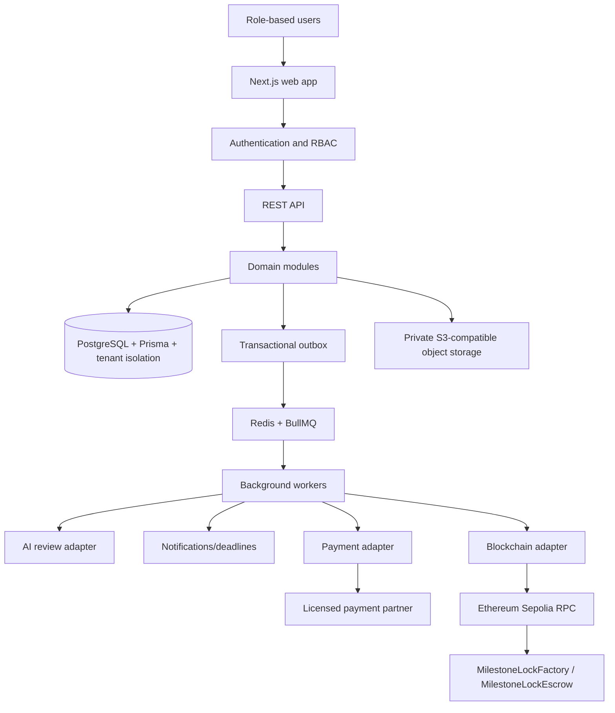

# MilestoneLock — Project Definition and Implementation Blueprint

**Source basis:** `dashboard_ui.pdf` (17-page Complete Dashboard UI Sitemap) and `MilestoneLock_Implementation_Specification_v1.0.docx` (Final Implementation Specification, v1.0.0).

**Document purpose:** Consolidate the source documents into one implementation-ready project definition. Source-backed decisions are labelled **Explicit requirement/decision**. Proposed implementation detail is labelled **Recommendation**. Items that require product, legal, provider, or operational confirmation are labelled **Unresolved decision / launch gate**.

## 1. Product purpose

MilestoneLock is a milestone-based escrow orchestration and dispute-resolution platform for software agencies. It converts informal freelance agreements—often made through channels such as WhatsApp and LinkedIn—into structured agreements, explicit milestone acceptance criteria, evidence-backed delivery workflows, independent dispute decisions, and auditable settlement instructions.

The product is a multi-tenant SaaS. MilestoneLock owns the agreement workflow, escrow state, evidence, disputes, decisions, and settlement orchestration. A licensed payment partner holds production funds; MilestoneLock must not represent itself as the production custodian of pooled customer funds.

### Product objectives — explicit

- Require funding before work begins where the payment arrangement permits.
- Make milestone acceptance criteria explicit and auditable.
- Preserve verifiable evidence and its submission history.
- Resolve straightforward disagreements through negotiation.
- Use AI as an evidence-analysis assistant, not an autonomous judge of subjective quality.
- Provide independent human arbitration for contested cases.
- Ensure that no single platform administrator can unilaterally decide and execute a disputed payout.
- Maintain an auditable record of important state transitions and settlement activity.

### Target context — explicit

| Dimension | Source position |
|---|---|
| First production market | India |
| Primary customer | Software agencies |
| MVP network | Ethereum Sepolia with test ETH |
| MVP target | Four weeks, team of 1–3 developers |
| Initial scale target | 1,000 escrows/month |
| Prepared scale target | 100,000 escrows/month |
| Arbitration fee | Paid by the organization |
| External arbitration in v1 | Exportable evidence only |

### MVP non-goals — explicit

Production custody by MilestoneLock; production stablecoin settlement; external arbitration integrations; an open arbitrator marketplace; fully autonomous AI adjudication; automated arbitrator payouts; multi-arbiter panels; native mobile applications; advanced white-label customization; and international payment corridors.

## 2. Scope

### In scope for the MVP

1. Organization registration, invitations, membership, tenant isolation, authentication, and role-based access.
2. Project, agreement, escrow, and milestone creation.
3. Structured milestone amounts, deadlines, and acceptance criteria.
4. Freelancer invitation and agreement acceptance.
5. Sepolia demo funding and milestone accounting.
6. Deliverable submission, client approval, revision requests, and dispute initiation.
7. Private evidence storage, malware scanning, SHA-256 integrity hashes, version history, and evidence snapshots.
8. Direct negotiation with immutable offers and counteroffers.
9. Structured AI evidence review with model/prompt versioning and human escalation.
10. One independent arbiter per case, conflict declarations, SLA tracking, signed rulings, and reassignment on timeout.
11. Separate settlement-signer authorization for human arbitration settlements.
12. Partial settlement, pull-based withdrawals, replay protection, and on-chain events.
13. Payment-provider adapter boundary and normalized payment/reconciliation lifecycle.
14. Notifications, deadlines, audit logs, transactional outbox, worker retries, and recovery.
15. Organization Admin, Client, Freelancer, and Arbiter interfaces needed for the end-to-end flow; restricted Settlement Signer and operational views; basic Platform Super Admin monitoring.

### Explicitly deferred or limited

- Production fiat custody is behind a licensed provider adapter and requires legal/provider approval.
- External arbitration is an evidence-export workflow only in v1.
- AI auto-resolution is disabled by default until manually reviewed cases establish acceptable performance.
- Advanced reports, analytics, white-labeling, mobile, marketplace, and cross-border payment features are later work.

## 3. Users and permissions

### Personas

| Role | Primary responsibility | Critical boundary |
|---|---|---|
| Organization owner/admin | Manage organization projects, agreements, people, and operations | Cannot unilaterally override a disputed award or unrestrictedly release funds |
| Project manager / organization member | Track milestones, deliverables, and project activity | Permissions are organization-scoped |
| Client | Accept agreements, fund work, review deliverables, approve, revise, or dispute | Cannot alter evidence history or bypass settlement authorization |
| Freelancer | Accept agreements, perform work, submit deliverables, respond to revisions, receive settlement | Must not be shown a payout as complete until provider confirmation |
| Independent arbiter | Review evidence and issue an impartial ruling | Must declare conflicts; does not execute settlement |
| Settlement signer | Verify and authorize a valid settlement instruction | Cannot change the merits or award amounts |
| Platform Super Admin/operator | Operate platform, compliance, monitoring, and security | Cannot silently modify an arbiter decision or independently authorize settlement |

### Role model — explicit

Organization membership roles in the source schema are `OWNER`, `ADMIN`, `PROJECT_MANAGER`, `BILLING_MANAGER`, and `MEMBER`. Platform operations and restricted arbiter/signer access must be separate from ordinary organization membership.

Server-side authorization is mandatory. The UI may hide unavailable actions, but the API and domain services must enforce permissions, organization context, case membership, state guards, and separation of duties.

## 4. User experience and navigation scope

The dashboard PDF defines six role-based surfaces sharing authentication, permissions, notifications, and audit services.

### Organization Admin Dashboard

Overview; Projects; Clients; Freelancers; Agreements; Milestones; Escrow & Payments; Disputes; Documents; Reports & Analytics; Team & Permissions; Notifications; Settings.

Key capabilities include creating agreements, selecting client/freelancer participants, defining scope/terms/milestones/amounts/deadlines/acceptance criteria, monitoring funding and payment-partner transactions, and viewing dispute/arbitration status. It must not have unrestricted settlement authority.

### Client Dashboard

Overview; My Projects; Agreements; Milestones; Deliverable Reviews; Escrow & Funding; Payments & Transactions; Disputes; Documents; Messages & Activity; Notifications; Settings.

The central review flow is: open submitted milestone → inspect files/evidence → compare against acceptance criteria → approve, request revision with reason, or raise a dispute.

### Freelancer Dashboard

Overview; My Projects; Milestones; My Tasks; Deliverable Submissions; Feedback & Revisions; Earnings & Payouts; Agreements; Disputes; Documents; Messages & Activity; Notifications; Profile & Settings.

Submission flow: open assigned milestone → review criteria → upload files or links → add notes → submit for review → track approval or revision. Approved work is not displayed as a completed payout until the payment partner confirms the transaction.

### Platform Super Admin Dashboard

Overview; Organizations; Users; Agreements/Projects; Transactions; Payment Providers; Disputes; Arbitration Management; Settlement Monitoring; AI Resolution Monitoring; Fees & Billing; Audit Logs; System Health; Security; Platform Settings.

The Super Admin monitors and operates the platform but cannot silently edit an arbiter decision or independently authorize a settlement.

### Restricted operational consoles

**Arbiter Console:** Assigned Disputes; Dispute Details; Evidence Review; Case Timeline; Questions & Clarifications; Decision Workspace; Decision Submission; Decision History.

**Settlement Signer Console:** Pending Settlements; Settlement Details; Decision Verification; Authorization; Settlement History; Security & Audit. It must show the dispute, arbiter identity, ruling hash, evidence snapshot hash, disputed amount, allocation, authorization expiry, and previous attempts. MFA and hardware-backed signing are recommended where feasible.

### Shared pages

Login; Registration; Email Verification; Forgot/Reset Password; Onboarding; Invitations; Notifications Center; User Profile; Security Settings; Help & Support; Terms & Policies; and 404/Unauthorized handling.

The PDF’s suggested Next.js route structure is a **recommendation**, not a requirement. All surfaces consume one modular backend and shared domain components.

## 5. System architecture

### Architectural position — explicit

Use a modular monolith with asynchronous workers and isolated payment/blockchain adapters. Business modules initially share one deployment and PostgreSQL database; background jobs run in a separate worker process. This is the approved architecture for a 1–3 developer team and preserves future extraction boundaries.

### Domain modules and ownership

| Module | Owns | Must not own |
|---|---|---|
| Identity | Users, sessions, permissions | Escrow decisions |
| Organization | Tenants, memberships, plans | Payment custody |
| Escrow | Agreement/milestone lifecycle | Arbiter decisions |
| Dispute | Resolution lifecycle | Direct fund custody |
| Evidence | File metadata and integrity | Arbitration outcomes |
| AI Review | Findings and recommendations | Fund authorization |
| Arbitration | Assignments and rulings | Unrestricted payment execution |
| Settlement | Authorized settlement instructions | Independent adjudication |
| Payment | Provider operations and reconciliation | Dispute verdicts |
| Blockchain | On-chain escrow and settlement | Tenant permissions |
| Notification | User communication | Business state transitions |
| Audit | Append-only event history | Mutable business authority |

### Trust boundaries — explicit

- **Payment provider:** Regulated partner controls production custody and permitted transfers.
- **MilestoneLock application:** Controls workflow, permissions, evidence, audit, settlement instructions, and provider reconciliation.
- **Independent adjudication:** Arbiter determines the award; a separate settlement signer verifies and authorizes execution.
- **AI:** Produces structured advisory findings. It cannot sign transactions, authorize provider payouts, or bypass eligibility rules.

## 6. Business workflows and state machines

### Agreement-to-settlement workflow

1. Organization Admin creates an agreement with client, freelancer, project scope, milestones, amounts, deadlines, and acceptance criteria.
2. Client reviews and accepts.
3. Client funds through the licensed provider (or Sepolia demo path).
4. Freelancer accepts and completes a milestone.
5. Freelancer submits deliverables and evidence.
6. Client approves, requests revisions, or opens a dispute.
7. Normal approvals follow the authorized release workflow; disputes follow negotiation, AI assessment, and—when needed—independent arbitration.
8. The settlement adapter executes the authorized instruction and reconciliation confirms the result.

### Dispute workflow

1. Either party opens a dispute; the disputed milestone’s ordinary settlement is frozen.
2. Both parties submit evidence within visible deadlines.
3. Tier 1 negotiation allows split offers, rejection, and counteroffers. Default window: 72 hours. Expiry escalates; it does not award funds.
4. Tier 2 AI review compares the agreement, structured criteria, submission, and evidence. It returns structured findings and may only qualify a narrowly defined objective client-silence case.
5. Subjective, risky, or ineligible cases enter Tier 3 independent arbitration.
6. The arbiter accepts, declares conflicts, reviews the frozen evidence snapshot, writes reasoning/reason codes, allocates the disputed amount, and signs a ruling.
7. The settlement signer independently verifies the ruling and authorizes the settlement instruction without changing its merits.
8. The payment or blockchain adapter executes once; the provider/chain result is reconciled; the case is marked settled.

### State vocabulary — explicit source terms

- Escrow: `DRAFT`, `AWAITING_FUNDING`, `FUNDED`, `AWAITING_ACCEPTANCE`, `ACTIVE`, `PARTIALLY_SETTLED`, `COMPLETED`, `CANCELLED`, `REFUNDED`.
- Milestone: `PENDING`, `IN_PROGRESS`, `SUBMITTED`, `REVISION_REQUESTED`, `APPROVED`, `DISPUTED`, `SETTLEMENT_PENDING`, `SETTLED`, `REFUNDED`.
- Dispute: `OPENED`, `EVIDENCE_COLLECTION`, `NEGOTIATION`, `AI_REVIEW`, `ARBITER_QUEUE`, `ASSIGNED`, `UNDER_REVIEW`, `DECISION_PENDING`, `APPEAL_PENDING`, `FINAL_DECISION`, `SETTLEMENT_PENDING`, `SETTLED`, `CLOSED`.
- Payment: `CREATED`, `AUTHORIZED`, `FUNDED`, `PARTIALLY_SETTLED`, `SETTLED`, `REFUND_PENDING`, `REFUNDED`, `FAILED`, `CHARGEBACK`.

All transitions require explicit guards. A timer firing alone must never imply a valid transition. Deadlines are stored as immutable UTC timestamps when a stage begins; policy changes must not silently rewrite existing cases.

### Default timing policy — explicit, subject to configuration

| Stage | Default |
|---|---:|
| Freelancer invitation | 7 days |
| Client approval | 72 hours |
| Negotiation | 72 hours |
| Evidence submission | 48 hours |
| AI assessment target | 120 seconds |
| Arbiter acceptance | 6 hours |
| Arbiter initial review | 24 hours |
| Final arbiter ruling | 72 hours |
| Appeal submission | 48 hours |

## 7. AI and arbitration boundaries

### AI responsibilities — explicit

AI may extract evidence content, compare requirements against deliverables, produce structured findings, provide confidence/uncertainty, identify missing evidence, and record model/prompt versions.

AI output must include a verdict or assessment, confidence, findings, missing evidence, contradictions, evidence references, model version, prompt version, and auto-resolution eligibility. It is an advisory record, not a settlement authorization.

### Automatic-resolution policy

Every condition must pass:

- client is silent;
- freelancer submitted the required work;
- acceptance criteria are structured;
- evidence integrity is verified;
- objective checks pass;
- there is no explicit objection;
- there is no conflicting evidence;
- AI confidence meets the policy threshold; and
- milestone value is within the policy limit.

Initial source policy: confidence ≥ 0.95; maximum milestone value 500,000 paise (₹5,000); client response period 72 hours; structured criteria, verified evidence, no explicit objection, and objective checks required.

The ₹5,000 and 95% thresholds are explicitly described as conservative testing thresholds, not legally validated production risk limits. Production auto-resolution remains disabled until manually reviewed cases establish acceptable performance. Enablement requires a controlled feature flag and explicit organization consent. If the freelancer has not submitted the required work, use the freelancer-inactivity/refund workflow instead.

### Human arbitration

One independent arbiter is assigned per case in v1. The arbiter must accept, declare conflicts, review the same evidence snapshot available to the parties, provide written reasoning and reason codes, specify freelancer/client allocation, and sign the ruling. Missing SLA triggers reassignment; the original arbiter cannot silently retain control.

An appeal, if enabled, requires a defined basis such as procedural error, material new evidence, or conflict discovery. It must not silently overwrite the original ruling. External arbitration is evidence export only in v1.

### Settlement signer boundary

The signer is not a second arbiter. The signer verifies identity, decision finality, evidence references, arithmetic, milestone balance, and signature validity. The signer can authorize, reject for technical/procedural invalidity, or request correction/reassignment; they cannot change the award on its merits.

## 8. Smart-contract design

### Contract architecture — explicit

The core components are `MilestoneLockFactory` and `MilestoneLockEscrow`. For the MVP, use one escrow contract with clearly separated modules or libraries supporting milestone accounting, dispute state, settlement credits, evidence roots, and authorized signers.

Contract roles:

| Role | Responsibility |
|---|---|
| `DEFAULT_ADMIN_ROLE` | Contract configuration and governance |
| `PAUSER_ROLE` | Emergency pause |
| `SETTLEMENT_SIGNER_ROLE` | Human arbitration settlement authorization |
| `AUTOMATION_ROLE` | Eligible automated silence settlements |
| `EVIDENCE_ANCHOR_ROLE` | Verified evidence commitments |

Production administration should use a Safe multisig. MVP contracts are immutable/versioned deployments; ordinary admins have no contract-upgrade authority. Any future upgrade path would require independent governance, timelocks, and audit.

### Settlement structure

The source model includes escrow ID, milestone ID, freelancer amount, client amount, ruling hash, nonce, deadline, and resolution type. Resolution types are mutual settlement, human arbitration, objective silence resolution, and refund.

Required capabilities: create/fund/accept escrow; submit and approve milestone; open dispute; anchor evidence; accept mutual settlement; resolve dispute; authorize automated settlement; claim funds; pause/unpause.

Required invariants:

- freelancer amount and client amount are non-negative;
- freelancer amount + client amount equals the frozen disputed milestone balance;
- disputed milestones cannot use ordinary release;
- nonce and deadline are valid and settlement executes once only;
- after settlement, record ruling hash and resolution type, credit recipients, mark the milestone settled, emit an event, prevent replay, and allow separate pull withdrawal.

Use EIP-712 typed signatures, domain separation, chain IDs, nonces, deadlines, state checks, reentrancy protection, and checks-effects-interactions.

### Payment adapter boundary

Production provider-held INR is not represented as an Ethereum contract balance. Use one normalized settlement domain model with separate execution adapters:

- `SepoliaSettlementAdapter`
- `LicensedPaymentSettlementAdapter`

They share lifecycle states but differ in custody, finality, and reversal semantics. Never represent Sepolia transactions as real production payments.

## 9. Data and security model

### Core data model

The source schema foundation includes `User`, `Organization`, `Membership`, `Escrow`, `Milestone`, `Dispute`, `Evidence`, `DisputeOffer`, `AIReview`, `ArbiterAssignment`, `ArbitrationDecision`, `Appeal`, `Payment`, and `LedgerEntry`.

Production additions include `EscrowParticipant`, `EscrowEvent`, `SettlementInstruction`, `SettlementAuthorization`, `ProviderWebhook`, `ProviderReconciliation`, `ArbiterProfile`, `ArbiterConflictDeclaration`, `AuditLog`, `ApiKey`, `WebhookEndpoint`, `WebhookDelivery`, `Notification`, `IdempotencyRecord`, `OutboxEvent`, `OrganizationBilling`, and `EvidenceAccessLog`.

Important separation: `ArbitrationDecision` and `SettlementAuthorization` are separate signed records. One signature must never prove both adjudication and authorization.

Use PostgreSQL with Prisma, organization-scoped resources, tenant-scoped queries, and Row-Level Security where supported. Store money as integer minor units (for example, paise); validate that milestone amounts sum to escrow total. Store timestamps in UTC.

### Evidence integrity and privacy

Evidence may include agreements, deliverables, screenshots, source code, communications, deployment records, invoices, and other relevant material.

For each object: validate type and size; malware-scan before extraction; compute SHA-256 server-side; store privately with version history; record uploader, timestamp, type, and storage key; log every access; and freeze an evidence snapshot when adjudication begins. Late evidence requires a recorded exception. Anchor only hashes or Merkle roots on-chain—never private contents or personal information.

Use encryption at rest, TLS in transit, private signed downloads, dispute-membership access control, explicit retention/deletion policies, and preservation of legally required financial records. An on-chain hash does not by itself anonymize the underlying data.

### Security controls

- Session/application authentication plus role-based authorization.
- Single-purpose, expiring invitation tokens.
- Idempotency for state-changing API calls and provider webhooks.
- HMAC/timestamp/replay protection for webhooks.
- Nonces, deadlines, chain IDs, and signature/domain validation.
- Multisig, hardware-backed keys, role separation, pause controls, and restricted signer access.
- Rate limits and anti-griefing controls for disputes and repeated rejection.
- Private storage, signed URLs, evidence access logs, backups, and immutable audit metadata.
- AI isolation: uploaded files, metadata, extracted strings, HTML, and screenshots are untrusted; extraction runs in isolated workers; output is strict JSON; monetary allocations are independently validated; AI receives no payment credentials, private keys, or signing tools.

## 10. API, events, and background jobs

### API conventions — explicit

Base URL: `https://api.milestonelock.com/v1`.

Use Bearer access tokens, JSON, `Idempotency-Key`, and verified organization context. Authenticate all endpoints unless explicitly public, use cursor pagination, integer minor units, expiring invitation tokens, structured error codes, and success/error envelopes containing a request ID.

### Core API surface

| Area | Endpoints from the source specification |
|---|---|
| Escrow | `POST/GET /escrows`, `GET/PATCH /escrows/:id`, `/escrows/:id/invite`, invitation acceptance, `/fund`, `/cancel`, `/events` |
| Milestone | `GET /milestones/:id`, `/submit`, `/approve`, `/request-revision`, `/dispute` |
| Dispute | Open dispute; offers; accept/reject offer; evidence signed-upload URL and confirmation; detail/timeline/evidence; appeals |
| AI review | Internal-only `/internal/disputes/:id/ai-review` and review retrieval |
| Arbitration | Arbiter case queue, accept, conflict declaration, evidence, request evidence, decision submission |
| Settlement | Retrieve, authorize, reject, execute, and list transactions |

The AI review endpoint must not be exposed to arbitrary organization API keys. Monetary allocations, permissions, eligibility, and state guards are validated by the backend independently of model output.

### Webhooks and events

Emit domain and integration events for escrow creation/funding, milestone submission/approval/revision/dispute, evidence confirmation, negotiation offers, AI review completion, arbiter assignment/acceptance/timeout/ruling, settlement authorization/execution, provider updates, refunds, chargebacks, reconciliation, notifications, and audit events.

Webhook deliveries use authenticated signatures, timestamps, replay prevention, idempotent processing, retention of failed events, manual redelivery, and retries at 1 minute, 5 minutes, 15 minutes, 1 hour, 6 hours, and 24 hours.

### Background jobs

Use a transactional outbox feeding Redis/BullMQ. Workers handle:

- invitation, approval, negotiation, evidence, arbiter, signer, and appeal deadlines;
- malware scan and document extraction;
- SHA-256 verification and evidence snapshotting;
- AI assessment and eligibility checks;
- email/notification dispatch;
- blockchain transaction submission, confirmation, and retry;
- provider webhook delivery and reconciliation;
- stale-case reassignment and operational alerts;
- periodic metrics, backups, and audit/event processing.

Jobs must be idempotent, durable, observable, retryable, and recoverable after worker restart or external outage. A database state change and its required background job must not be committed independently.

## 11. Infrastructure and deployment

### MVP components — explicit source proposal

| Service | Deployment |
|---|---|
| Next.js application | Docker |
| Background worker | Separate Docker container |
| PostgreSQL | Managed database or secured VPS database |
| Redis | Managed or private Redis |
| Object storage | Private S3-compatible bucket |
| RPC | Sepolia RPC provider |
| AI | Claude API adapter |
| Email | Transactional email provider |
| Monitoring | Sentry plus metrics/alerts |
| Reverse proxy | Caddy or Nginx |

Maintain separate Local, Staging/Sepolia, and Production environments with separate credentials, databases, buckets, and API keys. Do not keep production settlement private keys in ordinary environment variables; use KMS, HSM, or a dedicated restricted signer service.

### Non-functional targets

| Metric | MVP target | Production target |
|---|---:|---:|
| API availability | 99.5% | 99.9% |
| Normal API latency | P95 < 500 ms | P95 < 300 ms |
| Database availability | 99.5% | 99.9% |
| Notification dispatch | < 60 sec | < 15 sec |
| Deadline job delay | < 60 sec | < 10 sec |
| AI review | < 120 sec | < 60 sec |
| Escrow volume | 1,000/month | 100,000/month |
| RPO | 24 hours | 15 minutes |
| RTO | 8 hours | 2 hours |

At 100x scale, the source recommends read replicas/partitioning, multiple worker pools, dedicated AI and notification workers, multiple RPC providers, CDN-enabled authorized evidence delivery, and fuller observability.

## 12. Testing and MVP acceptance criteria

### Test strategy

| Test type | Minimum scope |
|---|---|
| Unit | State transitions, allocations, permissions |
| Integration | Database, workers, AI, payment/provider adapters |
| Contract | Solidity authorization and accounting |
| Security | Tenant isolation, signatures, replay, reentrancy, webhook forgery |
| End-to-end | Complete escrow, approval, dispute, arbitration, and settlement paths |
| Load | Concurrent escrows, deadlines, evidence, and queues |
| Recovery | RPC outage, worker restart, webhook retries, signer/provider failure |

### Essential scenarios

1. **Successful delivery:** create → fund → freelancer accepts → submit → client approves → settlement executes → milestone settled.
2. **Freelancer inactivity:** deadline/grace period → no submission → refund eligibility → refund executes.
3. **Client silence:** submission → notifications → approval deadline → no explicit objection → objective checks → AI review → all eligibility checks → automated settlement.
4. **Subjective disagreement:** rejection → dispute → negotiation expiry → AI review → human escalation → arbiter assignment/review/ruling → independent authorization → settlement.
5. **Signer unavailable:** primary signer misses SLA → backup signer → ruling/signature verified → one settlement execution, with no award change.
6. **Malicious evidence:** MIME/malware checks → isolated extraction → untrusted AI input → strict output validation → suspicious evidence escalated; no payment or permission change.

### MVP acceptance checklist

- Two users can complete an escrow.
- Multiple milestones, invitations, funding, submissions, and approvals work on Sepolia.
- Evidence is hashed and privately stored.
- Disputes, negotiation, counters, AI structured findings, and human escalation work.
- Arbiter conflict checks, signed ruling, and SLA reassignment work.
- Independent signer authorization and partial settlement work.
- Pull withdrawals and duplicate-settlement prevention work.
- Tenant isolation, audit logging, authenticated webhooks, and failed-job recovery pass.
- The complete demo works from a fresh deployment.

## 13. Risks and launch gates

| Risk / dependency | Required action | Blocks |
|---|---|---|
| Provider lacks approved delayed settlement | Obtain written provider confirmation | Production payments |
| Indian regulatory classification unclear | Obtain India-specific legal assessment | Production launch |
| Provider lacks partial settlement/refund/dispute holds | Define approved alternative | Partial fiat awards |
| Arbiter qualification/liability unclear | Define onboarding, conflict, terms, and liability model | Human arbitration launch |
| AI objective checks unreliable | Benchmark against human-reviewed cases | AI auto-resolution |
| Contract logic vulnerable | Independent security review | Mainnet deployment |
| Evidence privacy obligations unclear | Define retention/deletion policy | Production evidence storage |
| Cross-border payment requirements | Separate compliance review | Nepal/international expansion |

Provider selection must answer whether funds may be held pending milestones, partially released/refunded, held during disputes, initiated by a third-party platform, reconciled, charged back, and paid to verified freelancers; and what KYC/merchant onboarding and reporting are required. Do not select a provider based only on a standard checkout API.

The payment architecture is a technical recommendation, not legal advice. Production launch requires legal review, provider licensing/product confirmation, operating terms for arbiters/signers, and security review.

## 14. Implementation roadmap

### Four-week MVP plan — explicit source roadmap

**Week 1 — Foundation and contract security**

- Audit existing Solidity against the independent-arbiter and provider-adapter decisions.
- Add milestone accounting, partial-split settlement, mutual settlement signatures, and multisig authorization.
- Set up PostgreSQL/Prisma, organization tenancy, and authentication.
- Exit: funded milestone escrow with separate user identities.

**Week 2 — Dispute engine**

- Implement dispute lifecycle, negotiation/counters, evidence upload, SHA-256 metadata, BullMQ deadlines, audit trail, and contract-event ingestion.
- Exit: complete negotiation and evidence workflow.

**Week 3 — AI and arbitration**

- Implement structured evidence assessment, human escalation, arbiter queue, conflict checks, timeout reassignment, signed ruling submission, settlement authorization, and notifications.
- Exit: end-to-end dispute settlement works.

**Week 4 — SaaS and demonstration**

- Build organization, client, freelancer, and arbiter flows; add initial API keys/webhooks; run adversarial tests; deploy Sepolia demonstration; prepare scenarios.
- Exit: demonstrable multi-tenant dispute-resolution SaaS MVP.

### Cut list if schedule slips

Keep Sepolia escrow, existing contract integration, partial settlement, negotiation, evidence hashing, AI evidence review, human arbiter dashboard, multisig authorization, basic organization tenancy, basic API keys, and basic webhook events. Cut WhatsApp integration, white-label widget, and external arbitration implementation; retain external arbitration as design/evidence export only.

### Post-MVP direction

The source positions v1 as roughly 8–12 weeks after MVP for provider onboarding, production evidence storage, stronger webhooks/API/SDKs, arbiter operations, backups/disaster recovery, privacy/retention, security audit, and an India pilot. A v2 may add additional countries, legally supported stablecoin settlement, external arbitration integrations, white-label/SDK offerings, advanced AI comparison, arbiter marketplace, analytics, fraud detection, and enterprise integrations.

## 15. Recommended implementation conventions

These are implementation recommendations unless already stated as source decisions:

- Keep the backend as a modular monolith with explicit module ownership and domain services.
- Treat the central lifecycle—**create escrow → fund → submit milestone → approve or dispute → resolve → authorize → settle**—as the first vertical slice.
- Reuse shared domain components across dashboards; vary actions by server-enforced role.
- Use TypeScript, Next.js, PostgreSQL, Prisma, Redis/BullMQ, Solidity/OpenZeppelin, Ethers.js, Docker, and an adapter-based AI/provider integration.
- Protect the main branch with CI and review for contract, payment, authorization, and dispute-state changes.
- Run TypeScript checks, lint, Prisma validation, migration checks, unit/integration tests, Solidity compilation/tests, dependency scanning, and build verification on every pull request.
- Maintain append-only audit records; corrections use superseding records rather than silent edits or deletes.

## 16. Project invariants

The following invariants are central acceptance and review criteria:

1. Original milestone amount = released + refunded + remaining.
2. Disputed funds are frozen against ordinary release.
3. Freelancer award + client award = frozen disputed balance.
4. A settlement instruction can execute only once.
5. Arbiter ruling and settlement authorization are separate signed records.
6. AI cannot access payment credentials or signing tools.
7. Every state transition has an actor, timestamp, reason, and audit event.
8. Provider webhooks are authenticated and idempotently processed.
9. Evidence content remains private; only hashes/commitments may be anchored on-chain.
10. Tenant boundaries are enforced server-side and tested independently.

## 17. Final architecture position

MilestoneLock is not primarily a payment gateway. Its defensible product is the infrastructure connecting agreements, deliverables, evidence, independent decisions, and authorized payment settlement.

- The licensed provider supplies compliant production payment infrastructure.
- The independent arbiter supplies human judgment.
- The settlement signer supplies authorization separation.
- AI supplies evidence analysis.
- The smart contract supplies deterministic Sepolia and future on-chain execution.
- The SaaS application supplies organization management, workflow, and auditability.

The governing principle is: **No AI model, ordinary organization administrator, or single platform-owner key may unilaterally change a contested award and move funds. Every settlement must be traceable to an authorized resolution path.**

### Explicit unresolved decisions to close before production

Payment-provider selection and legal classification; approved custody/delayed-settlement arrangement; partial fiat release/refund behavior; arbiter qualifications, terms, liability, and backup coverage; AI auto-resolution performance and feature-flag policy; evidence retention/deletion; production signer/key management; and independent smart-contract/security review.

